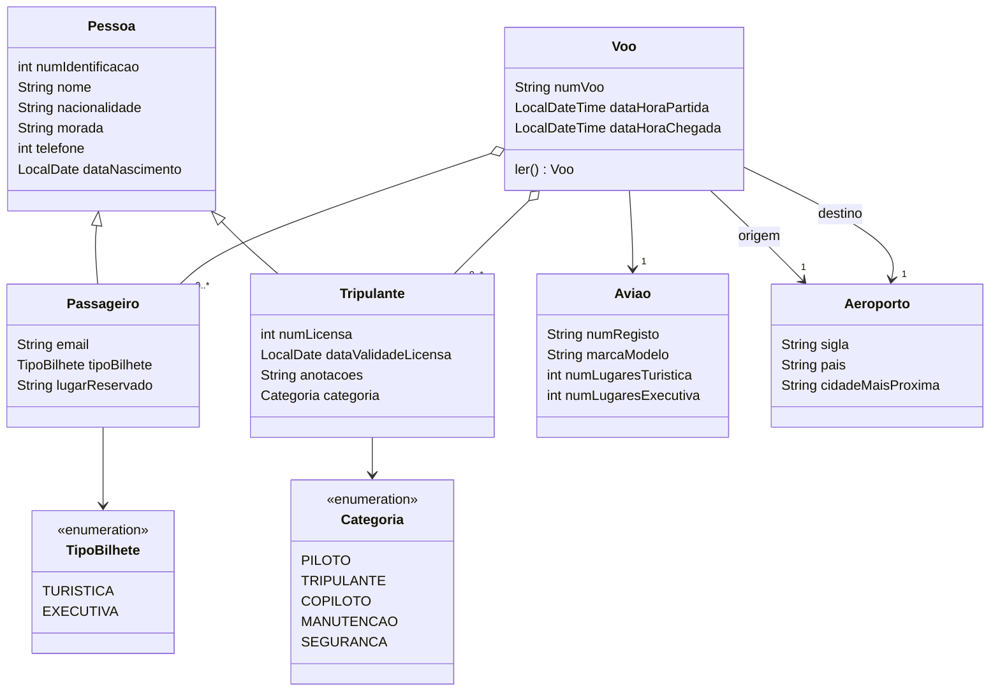
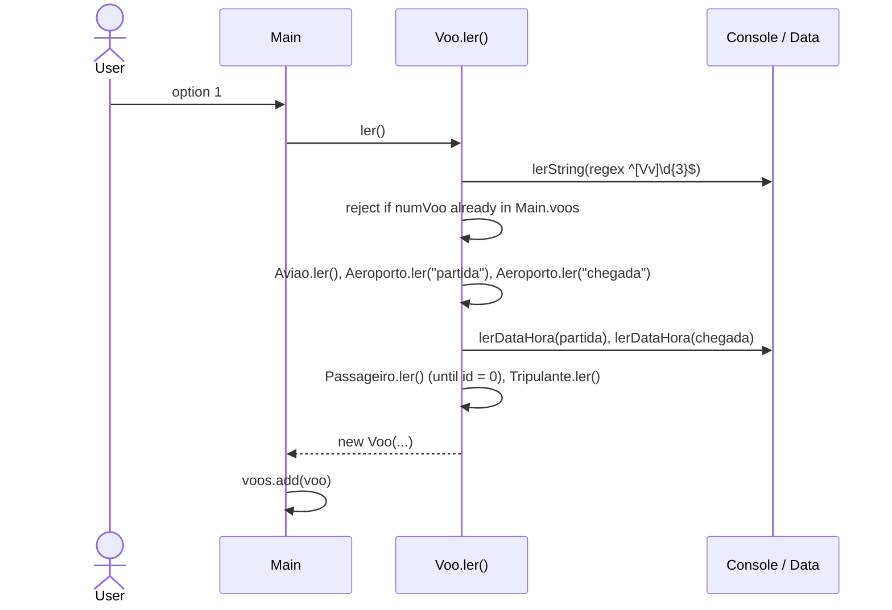

# Architecture — Airline Management (OOP refactor, Group 3)

> Documentation added in 2026 (portfolio). Reconstructed from the source code; the original team's reasoning is not recorded, so motivations are marked as inferred. Portuguese version: [ARCHITECTURE.pt.md](ARCHITECTURE.pt.md).

## 1. Overview

A single-module Maven console application (Java 17, no third-party dependencies) in package `org.companhiaaerea`. The user drives a numbered text menu; flights live in memory in a static list (`Main.voos`) and can be saved to / loaded from a text file.

| Layer | Classes | Role |
|---|---|---|
| Entry point + use cases | `Main` | Menu loop and one static method per menu option (add, remove, search, statistics, edit passengers) |
| Domain | `Voo`, `Aviao`, `Aeroporto`, `Pessoa`, `Passageiro`, `Tripulante` | Data, constructors, getters/setters, `toString()` and a static `ler()` that reads an instance from the console |
| Utilities (`utils`) | `Console`, `Data`, `File` | Regex-validated console input, date parsing, flat-file persistence |

## 2. Class diagram



`Pessoa` is a concrete class (not abstract) with public constructors; `Passageiro` and `Tripulante` call `super(...)` and add their own fields. Fields are package-private with public getters/setters.

## 3. Menu and use cases (`Main`)

| Option | Method | What it does |
|---|---|---|
| 1 | `adicionarVoo` | Reads a full flight via `Voo.ler()` and appends it to `voos` |
| 2 | `retirarVoo` | Finds a flight by number + departure date and removes it |
| 3 | `submenuPesquisar` | 1 = search by date interval and route (`pesquisarVooDataRota`); 2 = by date interval (`pesquisarVoosData`) |
| 4 | `pesquisarVooMaisPassageirosData` | Flight with most passengers in a date interval |
| 5 | `pesquisarListaPassageirosData` | Passenger lists of the flights departing on a date |
| 6 | `alterarPassageirosVoo` | Add or remove passengers of one flight |
| 7 | `mediaPassageiros` | Average passengers per flight in a date interval (reuses option 3.2) |
| 8 | `totalPassageiros` | Total passengers in a date interval |
| 9 | `File.guardarEmFicheiro` | Save all flights to `<user.home>/companhia_aerea/<name>.voos` |
| 10 | `File.readVooListFromFile` | Pick a file from that folder and **replace** the in-memory list with its contents |
| 0 | — | Exit; if there are flights, offers to save first |

## 4. Main flows

### 4.1 Adding a flight



Every prompt goes through `Console.lerString(msg, regex, errorMsg)`, which repeats until the input matches the regex (phone: 9 digits; e-mail: `^(.+)@(\S+)$`; ticket: 1 or 2; seat: `[A-Z][0-9]{2}`; dates: `dd/MM/yyyy` and `dd/MM/yyyy HH:mm`).

### 4.2 Persistence (`utils.File`)

One flight per line, fields separated by `;`, in this order:

```
numVoo ; aviao(numRegisto, marcaModelo, lugaresTuristica, lugaresExecutiva) ;
origem(sigla, pais, cidade) ; destino(sigla, pais, cidade) ; partida ; chegada ;
[passageiro(id, nome, nacionalidade, morada, telefone, nascimento, email, bilhete, lugar)]* ;
PilotoTripulante ;
[tripulante(id, nome, nacionalidade, morada, telefone, nascimento, numLicenca, validadeLicenca, anotacoes, categoria)]*
```

The literal `PilotoTripulante` is the delimiter between the variable-length passenger block and the crew block; the reader consumes passengers until it sees it. Dates use ISO format (`LocalDate.toString()`), enums are stored by name.

## 5. Verified issues (read from the code)

| # | Finding | Where |
|---|---|---|
| 1 | The `;`-separated format breaks if any free-text field (name, address, notes) contains `;` — the line is misparsed on load | `File.java` |
| 2 | `readVooListFromFile` catches only `IOException`; a malformed or hand-edited file raises `ArrayIndexOutOfBounds`/`NumberFormat`/`DateTimeParse` exceptions and crashes the app | `File.java` |
| 3 | Reader/writer are closed only on the success path (no try-with-resources) | `File.java` |
| 4 | Option 10 indexes `listFiles()` with the typed number; an out-of-range number throws `ArrayIndexOutOfBounds` | `Main.java` |
| 5 | `mediaPassageiros` divides by `voosAux.size()` as `double`; with no matching flights it prints `NaN` | `Main.java` |
| 6 | `Voo.ler()` checks for a duplicate flight number but no check was found for arrival after departure, or seat number vs. the aircraft's seat counts | `Voo.java` |
| 7 | `Voo` and `File` import the static `Main.voos`, so domain and utility code depend on the entry point (circular coupling) | `Voo.java`, `File.java` |
| 8 | Duplicate flight number is handled by recursion (`return ler()`) rather than a loop | `Voo.java` |
| 9 | No automated tests: there is no `src/test` and `pom.xml` declares no test dependency | `pom.xml` |
| 10 | Passenger/crew personal data (phone, address, e-mail) is saved in clear text under the user's home folder | `File.java` |

Authorship: the Javadoc `@author` tags in the source are the only record of who wrote what (the repository has no per-author history): `Voo`, `Aeroporto` — Ricardo Pereira; `Aviao`, `Passageiro`, `Console`, `Data`, `File` — Francisco Silva; `Pessoa`, `Tripulante` — Bruno Silva; `Main` — all three. TODO: confirmar com o BMS (the tags are not independently verifiable).
