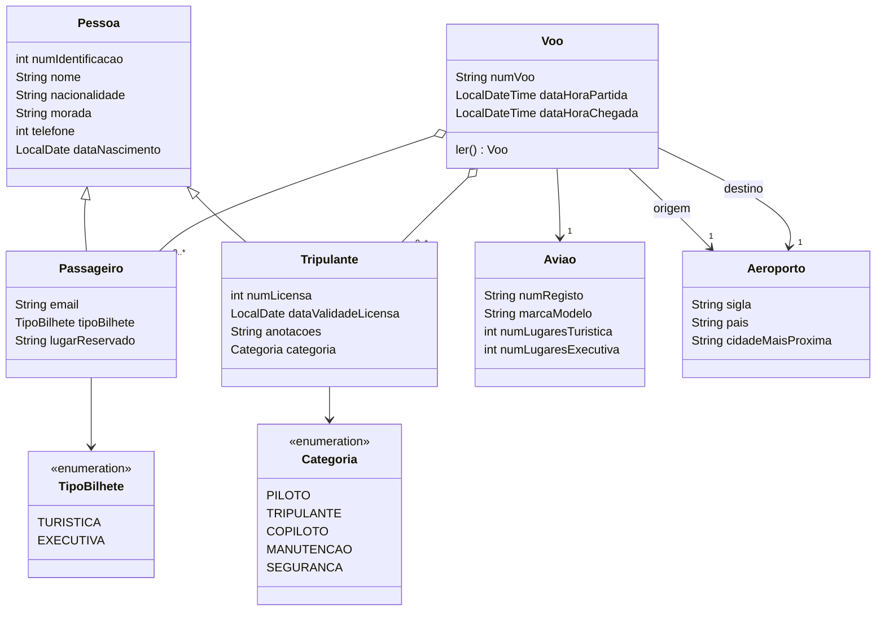
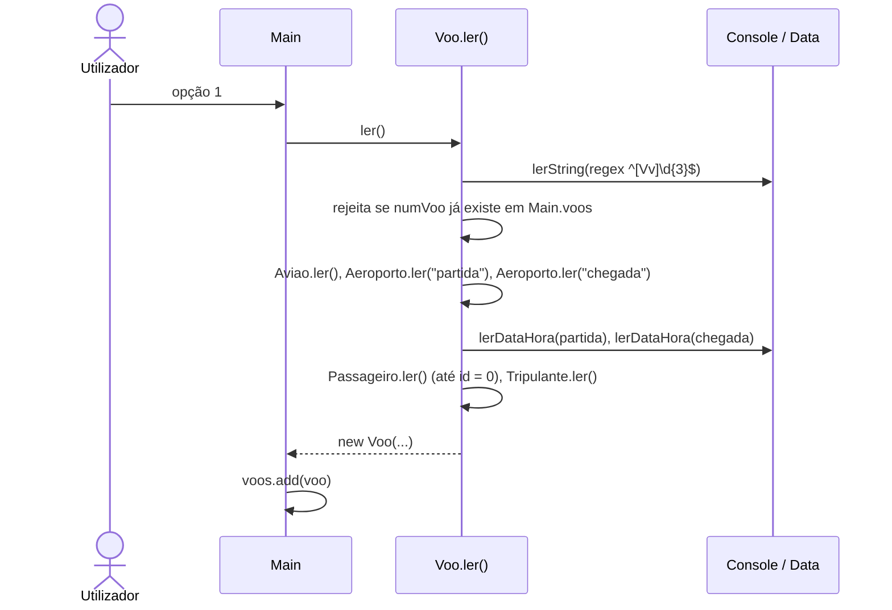

# Arquitetura — Gestão de Companhia Aérea (refatoração OOP, Grupo 3)

> Documentação adicionada em 2026 (portfolio). Reconstruída a partir do código-fonte; o raciocínio original da equipa não está registado, por isso as motivações estão marcadas como inferidas. Versão inglesa: [ARCHITECTURE.md](ARCHITECTURE.md).

## 1. Visão geral

Aplicação de consola Maven de um só módulo (Java 17, sem dependências externas) no pacote `org.companhiaaerea`. O utilizador usa um menu de texto numerado; os voos vivem em memória numa lista estática (`Main.voos`) e podem ser guardados/carregados de um ficheiro de texto.

| Camada | Classes | Papel |
|---|---|---|
| Entrada + casos de uso | `Main` | Ciclo do menu e um método estático por opção (adicionar, retirar, pesquisar, estatísticas, editar passageiros) |
| Domínio | `Voo`, `Aviao`, `Aeroporto`, `Pessoa`, `Passageiro`, `Tripulante` | Dados, construtores, getters/setters, `toString()` e um `ler()` estático que lê uma instância da consola |
| Utilitários (`utils`) | `Console`, `Data`, `File` | Leitura da consola validada por regex, parsing de datas, persistência em ficheiro de texto |

## 2. Diagrama de classes



`Pessoa` é uma classe concreta (não abstrata) com construtores públicos; `Passageiro` e `Tripulante` chamam `super(...)` e acrescentam os seus campos. Os campos têm visibilidade de pacote, com getters/setters públicos.

## 3. Menu e casos de uso (`Main`)

| Opção | Método | O que faz |
|---|---|---|
| 1 | `adicionarVoo` | Lê um voo completo com `Voo.ler()` e acrescenta-o a `voos` |
| 2 | `retirarVoo` | Encontra um voo por número + data de partida e remove-o |
| 3 | `submenuPesquisar` | 1 = pesquisa por intervalo de datas e rota (`pesquisarVooDataRota`); 2 = por intervalo de datas (`pesquisarVoosData`) |
| 4 | `pesquisarVooMaisPassageirosData` | Voo com mais passageiros num intervalo de datas |
| 5 | `pesquisarListaPassageirosData` | Listas de passageiros dos voos que partem numa data |
| 6 | `alterarPassageirosVoo` | Adicionar ou remover passageiros de um voo |
| 7 | `mediaPassageiros` | Média de passageiros por voo num intervalo de datas (reutiliza a opção 3.2) |
| 8 | `totalPassageiros` | Total de passageiros num intervalo de datas |
| 9 | `File.guardarEmFicheiro` | Guarda todos os voos em `<user.home>/companhia_aerea/<nome>.voos` |
| 10 | `File.readVooListFromFile` | Escolhe um ficheiro dessa pasta e **substitui** a lista em memória pelo seu conteúdo |
| 0 | — | Sai; se houver voos, oferece guardar primeiro |

## 4. Fluxos principais

### 4.1 Adicionar um voo



Cada pergunta passa por `Console.lerString(msg, regex, msgErro)`, que repete até a entrada corresponder à regex (telefone: 9 dígitos; e-mail: `^(.+)@(\S+)$`; bilhete: 1 ou 2; lugar: `[A-Z][0-9]{2}`; datas: `dd/MM/yyyy` e `dd/MM/yyyy HH:mm`).

### 4.2 Persistência (`utils.File`)

Um voo por linha, campos separados por `;`, por esta ordem:

```
numVoo ; aviao(numRegisto, marcaModelo, lugaresTuristica, lugaresExecutiva) ;
origem(sigla, pais, cidade) ; destino(sigla, pais, cidade) ; partida ; chegada ;
[passageiro(id, nome, nacionalidade, morada, telefone, nascimento, email, bilhete, lugar)]* ;
PilotoTripulante ;
[tripulante(id, nome, nacionalidade, morada, telefone, nascimento, numLicenca, validadeLicenca, anotacoes, categoria)]*
```

O literal `PilotoTripulante` é o delimitador entre o bloco de passageiros (comprimento variável) e o da tripulação; o leitor consome passageiros até o encontrar. As datas usam o formato ISO (`LocalDate.toString()`) e os enums são guardados pelo nome.

## 5. Problemas verificados (lidos no código)

| # | Achado | Onde |
|---|---|---|
| 1 | O formato separado por `;` quebra se um campo de texto livre (nome, morada, anotações) contiver `;` — a linha é mal interpretada ao carregar | `File.java` |
| 2 | `readVooListFromFile` só apanha `IOException`; um ficheiro malformado ou editado à mão lança `ArrayIndexOutOfBounds`/`NumberFormat`/`DateTimeParse` e a aplicação termina | `File.java` |
| 3 | Leitor/escritor só são fechados no caminho de sucesso (sem try-with-resources) | `File.java` |
| 4 | A opção 10 indexa `listFiles()` com o número escrito; um número fora do intervalo lança `ArrayIndexOutOfBounds` | `Main.java` |
| 5 | `mediaPassageiros` divide por `voosAux.size()` em `double`; sem voos correspondentes imprime `NaN` | `Main.java` |
| 6 | `Voo.ler()` verifica número de voo duplicado, mas não se encontrou validação de chegada depois da partida, nem do lugar face aos lugares do avião | `Voo.java` |
| 7 | `Voo` e `File` importam o estático `Main.voos`, logo domínio e utilitários dependem do ponto de entrada (acoplamento circular) | `Voo.java`, `File.java` |
| 8 | O número de voo duplicado é tratado por recursão (`return ler()`) em vez de ciclo | `Voo.java` |
| 9 | Sem testes automáticos: não existe `src/test` e o `pom.xml` não declara dependência de testes | `pom.xml` |
| 10 | Dados pessoais de passageiros/tripulação (telefone, morada, e-mail) são guardados em texto simples na pasta do utilizador | `File.java` |

Autoria: as etiquetas Javadoc `@author` no código-fonte são o único registo de quem escreveu o quê (o repositório não tem histórico por autor): `Voo`, `Aeroporto` — Ricardo Pereira; `Aviao`, `Passageiro`, `Console`, `Data`, `File` — Francisco Silva; `Pessoa`, `Tripulante` — Bruno Silva; `Main` — os três. TODO: confirmar com o BMS (as etiquetas não são verificáveis de forma independente).
