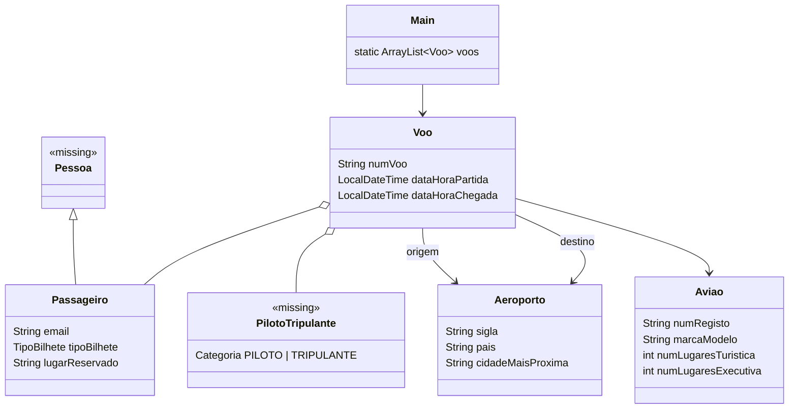

# Architecture — Companhia Aérea (early version)

> Documentation added in 2026 (portfolio). Reconstructed from the source code; the team's reasoning is not recorded. Portuguese version: [ARCHITECTURE.pt.md](ARCHITECTURE.pt.md).

## 1. Overview

A single-module Maven console project (Java 17, no dependencies) in package `org.example`: 5 classes, 711 lines. It is an **unfinished snapshot**: the domain model is drafted, but only "add flight" is wired into the menu, and the code does not compile as committed (see section 4). The finished refactor is [`airline-management-oop`](../../airline-management-oop/docs/ARCHITECTURE.md).

| Class | Role |
|---|---|
| `Main` | Menu text, one-shot `switch`, and all console readers (`lerNumVoo`, `lerAviao`, `lerAeroporto`, `lerDataHora`, `lerPassageiros`, `lerTripulacao`) |
| `Voo` | Flight: number, aircraft, origin/destination airport, departure/arrival, passenger list, crew list |
| `Aviao` | Registration, make/model, tourist and executive seat counts |
| `Aeroporto` | Code, country, nearest city |
| `Passageiro` | Declared `extends Pessoa`; adds e-mail, ticket type (`TURISTICA`/`EXECUTIVA`) and seat |

## 2. Class diagram

Classes marked `<<missing>>` are referenced by the code but **absent from the repository**.

## 3. Intended flow (option 1, "add flight")

`Main.adicionarVoo()` builds a `Voo` by calling the readers in argument order, then `voos.add(voo)`. The menu prints 11 options, but `switch` has an implementation only for case 1; cases 2–12 are empty and nothing loops back to the menu, so `main` ends after one action.

## 4. Verified issues (read from the code)

| # | Finding | Where |
|---|---|---|
| 1 | `Pessoa` and `PilotoTripulante` are used (`Passageiro extends Pessoa`, `Voo.tripulacao`, `Main.lerTripulacao`) but no such files are tracked (`git ls-files`), so the project cannot compile as committed | `Passageiro.java`, `Voo.java`, `Main.java` |
| 2 | `Main.voos` is declared but never initialised, so `voos.add(...)` would throw `NullPointerException` once all input is read | `Main.java` |
| 3 | `lerTripulacao` builds each `PilotoTripulante` but never adds it to the returned list, so the crew is always empty | `Main.java` |
| 4 | `lerDataHora` calls `scanner.next("")` (a pattern matching only the empty token) on a value that contains a space (`dd-MM-yyyy HH:mm`), so it cannot read a valid date-time | `Main.java` |
| 5 | Input uses `Scanner.next()` (single words), so names, addresses and the "marca-modelo" must have no spaces; no validation of numbers or dates | `Main.java` |
| 6 | The menu runs once (no loop); options 2–11 are printed but empty, and `case 12` has no menu entry | `Main.java` |
| 7 | No persistence despite the "save/read file" menu entries; no tests; no `.gitignore` in the project | project |

TODO: confirmar com o BMS — whether `Pessoa.java` / `PilotoTripulante.java` existed locally and were left out of the import.
