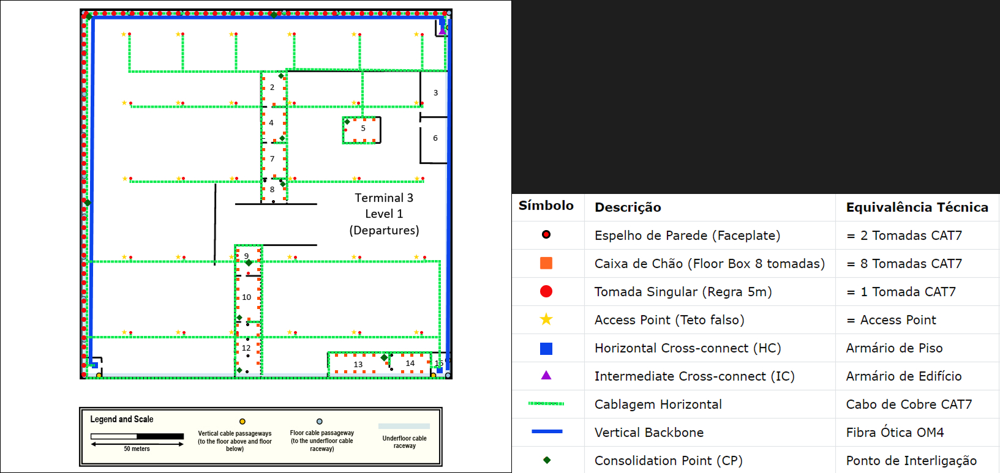
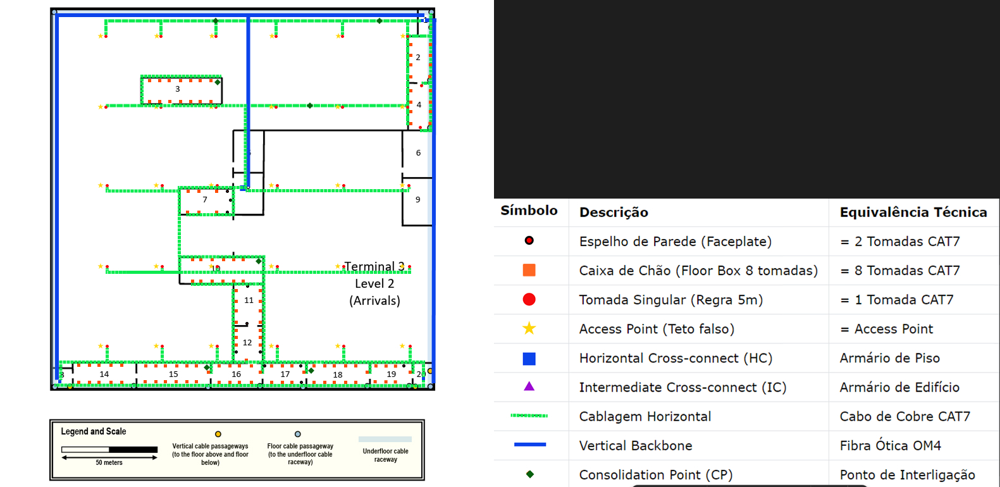

# Tarefa T.1.2 - Projeto de Cablagem Estruturada - Terminal 3 (T3)

**Número de Aluno:** 1240904

**Sprint:** 1

**Data:** 2026-02-26

**Edifício:** Terminal 3 (T3)

**Pisos Abrangidos:** Nível 1 (Departures) e Nível 2 (Arrivals)

---

## 1. Introdução

Este documento apresenta o projeto de cablagem estruturada para o Terminal 3 do aeroporto, abrangendo os pisos 1 e 2. O projeto segue as normas de cablagem estruturada (ISO/IEC 11801 e EN 50173), as decisões técnicas globais definidas no `planning.md` (padrão T568B, fibra OM4 para backbones, cobre CAT7 para horizontal) e as regras de dimensionamento aprendidas na aula PL01 (distância máxima de 90m para cablagem horizontal, sobredimensionamento de 100% para armários).

Em coordenação com a equipa, o Main Cross-connect (MC) do campus foi estabelecido no Terminal 2. Sendo assim, o Terminal 3 disporá de um Intermediate Cross-connect (IC) principal no Nível 1, que receberá o Campus Backbone proveniente do T2 e fará a distribuição vertical para os Horizontal Cross-connects (HC) dos Níveis 1 e 2.

---

### **Network Outlets**

**Critérios utilizados:**

1. **Número Standard:** 2 tomadas por cada 10 m² (ou fração) como base, garantindo flexibilidade.
2. **Access Points (Wi-Fi):** Posicionados geometricamente para garantir que todas as áreas de utilizadores estão dentro do círculo de cobertura (50m de diâmetro).
3. **Requisitos Especiais:**
   - Paredes exteriores: 1 tomada a cada 5 metros (conforme enunciado)
   - Salas técnicas: 0 tomadas de utilizador
   - Salas sem tomadas: conforme especificado no enunciado

### 2.2. Nível 1 (Departures)

| Divisão                     |  Área (m²)  | Cálculo Base (2/10m²) | **Total Tomadas** | Observações                         |
| :--------------------------- | :-----------: | :---------------------: | :---------------: | :------------------------------------ |
| **3.1.1**                    |     103,4     |            0            |       **0**       | **Sala técnica** (HC primário e IC) |
| 3.1.2                        |     266,3     |    (266.3/10)*2 = 54    |      **54**      |                                       |
| **3.1.3**                    |     371,0     |            0            |       **0**       | Sem tomadas                           |
| 3.1.4                        |     267,7     |    (267.7/10)*2 = 54    |      **54**      |                                       |
| 3.1.5                        |     278,8     |    (278.8/10)*2 = 56    |      **56**      |                                       |
| **3.1.6**                    |     420,8     |            0            |       **0**       | Sem tomadas                           |
| 3.1.7                        |     267,7     |    (267.7/10)*2 = 54    |      **54**      |                                       |
| 3.1.8                        |     183,5     |    (183.5/10)*2 = 38    |      **38**      |                                       |
| 3.1.9                        |     235,7     |    (235.7/10)*2 = 48    |      **48**      |                                       |
| 3.1.10                       |     355,0     |    (355.0/10)*2 = 72    |      **72**      |                                       |
| **3.1.11**                   |     106,1     |            0            |       **0**       | **Sala técnica** (HC secundário)    |
| 3.1.12                       |     421,7     |    (421.7/10)*2 = 86    |      **86**      |                                       |
| 3.1.13                       |     436,2     |    (436.2/10)*2 = 88    |      **88**      |                                       |
| 3.1.14                       |     290,8     |    (290.8/10)*2 = 60    |      **60**      |                                       |
| **3.1.15**                   |     137,6     |            0            |       **0**       | **Sala técnica** (HC terciário)     |
| **Parede Exterior Superior** | 200m lineares |            -            |      **40**      | 1 tomada a cada 5m                    |
| **Parede Exterior Esquerda** | 200m lineares |            -            |      **40**      | 1 tomada a cada 5m                    |
| **Grelha Wi-Fi (Nível 1)**  |  Teto Falso  |   30 APs (1 cabo/AP)   |      **30**      | Distância geométrica 50m diâm.     |
| **TOTAL NÍVEL 1**           |              |                        |      **720**      | **Soma total de tomadas (N1)**        |

### 2.3. Nível 2 (Arrivals)

| Divisão                    | Área (m²) | Cálculo Base (2/10m²) | **Total Tomadas** | Observações                      |
| :-------------------------- | :---------: | :---------------------: | :---------------: | :--------------------------------- |
| **3.2.1**                   |    101,8    |            0            |       **0**       | **Sala técnica** (HC primário)   |
| 3.2.2                       |    317,2    |           64           |      **64**      |                                    |
| 3.2.3                       |    592,2    |           120           |      **120**      |                                    |
| 3.2.4                       |    322,4    |           66           |      **66**      |                                    |
| **3.2.5**                   |    357,2    |            0            |       **0**       | Sem tomadas                        |
| **3.2.6**                   |    420,8    |            0            |       **0**       | Sem tomadas                        |
| 3.2.7                       |    268,8    |           54           |      **54**      |                                    |
| **3.2.8**                   |    346,3    |            0            |       **0**       | **Sem tomadas** (quarto HC)        |
| **3.2.9**                   |    420,8    |            0            |       **0**       | Sem tomadas                        |
| 3.2.10                      |    598,9    |           120           |      **120**      |                                    |
| 3.2.11                      |    335,9    |           68           |      **68**      |                                    |
| 3.2.12                      |    294,9    |           60           |      **60**      |                                    |
| **3.2.13**                  |    114,5    |            0            |       **0**       | **Sala técnica** (HC secundário) |
| 3.2.14                      |    400,0    |           80           |      **80**      |                                    |
| 3.2.15                      |    513,5    |           104           |      **104**      |                                    |
| 3.2.16                      |    357,7    |           72           |      **72**      |                                    |
| 3.2.17                      |    301,0    |           62           |      **62**      |                                    |
| 3.2.18                      |    438,2    |           88           |      **88**      |                                    |
| 3.2.19                      |    293,0    |           60           |      **60**      |                                    |
| **3.2.20**                  |    149,2    |            0            |       **0**       | **Sala técnica** (HC terciário)  |
| **Grelha Wi-Fi (Nível 2)** | Teto Falso |   30 APs (1 cabo/AP)   |      **30**      | Distância geométrica 50m diâm.  |
| **TOTAL NÍVEL 2**          |            |                        |     **1048**     | **Soma total de tomadas (N2)**     |

---

## 3. Implantação de Tomadas e Cross-connects (Justificada)

### 3.1. Localização dos Cross-connects

Devido às grandes dimensões do Terminal 3 (aprox. 200x200m), um único HC por piso violaria a norma dos 90 metros para a cablagem de cobre CAT7. Para resolver este problema de engenharia, a topologia foi dividida em três zonas de cobertura por piso:

- **Horizontal Cross-connects (HC) - Nível 1:**

  - **HC 1A (Sala 3.1.1):** Cobre o quadrante Noroeste.
  - **HC 1B (Sala 3.1.11):** Cobre o quadrante Sudoeste.
  - **HC 1C (Sala 3.1.15):** Cobre o quadrante Sudeste.

  *Justificação:* Esta distribuição triangular garante que o caminho de cabo desde qualquer armário até à tomada mais remota da sua zona de responsabilidade seja sempre inferior a 80 metros ortogonais.
- **Horizontal Cross-connects (HC) - Nível 2:**

  - **HC 2A (Sala 3.2.1):** Alinhado verticalmente com o HC 1A.
  - **HC 2B (Sala 3.2.13):** Alinhado estrategicamente para a zona Sudoeste.
  - **HC 2C (Sala 3.2.20):** Alinhado estrategicamente para a zona Sudeste.
  - **HC 2D (Sala 3.2.8):** *Adicionado estrategicamente na zona de reserva central para garantir rigorosamente que nenhum traçado de cobre ultrapasse o limite normativo de 90 metros no núcleo do edifício.*
- **Intermediate Cross-connect (IC):** Instalado no **Nível 1, Sala 3.1.1**.

  - *Justificação:* Sendo o Nível 1 o piso com acesso direto à vala técnica subterrânea, atua como o ponto de entrada das infraestruturas (Entrance Facility). O IC fica posicionado nesta sala para receber o Campus Backbone de fibra ótica (ligação ao MC no T2) e partilhará a sala com o armário HC 1A, centralizando a distribuição do Vertical Backbone para os restantes HCs.

## 4. Tipos de Cabo utilizados

### 4.1. Cablagem Horizontal (Tomadas ⇔ HC)

- **Tipo de Cabo:** CAT7 S/FTP LSZH (Low Smoke Zero Halogen).
- **Arquitetura de Zone Cabling (Consolidation Points):** Foram utilizados **Consolidation Points (CP)** para flexibilidade, instalados no **Teto Falso** (para APs) e em **Condutas de Pavimento** (para Caixas de Chão em salas de alta densidade).
- **Pathway:** Os cabos seguem por calhas metálicas perfuradas no teto falso e condutas de chão, com descidas organizadas para tomadas e APs, e subidas para os racks nos HCs.

### 4.2. Vertical Backbone (HC ⇔ IC)

- **Tipo de Cabo:** Fibra Ótica Multimodo OM4 (12 fibras por ligação, garantindo redundância e capacidade de crescimento).
- **Pathway:** A fibra segue por caminhos dedicados e separados do cobre, desde os HCs até às passagens verticais (shafts) e depois horizontalmente pelo teto falso até ao IC na Sala 3.1.1.

### 4.3. Cálculo de Comprimentos de Cabo

### 4.3.1. Cálculo de Cabo de Cobre CAT7 (Distância Média)

Para o cálculo do comprimento dos cabos horizontais, adotou-se a fórmula da **Distância Média por Sala**, adicionando as seguintes constantes verticais e de folga para cada cabo, de modo a garantir uma margem segura para manutenção e respeitar os desníveis da arquitetura (teto falso a 4m):

As medidas foram feitas com ponto de partida no HC mais proximo de cada sala, utilizando CP como ponto intermédio nos casos onde o comprimento do cabo ultrapassa os 90m.

* Descida e encaminhamento no Rack (HC): 3,0 m
* Descida na Parede (do teto falso a 4m até à tomada a 0,3m): 3,7 m
* Folga na caixa da tomada: 0,3 m
* **Total Fixo a somar à distância horizontal (Tomadas Parede/Chão): 7,0 metros**
* **Total Fixo a somar para Access Points (Teto): 5,0 metros** *(3m HC + 2m folga/Ponto de Consolidação)*

A tabela seguinte demonstra o cálculo discriminado para todas as áreas do Terminal 3:

| Divisão / Zona           | HC Associado | Dist. Perto (m) | Dist. Longe (m) | Média Horiz. (m) | Total por Cabo (m) | Qtd. Tomadas | Total Base (m) | **Total a Encomendar (+10%)** |
| :------------------------ | :----------- | :-------------: | :-------------: | :---------------: | :----------------: | :----------: | :------------: | :---------------------------: |
| **NÍVEL 1 (Departures)** |              |                |                |                  |                    |              |                |                              |
| Sala 3.1.1 (IC/HC)        | [HC]         |        0        |        0        |        0,0        |        0,0        |      0      |      0,0      |          **0,00 m**          |
| Sala 3.1.2                | [HC 1A]      |      124,0      |      138,5      |      131,25      |       138,25       |      54      |     7465,5     |         **8212,05 m**         |
| Sala 3.1.3                | [HC]         |        0        |        0        |        0,0        |        0,0        |      0      |      0,0      |          **0,00 m**          |
| Sala 3.1.4                | [HC 1A]      |      130,7      |      144,8      |      137,75      |       144,75       |      54      |     7816,5     |         **8598,15 m**         |
| Sala 3.1.5                | [HC 1A]      |      90,0      |      116,6      |      103,30      |       110,30       |      56      |     6176,8     |         **6794,48 m**         |
| Sala 3.1.6                | [HC]         |        0        |        0        |        0,0        |        0,0        |      0      |      0,0      |          **0,00 m**          |
| Sala 3.1.7                | [HC 1A]      |      149,7      |      163,7      |      156,70      |       163,70       |      54      |     8839,8     |         **9723,78 m**         |
| Sala 3.1.8                | [HC 1A]      |      170,6      |      175,8      |      173,20      |       180,20       |      38      |     6847,6     |         **7532,36 m**         |
| Sala 3.1.9                | [HC 1B]      |      125,8      |      135,9      |      130,85      |       137,85       |      48      |     6616,8     |         **7278,48 m**         |
| Sala 3.1.10               | [HC 1B]      |      99,3      |      120,5      |      109,90      |       116,90       |      72      |     8416,8     |         **9258,48 m**         |
| Sala 3.1.11 (HC)          | [HC]         |        0        |        0        |        0,0        |        0,0        |      0      |      0,0      |          **0,00 m**          |
| Sala 3.1.12               | [HC 1B]      |      82,0      |      90,0      |       86,00       |       93,00       |      86      |     7998,0     |         **8797,80 m**         |
| Sala 3.1.13               | [HC 1C]      |      33,0      |      63,4      |       48,20       |       55,20       |      88      |     4857,6     |         **5343,36 m**         |
| Sala 3.1.14               | [HC 1C]      |       9,3       |      27,1      |       18,20       |       25,20       |      60      |     1512,0     |         **1663,20 m**         |
| Sala 3.1.15 (HC)          | [HC]         |        0        |        0        |        0,0        |        0,0        |      0      |      0,0      |          **0,00 m**          |
| Grelha Wi-Fi (APs)        | [Vários]    |        -        |        -        |       45,00       |    50,00 (+5m)    |      30      |     1500,0     |         **1650,00 m**         |
| Paredes Exteriores        | [Vários]    |       3,6       |      203,6      |      103,60      |       110,60       |      80      |     8848,0     |         **9732,80 m**         |
| **Sub-Total Nível 1**    |              |                |                |                  |                    |   **720**   |  **76895,4**  |        **84584,94 m**        |
|                           |              |                |                |                  |                    |              |                |                              |
| **NÍVEL 2 (Arrivals)**   |              |                |                |                  |                    |              |                |                              |
| Sala 3.2.1 (HC)           | [HC]         |        0        |        0        |        0,0        |        0,0        |      0      |      0,0      |          **0,00 m**          |
| Sala 3.2.2                | [HC 2A]      |      10,8      |      27,5      |       19,15       |       26,15       |      64      |     1673,6     |         **1840,96 m**         |
| Sala 3.2.3                | [HC 2D]      |      58,2      |      89,9      |       74,05       |       81,05       |     120     |     9726,0     |        **10698,60 m**        |
| Sala 3.2.4                | [HC 2A]      |      34,6      |      51,6      |       43,10       |       50,10       |      66      |     3306,6     |         **3637,26 m**         |
| Sala 3.2.5                | [HC]         |        0        |        0        |        0,0        |        0,0        |      0      |      0,0      |          **0,00 m**          |
| Sala 3.2.6                | [HC]         |        0        |        0        |        0,0        |        0,0        |      0      |      0,0      |          **0,00 m**          |
| Sala 3.2.7                | [HC 2D]      |      11,4      |      37,9      |       24,65       |       31,65       |      54      |     1709,1     |         **1880,01 m**         |
| Sala 3.2.8                | [HC]         |        0        |        0        |        0,0        |        0,0        |      0      |      0,0      |          **0,00 m**          |
| Sala 3.2.9                | [HC]         |        0        |        0        |        0,0        |        0,0        |      0      |      0,0      |          **0,00 m**          |
| Sala 3.2.10               | [HC 2D]      |      73,9      |      98,4      |       86,15       |       93,15       |     120     |    11178,0    |        **12295,80 m**        |
| Sala 3.2.11               | [HC 2D]      |      83,7      |      99,9      |       91,80       |       98,80       |      68      |     6718,4     |         **7390,24 m**         |
| Sala 3.2.12               | [HC 2B]      |      93,0      |      114,4      |      103,70      |       110,70       |      60      |     6642,0     |         **7306,20 m**         |
| Sala 3.2.13 (HC)          | [HC]         |        0        |        0        |        0,0        |        0,0        |      0      |      0,0      |          **0,00 m**          |
| Sala 3.2.14               | [HC 2B]      |       8,2       |      30,4      |       19,30       |       26,30       |      80      |     2104,0     |         **2314,40 m**         |
| Sala 3.2.15               | [HC 2B]      |      42,5      |      75,2      |       58,85       |       65,85       |     104     |     6848,4     |         **7533,24 m**         |
| Sala 3.2.16               | [HC 2B]      |      80,7      |      101,9      |       91,30       |       98,30       |      72      |     7077,6     |         **7785,36 m**         |
| Sala 3.2.17               | [HC 2C]      |      66,0      |      76,8      |       71,40       |       78,40       |      62      |     4860,8     |         **5346,88 m**         |
| Sala 3.2.18               | [HC 2C]      |      33,4      |      54,9      |       44,15       |       51,15       |      88      |     4501,2     |         **4951,32 m**         |
| Sala 3.2.19               | [HC 2C]      |      11,0      |      23,2      |       17,10       |       24,10       |      60      |     1446,0     |         **1590,60 m**         |
| Sala 3.2.20 (HC)          | [HC]         |        0        |        0        |        0,0        |        0,0        |      0      |      0,0      |          **0,00 m**          |
| Grelha Wi-Fi (APs)        | [Vários]    |        -        |        -        |       45,00       |    50,00 (+5m)    |      30      |     1500,0     |         **1650,00 m**         |
| **Sub-Total Nível 2**    |              |                |                |                  |                    |   **1048**   |  **69291,7**  |        **76220,87 m**        |
|                           |              |                |                |                  |                    |              |                |                              |
| **TOTAL GERAL T3**        |              |                |                |                  |                    |   **1768**   |  **146187,1**  |        **160805,81 m**        |

#### 4.3.2. Cabo de Fibra Ótica OM4 (Vertical & Campus Backbone)

O cálculo é feito por percurso, usando a fórmula: `Distância Horizontal + Distância Vertical + Folgas (10m)`. As distâncias horizontais foram estimadas com base em percursos ortogonais realistas dentro do edifício de 200x200m.

- Distância vertical N2 → N1: **6 metros**.
- Distância vertical N1 → Subsolo: **10 metros**.

| Ligação (Origem ➔ Destino)  | Traçado Horizontal (Est.) | Traçado Vertical (Shaft)   | Folgas | Comprimento Total (Est.) |
| :----------------------------- | :------------------------- | :-------------------------- | :----- | :----------------------- |
| **HC 1A (Sala 3.1.1) ➔ IC**   | 0 m (Mesma sala)           | 0 m                         | 10 m   | **10 m**                 |
| **HC 1B (Sala 3.1.11) ➔ IC**  | *120* m                    | 0 m                         | 10 m   | **130 m**                |
| **HC 1C (Sala 3.1.15) ➔ IC**  | *150* m                    | 0 m                         | 10 m   | **160 m**                |
| **HC 2A (Sala 3.2.1) ➔ IC**   | 0 m                        | 6 m (Desce do N2 p/ N1)     | 10 m   | **16 m**                 |
| **HC 2B (Sala 3.2.13) ➔ IC**  | *120* m                    | 6 m (Desce do N2 p/ N1)     | 10 m   | **136 m**                |
| **HC 2C (Sala 3.2.20) ➔ IC**  | *150* m                    | 6 m (Desce do N2 p/ N1)     | 10 m   | **166 m**                |
| **HC 2D (Sala 3.2.8) ➔ IC**   | *100* m (Até à 3.2.1)    | 6 m (Desce do N2 p/ N1)     | 10 m   | **116 m**                |
| **IC (Sala 3.1.1) ➔ MC (T2)** | *2* m                      | **10 m** (Desce p/ Subsolo) | 20 m   | **32 m**                 |

*(Nota: Para garantir redundância, cada comprimento deverá ser multiplicado por 2, perfazendo um cabo principal e um de backup. No caso da Sala 3.2.8, a distância de 100m é uma estimativa visual ortogonal até à Sala 3.2.1).*

## 5. Inventário de Hardware

## 5. Inventário de Hardware

### 5.1. Inventário Global - Nível 1 (HCs nas Salas 3.1.1, 3.1.11, 3.1.15)

| Item                          | Tipo / Especificação  | Quantidade | Cálculo / Justificação                                                                                                                   |
| :---------------------------- | :---------------------- | :--------- | :------------------------------------------------------------------------------------------------------------------------------------------ |
| **Tomadas Utilizador + Teto** | Keystone CAT7 (T568B)   | 720        | Total Nível 1 (inclui APs e Tomadas Externas)                                                                                              |
| **Cabo Horizontal (CAT7)** | CAT7 S/FTP LSZH         | **~84.585 m** | Conforme soma exata da tabela de dimensionamento rigoroso (Secção 4.3.1)                                                                 |
| **Cabo Vertical (Fibra OM4)** | Cabo de fibra ótica OM4, 24 fibras, LSZH, conectores LC duplex | **~600 m** | (10m + 130m + 160m) x 2 (redundância total)                                                                                                      |
| **Patch Panel Cobre** | CAT7, 48 portas, 1U     | 15         | 720/48 = 15 painéis (distribuídos pelos 3 HCs)                                                                                            |
| **Patch Panel Fibra (p/ IC)** | Patch Panel OM4, 24 portas LC duplex, 1U | **3** | 1 painel por cada um dos 3 HCs do piso                                                                                                      |
| **Organizador de Cabos** | 1U, horizontal          | **18** | 1 por cada painel (15 cobre + 3 fibra)                                                                                                      |
| **Armários Telecom.** | Rack 19", 42U           | 3          | 1 rack por sala. Estimativa por rack: ~5U (cobre) + 1U (fibra) + 6U (org.) + 2U (sw) = 14U + 100% folga = 28U → Rack de 42U é suficiente. |

### 5.2. Inventário Global - Nível 2 (HCs nas Salas 3.2.1, 3.2.8, 3.2.13, 3.2.20)

| Item                          | Tipo / Especificação  | Quantidade | Cálculo / Justificação                                                    |
| :---------------------------- | :---------------------- | :--------- | :--------------------------------------------------------------------------- |
| **Tomadas Utilizador + Teto** | Keystone CAT7 (T568B)   | 1048       | Total Nível 2 (inclui APs)                                                  |
| **Cabo Horizontal (CAT7)** | CAT7 S/FTP LSZH         | **~76.221 m** | Conforme soma exata da tabela de dimensionamento rigoroso (Secção 4.3.1)  |
| **Cabo Vertical (Fibra OM4)** | Cabo de fibra ótica OM4, 24 fibras, LSZH, conectores LC duplex | **~868 m** | (16m + 136m + 166m + 116m) x 2 (redundância total)                                |
| **Patch Panel Cobre** | CAT7, 48 portas, 1U     | 22         | 1048/48 ≈ 21.8 → 22 painéis (distribuídos pelos 4 HCs)                   |
| **Patch Panel Fibra (p/ IC)** | Patch Panel OM4, 24 portas LC duplex, 1U | **4** | 1 painel por cada um dos 4 HCs do piso                                       |
| **Organizador de Cabos** | 1U, horizontal          | **26** | 1 por cada painel (22 cobre + 4 fibra)                                       |
| **Armários Telecom.** | Rack 19", 42U           | **4** | 1 rack por cada sala técnica. Rack 42U garante ampla margem de crescimento. |

### 5.3. Inventário - IC (Nível 1 - Sala 3.1.1)

| Item                                  | Tipo / Especificação | Quantidade | Cálculo / Justificação                                                                                                                                 |
| :------------------------------------ | :--------------------- | :--------- | :-------------------------------------------------------------------------------------------------------------------------------------------------------- |
| **Cabo Campus Backbone** | Cabo de fibra ótica OM4, 24 fibras, LSZH, conectores LC duplex | **~60 m** | Referente apenas à ligação (redundante: 30m x 2) desde o IC até à entrada da vala técnica no subsolo do T3. O restante traçado é faturado no T2.         |
| **Patch Panel Fibra (Receção HCs)** | Patch Panel OM4, 24 portas LC duplex, 1U | **2** | Para agregar as ligações (principal+redundante) dos 7 HCs remotos (3 do N1, 4 do N2).                                                                   |
| **Patch Panel Fibra (Ligação MC)** | Patch Panel OM4, 24 portas LC duplex, 1U | **1** | Para a terminação da ligação (principal+redundante) do Campus Backbone que segue para o MC.                                                             |
| **Organizador de Cabos** | 1U, horizontal         | **3** | 1 por cada painel de fibra ótica.                                                                                                                        |
| **Armário Telecom. (Exclusivo IC)** | Rack 19", 42U          | **1** | 3U (painéis) + 3U (gestão) + 4U (switches core) = 10U. 10U + 100% folga = 20U. Um rack de 42U adicional é adequado e oferece espaço para crescimento. |

## 6. Schematic Plans (Plantas Esquemáticas de Implantação)

### 6.1. Legenda dos Símbolos Utilizados

| Símbolo | Descrição                          | Equivalência Técnica  | Cor             |
| :------: | :----------------------------------- | :---------------------- | :-------------- |
|    ●    | Espelho de Parede (Faceplate)        | = 2 Tomadas CAT7        | Vermelho        |
|    🟧    | Caixa de Chão (Floor Box 8 tomadas) | = 8 Tomadas CAT7        | Laranja         |
|    ◉    | Tomada Singular (Regra 5m)           | = 1 Tomada CAT7         | Vermelho vazado |
|    ★    | Access Point (Teto falso)            | = Access Point          | Amarelo         |
|    ■    | Horizontal Cross-connect (HC)        | Armário de Piso        | Azul            |
|    ▲    | Intermediate Cross-connect (IC)      | Armário de Edifício   | Roxo            |
|  ─ ─  | Cablagem Horizontal                  | Cabo de Cobre CAT7      | Verde tracejado |
|  ━━━  | Vertical Backbone                    | Fibra Ótica OM4        | Azul sólido    |
|    ◆    | Consolidation Point (CP)             | Ponto de Interligação | Verde Escuro    |
|    ⬛    | Passagem Vertical (Shaft)            | Poço de cabos          | Cinza/Amarelo   |

**Level 1**

**Level 2**

### 6.2. Nota sobre as Plantas Esquemáticas

As plantas esquemáticas foram desenhadas para refletir a topologia e a distribuição dos pontos de rede calculados (**720 tomadas no Nível 1 e 1048 tomadas no Nível 2**). Foram priorizados caminhos ortogonais para o traçado dos cabos.

### 6.3. Descrição da Implantação - Nível 1 (Departures)

- **Cross-connects:** O **IC** (▲) e o **HC 1A** (■) partilham a **Sala 3.1.1**. O **HC 1B** e **HC 1C** (■) encontram-se nas **Salas 3.1.11** e **3.1.15**.
- **Tomadas:** Distribuídas conforme os cálculos, com Caixas de Chão (🟧) em zonas de alta densidade e tomadas singulares (◉) nas paredes exteriores.
- **Access Points (★):** **30 APs** distribuídos geometricamente no teto falso para garantir cobertura Wi-Fi total.
- **Pathways:** O Vertical Backbone (fibra) converge dos HCs para o IC.

### 6.4. Descrição da Implantação - Nível 2 (Arrivals)

- **Cross-connects:** Os três **HCs** (■) do piso (Salas 3.2.1,3.2.8, 3.2.13, 3.2.20) ligam-se por fibra ao IC no piso inferior.
- **Tomadas:** Nas Salas 3.2.3 e 3.2.10, com **120 tomadas** em cada, o desenho recorre a Caixas de Chão (🟧).
- **Access Points (★):** **30 APs** distribuídos de forma equilibrada pelas salas e corredores.
- **Pathways:** A cablagem horizontal (verde tracejado) demonstra o percurso desde os HCs até às zonas de cobertura, respeitando o limite de 90 metros.
