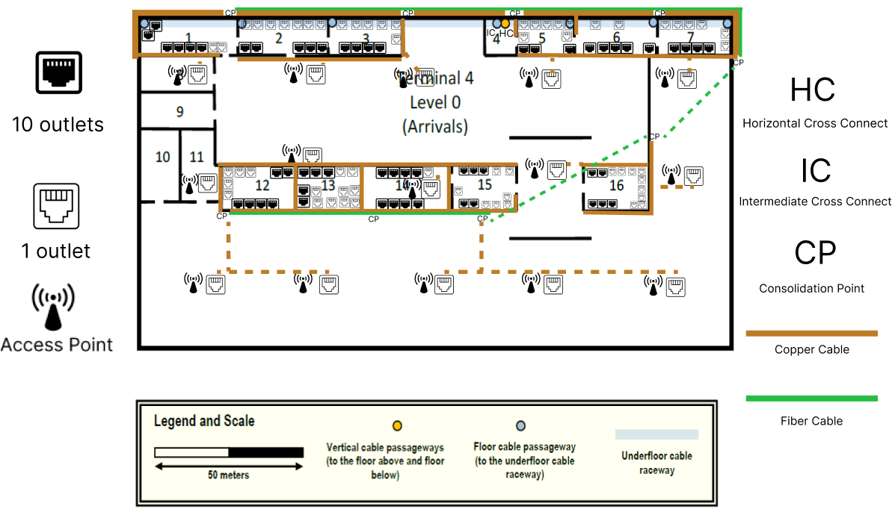
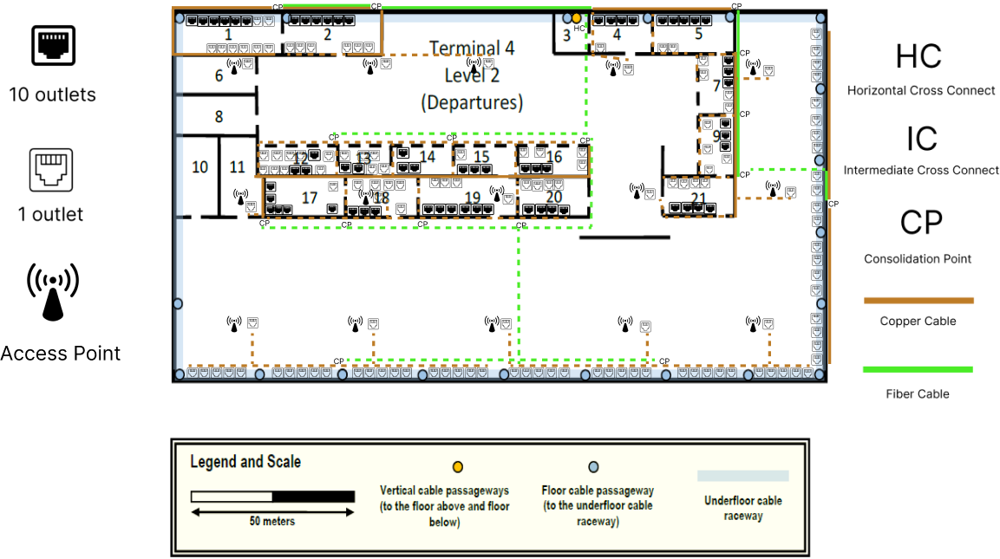

# Tarefa T.1.4 - Projeto de Cablagem Estruturada - Terminal 4 (T4)

**Número de Aluno:** 1240935

**Sprint:** 1

**Edifício:** Terminal 4 (T4)

**Pisos Abrangidos:** Nível 0 (Arrivals) e Nível 2 (Departures)

---

## 1. Introdução

Este documento apresenta o projeto de cablagem estruturada para o Terminal 4 do aeroporto, abrangendo os pisos 0 e 2. O projeto segue as normas de cablagem estruturada (ISO/IEC 11801 e EN 50173), as decisões técnicas globais definidas no `planning.md` (padrão T568B, fibra OM4 para backbones, cobre CAT7 para horizontal) e as regras de dimensionamento aprendidas na aula PL01 (distância máxima de 90m para cablagem horizontal, sobredimensionamento de 100% para armários).

Em coordenação com a equipa, o Main Cross-connect (MC) do campus foi estabelecido no Terminal 2. Sendo assim, o Terminal 4 disporá de um Intermediate Cross-connect (IC) principal no Nível 0, que receberá o Campus Backbone proveniente do T2 e fará a distribuição vertical para os Horizontal Cross-connects (HC) dos Níveis 0 e 2.

---

## 2. Cálculo do Número de Tomadas por Divisão (Nível 0 e Nível 2)

### 2.1. Metodologia e Conversão de Escala

Seguindo as indicações da aula PL01, o número de tomadas por divisão foi calculado com base na área real das salas.

**Dados da escala:**
- 3.1 cm no desenho = 50 metros na realidade
- Fator de conversão: 1 cm = 50/3.1 ≈ **16.13 metros/cm**

**Critérios utilizados:**
1. **Número Standard:** 2 tomadas por cada 10 m² (ou fração) como base, garantindo flexibilidade.
2. **Access Points (Wi-Fi):** Posicionados geometricamente para garantir que todas as áreas de utilizadores estão dentro do círculo de cobertura (50m de diâmetro).
3. **Requisitos Especiais:**
    - Paredes exteriores: 1 tomada a cada 5 metros (conforme enunciado)
    - Salas técnicas: 0 tomadas de utilizador
    - Salas sem tomadas: conforme especificado no enunciado

### 2.2. Cálculo das Áreas Reais - Nível 0 (Arrivals)

| Sala    | Medidas (cm) | Comprimento (m) | Largura (m) | Área (m²) |
| ------- | ------------ | --------------- | ----------- | --------- |
| Sala 1  | 2.0 x 0.6    | 32.5            | 9.5         | **309**   |
| Sala 2  | 1.85 x 0.6   | 30.0            | 9.5         | **285**   |
| Sala 3  | 1.5 x 0.6    | 24.0            | 9.5         | **228**   |
| Sala 5  | 1.2 x 0.6    | 19.5            | 9.5         | **185**   |
| Sala 6  | 1.7 x 0.6    | 27.5            | 9.5         | **261**   |
| Sala 7  | 1.5 x 0.6    | 24.0            | 9.5         | **228**   |
| Sala 12 | 1.5 x 0.85   | 24.0            | 13.5        | **324**   |
| Sala 13 | 1.35 x 0.85  | 22.0            | 13.5        | **297**   |
| Sala 14 | 1.85 x 0.85  | 30.0            | 13.5        | **405**   |
| Sala 15 | 1.3 x 0.85   | 21.0            | 13.5        | **284**   |
| Sala 16 | 1.35 x 0.85  | 22.0            | 13.5        | **297**   |

### 2.3. Tomadas - Nível 0 (Arrivals)

| Sala    | Área | Tomadas Base | AP | **Total** |
| ------- | ---- | ------------ |----|-----------|
| Sala 1  | 309  | 62           | 2  | **64**    |
| Sala 2  | 285  | 57           | 1  | **58**    |
| Sala 3  | 228  | 46           | 1  | **47**    |
| Sala 5  | 185  | 37           | 1  | **38**    |
| Sala 6  | 261  | 52           | 1  | **53**    |
| Sala 7  | 228  | 46           | 1  | **47**    |
| Sala 12 | 324  | 65           | 2  | **67**    |
| Sala 13 | 297  | 59           | 2  | **61**    |
| Sala 14 | 405  | 81           | 2  | **83**    |
| Sala 15 | 284  | 57           | 1  | **58**    |
| Sala 16 | 297  | 59           | 1  | **60**    |
   
 - Total 636 pontos de rede

### 2.4. Cálculo das Áreas — Nível 2 (Departures)

| Sala    | Medidas (cm) | Comprimento (m) | Largura (m) | Área    |
| ------- | ------------ | --------------- | ----------- | ------- |
| Sala 1  | 2.0 x 0.65   | 32.5            | 10.5        | **341** |
| Sala 2  | 1.9 x 0.65   | 30.5            | 10.5        | **320** |
| Sala 4  | 1.2 x 0.65   | 19.5            | 10.5        | **205** |
| Sala 5  | 1.55 x 0.65  | 25.0            | 10.5        | **262** |
| Sala 7  | 1.0 x 0.65   | 16.0            | 10.5        | **168** |
| Sala 9  | 1.0 x 0.65   | 16.0            | 10.5        | **168** |
| Sala 12 | 1.5 x 0.5    | 24.0            | 8.0         | **192** |
| Sala 13 | 1.0 x 0.5    | 16.0            | 8.0         | **128** |
| Sala 14 | 1.15 x 0.5   | 18.5            | 8.0         | **148** |
| Sala 15 | 1.2 x 0.5    | 19.5            | 8.0         | **156** |
| Sala 16 | 1.3 x 0.5    | 21.0            | 8.0         | **168** |
| Sala 17 | 1.5 x 0.65   | 24.0            | 10.5        | **252** |
| Sala 18 | 1.35 x 0.65  | 22.0            | 10.5        | **231** |
| Sala 19 | 1.85 x 0.65  | 30.0            | 10.5        | **315** |
| Sala 20 | 1.3 x 0.65   | 21.0            | 10.5        | **221** |
| Sala 21 | 1.3 x 0.65   | 21.0            | 10.5        | **221** |

### 2.5. Tomadas - Nível 2 (Arrivals)

| Sala    | Área | Tomadas Base | AP | **Total** |
| ------- | ---- | ------------ |----|-----------|
| Sala 1  | 341  | 68           | 1  | **69**    |
| Sala 2  | 320  | 64           | 1  | **65**    |
| Sala 4  | 205  | 41           | 1  | **42**    |
| Sala 5  | 262  | 52           | 1  | **53**    |
| Sala 7  | 168  | 34           | 1  | **35**    |
| Sala 9  | 168  | 34           | 1  | **35**    |
| Sala 12 | 192  | 38           | 1  | **39**    |
| Sala 13 | 128  | 26           | 1  | **27**    |
| Sala 14 | 148  | 30           | 0  | **30**    |
| Sala 15 | 156  | 31           | 1  | **32**    |
| Sala 16 | 168  | 34           | 1  | **35**    |
| Sala 17 | 252  | 50           | 1  | **51**    |
| Sala 18 | 231  | 46           | 1  | **47**    |
| Sala 19 | 315  | 63           | 1  | **64**    |
| Sala 20 | 221  | 44           | 1  | **45**    |
| Sala 21 | 221  | 44           | 1  | **45**    |

 - Total 714 + 30 (tomadas nas paredes) = 744 pontos de rede
 - 
---

## 3. Implantação de Tomadas e Cross-connects (Justificada)

### 3.1. Localização dos Cross-connects

- **Horizontal Cross-connect (HC) - Nível 0:** Instalado na **Sala 4**. Justificação:
   - Sala identificada como adequada para infraestrutura.

- **Horizontal Cross-connect (HC) - Nível 2:** Instalado na **Sala 3**. Justificação:
   - Sala identificada como adequada para infraestrutura.

## 4. Tipos de Cabo utilizados

### 4.1. Cablagem Horizontal (Tomadas ⇔ HC)

- **Tipo de Cabo:** CAT7 S/FTP LSZH (Low Smoke Zero Halogen).
- **Arquitetura de Zone Cabling (Consolidation Points):** Foram utilizados **Consolidation Points (CP)** para flexibilidade, instalados no **Teto Falso** (para APs) e em **Condutas de Pavimento** (para Caixas de Chão em salas de alta densidade).
- **Pathway:** Os cabos seguem por calhas metálicas perfuradas no teto falso e condutas de chão, com descidas organizadas para tomadas e APs, e subidas para os racks nos HCs.

### 4.2. Vertical Backbone (HC ⇔ IC)

- **Tipo de Cabo:** Fibra Ótica Multimodo OM4 (24 fibras por ligação, garantindo redundância e capacidade de crescimento).
- **Pathway:** A fibra segue por caminhos dedicados e separados do cobre, desde os HCs até às passagens verticais (shafts) e depois horizontalmente pelo teto falso até ao IC na Sala 3.1.1.

### 4.3. Cálculo de Comprimentos de Cabo

### 4.3.1. Cálculo de Cabo de Cobre CAT7 (Distância Média)

Para o cálculo do comprimento dos cabos horizontais, adotou-se a fórmula da **Distância Média por Sala**, adicionando as seguintes constantes verticais e de folga para cada cabo, de modo a garantir uma margem segura para manutenção e respeitar os desníveis da arquitetura (teto falso a 4m):

As medidas foram feitas com ponto de partida no HC mais proximo de cada sala, utilizando CP como ponto intermédio nos casos onde o comprimento do cabo ultrapassa os 90m.

* Descida e encaminhamento no Rack (HC): 3,0 m
* Descida na Parede (do teto falso a 4m até à tomada a 0,3m): 3,7 m
* Folga na caixa da tomada: 0,3 m
* **Total Fixo a somar à distância horizontal (Tomadas Parede/Chão): 7,0 metros**
* **Total Fixo a somar para Access Points (Teto): 5,0 metros** *(3m HC + 2m folga/Ponto de Consolidação)*   

| Divisão / Zona           | Dist. Perto (m) | Dist. Longe (m) | Média Horiz. (m) | Qtd. Tomadas | Total Base (m) | **Total a Encomendar (+10%)** |
|:-------------------------|:---------------:|:---------------:|:----------------:|:------------:|:--------------:|:-----------------------------:|
| **NÍVEL 0 (Departures)** |                 |                 |                  |              |                |                               |
| Sala 4.0.1               |      35,5       |      45,6       |       40,6       |      64      |     2598,4     |         **2858,24 m**         |
| Sala 4.0.2               |      30,6       |      50,3       |       40,5       |      58      |     2349,0     |         **2583,90 m**         |
| Sala 4.0.3               |       2,9       |      32,7       |       17,8       |      47      |     836,6      |         **920,26 m**          |
| Sala 4.0.4 (HC / IC)     |        0        |        0        |       0,0        |      0       |      0,0       |          **0,00 m**           |
| Sala 4.0.5               |       2,0       |      43,6       |       22,8       |      38      |     866,4      |         **953,04 m**          |
| Sala 4.0.6               |       2,8       |      30,2       |       16,5       |      53      |     874,5      |         **961,95 m**          |
| Sala 4.0.7               |       1,9       |      19,5       |       10,7       |      47      |     502,9      |         **553,19 m**          |
| Sala 4.0.8               |        0        |        0        |       0,0        |      0       |      0,0       |          **0,00 m**           |
| Sala 4.0.9               |        0        |        0        |       0,0        |      0       |      0,0       |          **0,00 m**           |
| Sala 4.0.10              |        0        |        0        |       0,0        |      0       |      0,0       |          **0,00 m**           |
| Sala 4.0.11              |        0        |        0        |       0,0        |      0       |      0,0       |          **0,00 m**           |
| Sala 4.0.12              |       2,9       |      40,8       |       21,9       |      67      |     1467,3     |         **1614,03 m**         |
| Sala 4.0.13              |       4.7       |      44,7       |       24,7       |      61      |     1506,7     |         **1657,37 m**         |
| Sala 4.0.14              |       1.8       |      47,1       |       24,5       |      83      |     2033,5     |         **2236,85 m**         |
| Sala 4.0.15              |       1.4       |      42.5       |       22,0       |      58      |     1276,0     |         **1403,60 m**         |
| Sala 4.0.16              |       8.0       |      58.6       |       33,3       |      60      |     1998,0     |         **2197,80 m**         |
| Grelha Wi-Fi (APs)       |        -        |        -        |       45,0       |      0       |      0,0       |          **0,00 m**           |
| Paredes Exteriores       |        0        |        0        |       0,0        |      0       |      0,0       |          **0,00 m**           |
| **Sub-Total Nível 0**    |                 |                 |                  |   **636**    |  **16309,3**   |         **17940,0 m**         |
|                          |                 |                 |                  |              |                |                               |
| **NÍVEL 2 (Arrivals)**   |                 |                 |                  |              |                |                               |
| Sala 4.2.1               |       2,2       |      52.8       |       27,5       |      69      |     1897,5     |         **2087,25 m**         |
| Sala 4.2.2               |       2,6       |      46,5       |       24,6       |      65      |     1599,0     |         **1758,90 m**         |
| Sala 4.2.3  (HC)         |        0        |        0        |       0,0        |      0       |      0,0       |          **0,00 m**           |
| Sala 4.2.4               |       2,4       |      22,9       |       12,7       |      42      |     533,4      |         **586,74 m**          |
| Sala 4.2.5               |       4,6       |      35,6       |       20,1       |      53      |     1065,3     |         **1171,83 m**         |
| Sala 4.2.6               |        0        |        0        |       0,0        |      0       |      0,0       |          **0,00 m**           |
| Sala 4.2.7               |       2,6       |      26,3       |       14,5       |      35      |     507,5      |         **558,25 m**          |
| Sala 4.2.8               |        0        |        0        |       0,0        |      0       |      0,0       |          **0,00 m**           |
| Sala 4.2.9               |       3,2       |      25,2       |       14,2       |      35      |     497,0      |         **546,70 m**          |
| Sala 4.2.10              |        0        |        0        |       0,0        |      0       |      0,0       |          **0,00 m**           |
| Sala 4.2.11              |        0        |        0        |       0,0        |      0       |      0,0       |          **0,00 m**           |
| Sala 4.2.12              |       2,0       |      33,7       |       17,9       |      39      |     698,1      |         **767,91 m**          |
| Sala 4.2.13              |       3,5       |      28,8       |       16,2       |      27      |     437,4      |         **481,14 m**          |
| Sala 4.2.14              |       5,8       |      24,5       |       15,2       |      30      |     456,0      |         **501,60 m**          |
| Sala 4.2.15              |       1,8       |      29,9       |       15,9       |      32      |     508,8      |         **559,68 m**          |
| Sala 4.2.16              |       1,9       |      34,3       |       18,1       |      35      |     633,5      |         **696,85 m**          |
| Sala 4.2.17              |       1,7       |      23,6       |       12,7       |      51      |     647,7      |         **712,47 m**          |
| Sala 4.2.18              |       2,3       |      27,8       |       15,1       |      47      |     709,7      |         **780,67 m**          |
| Sala 4.2.19              |       2,6       |      22,6       |       12,6       |      64      |     806,4      |         **887,04 m**          |
| Sala 4.2.20              |       2,7       |      27,6       |       15,2       |      45      |     684,0      |         **752,40 m**          |
| Sala 4.2.21              |       6,8       |      36,4       |       21,6       |      45      |     972,0      |         **1069,20 m**         |
| Grelha Wi-Fi (APs)       |        -        |        -        |       0,0        |      0       |      0,0       |          **0,00 m**           |
| **Sub-Total Nível 2**    |                 |                 |                  |   **714**    |  **12653,3**   |         **13919,0 m**         |
|                          |                 |                 |                  |              |                |                               |
| **TOTAL GERAL T4**       |                 |                 |                  |   **1350**   |  **28962,6**   |         **31859,0 m**         |

#### 4.3.2. Cabo de Fibra Ótica OM4 (Vertical & Campus Backbone)

O cálculo é feito por percurso, usando a fórmula: `Distância Horizontal + Distância Vertical + Folgas (10m)`. As distâncias horizontais foram estimadas com base em percursos ortogonais realistas dentro do edifício de 200x200m.

- Distância vertical N2 → Subsolo: **9 metros**.

| Ligação (Origem ➔ Destino)         | Traçado Horizontal (Est.) | Traçado Vertical (Shaft) | Folgas | Comprimento Total (Est.) |
|:-----------------------------------|:--------------------------|:-------------------------|:-------|:-------------------------|
| **HC 1A (Sala 3.1.1) ➔ IC**        | 0 m (Mesma sala)          | 0 m                      | 10 m   | **10 m**                 |
| **HC 2A (Sala 3.2.1) ➔ IC**        | 0 m                       | 12 m (Desce do N2 p/ N0) | 10 m   | **22 m**                 |
| **IC (Sala 3.1.1) ➔ MC (T2)**      | 0 m                       | 3 m (Desce p/ Subsolo)   | 20 m   | **23 m**                 |
| **HC ➔ CP Sala 4.0.1**             | 92,52 m                   | 0 m                      | 10 m   | **102,52 m**             |
| **CP Sala 4.0.1 ➔ CP Sala 4.0.7**  | 95,5 m                    | 0 m                      | 10 m   | **105,5 m**              |
| **CP Sala 4.0.7➔ CP Sala 4.0.16**  | 35,0 m                    | 0 m                      | 10 m   | **45 m**                 |
| **CP Sala 4.0.16➔ CP Sala 4.0.15** | 60,4 m                    | 0 m                      | 10 m   | **70,4 m**               |
| **CP Sala 4.0.15➔ CP Sala 4.0.12** | 88,4 m                    | 0 m                      | 10 m   | **98,4 m**               |
| **HC ➔ CP Sala 4.2.2**             | 65,3 m                    | 0 m                      | 10 m   | **75,3 m**               |
| **CP Sala 4.2.2 ➔ CP Sala 4.2.1**  | 27,5 m                    | 0 m                      | 10 m   | **37,5 m**               |
| **HC➔ CP Sala 4.2.16**             | 39,0 m                    | 0 m                      | 10 m   | **49 m**                 |
| **CP Sala 4.2.16➔ CP Sala 4.2.12** | 79,4 m                    | 0 m                      | 10 m   | **89,4 m**               |
| **CP Sala 4.2.16➔ CP Sala 4.2.20** | 27,6 m                    | 0 m                      | 10 m   | **37,6 m**               |
| **CP Sala 4.2.20➔ CP Sala 4.2.17** | 101,9 m                   | 0 m                      | 10 m   | **111,9 m**              |
| **CP Sala 4.2.20➔ Parede**         | 39,5 m                    | 0 m                      | 10 m   | **49,5 m**               |
| **CP Parede 1➔ CP Parede 2**       | 96,2 m                    | 0 m                      | 10 m   | **106,2 m**              |
| **CP Sala 4.2.5➔ CP Sala 4.2.9**   | 50,7 m                    | 0 m                      | 10 m   | **60,7 m**               |
| **CP Sala 4.2.9➔ Parede**          | 28,2 m                    | 0 m                      | 10 m   | **38,2 m**               |
| **Parede ➔ CP Parede 4**           | 9,1 m                     | 0 m                      | 10 m   | **19,1 m**               |

*(Nota: Para garantir redundância, cada comprimento deverá ser multiplicado por 2, perfazendo um cabo principal e um de backup.

## 5. Inventário de Hardware

### 5.1. Inventário Global - Nível 0

| Item                          | Tipo / Especificação    | Quantidade   | Cálculo / Justificação                                    |
|:------------------------------|:------------------------|:-------------|:----------------------------------------------------------|
| **Tomadas Utilizador + Teto** | Keystone CAT7 (T568B)   | 636          | Total Nível 0 (inclui APs)                                |
| **Cabo Horizontal (CAT7)**    | CAT7 S/FTP LSZH         | **~17940 m** | Conforme soma exata da tabela de dimensionamento rigoroso |
| **Cabo Vertical (Fibra OM4)** | OM4                     | **~954 m**   | total  x 2 (redundância)                                  |
| **Patch Panel Cobre**         | CAT7, 48 portas, 1U     | 14           | 636/48 = 14 painéis                                       |
| **Patch Panel Fibra (p/ IC)** | OM4, 24 portas (LC), 1U | **1**        | 1 HC                                                      |
| **Organizador de Cabos**      | 1U, horizontal          | **15**       | 1 por cada painel (14 cobre + 1 fibra)                    |
| **Armários Telecom.**         | Rack 19", 42U           | 1            | 1 rack por cada sala técnica.                             |

### 5.2. Inventário Global - Nível 2 

| Item                          | Tipo / Especificação    | Quantidade   | Cálculo / Justificação                                                   |
|:------------------------------|:------------------------|:-------------|:-------------------------------------------------------------------------|
| **Tomadas Utilizador + Teto** | Keystone CAT7 (T568B)   | 744          | Total Nível 2 (inclui APs e tomadas externas)                            |
| **Cabo Horizontal (CAT7)**    | CAT7 S/FTP LSZH         | **~13919 m** | Conforme soma exata da tabela de dimensionamento rigoroso (Secção 4.3.1) |
| **Cabo Vertical (Fibra OM4)** | OM4                     | **~1349 m**  | total x 2 (redundância)                                                  |
| **Patch Panel Cobre**         | CAT7, 48 portas, 1U     | 16           | 744/48 = 16 painéis                                                      |
| **Patch Panel Fibra (p/ IC)** | OM4, 24 portas (LC), 1U | **1**        | 1 HC                                                                     |
| **Organizador de Cabos**      | 1U, horizontal          | **17**       | 1 por cada painel (16 cobre + 1 fibra)                                   |
| **Armários Telecom.**         | Rack 19", 42U           | **1**        | 1 rack por cada sala técnica.                                            |

### 5.3. Inventário - IC 

| Item                                 | Tipo / Especificação | Quantidade | Cálculo / Justificação                                                                                                                                |
|:-------------------------------------|:---------------------|:-----------|:------------------------------------------------------------------------------------------------------------------------------------------------------|
| **Cabo Campus Backbone (Fibra OM4)** | OM4                  | **15 m**   | Ligação redundante ao MC no T2                                                                                                                        |
| **Patch Panel Fibra (Receção HCs)**  | OM4, 24 portas, 1U   | **2**      | Para agregar as ligações (principal+redundante) dos 2 HCs remotos.                                                                                    |
| **Patch Panel Fibra (Ligação MC)**   | OM4, 24 portas, 1U   | **1**      | Para a ligação (principal+redundante) ao Campus Backbone (MC).                                                                                        |
| **Organizador de Cabos**             | 1U, horizontal       | **3**      | 1 por cada painel de fibra ótica.                                                                                                                     |
| **Armário Telecom. (Exclusivo IC)**  | Rack 19", 42U        | **1**      | 3U (painéis) + 3U (gestão) + 4U (switches core) = 10U. 10U + 100% folga = 20U. Um rack de 42U adicional é adequado e oferece espaço para crescimento. |

## 6. Schematic Plans (Plantas Esquemáticas de Implantação)

### 6.1. Imagens

**Level 0**

**Level 2**

