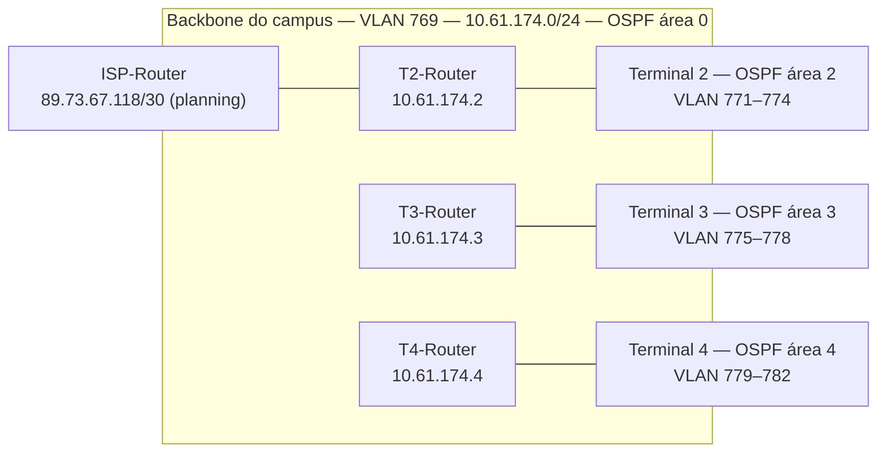

# Índice da documentação — Rede do campus aeroportuário RCOMP 2025/26

> Documentação adicionada em 2026 (portfolio). Isto é um **mapa** dos documentos originais da equipa em [`../doc/`](../doc/); nenhum foi editado. Os factos abaixo foram lidos desses ficheiros; o que não é verificável está marcado `TODO: confirmar com o BMS`. Versão inglesa: [INDEX.md](INDEX.md). Ver também [GLOSSARY](GLOSSARY.pt.md) e [SETUP](SETUP.pt.md).

## 1. Equipa e sprints

Nos documentos originais os membros são identificados só pelo número de aluno (os nomes não constam, exceto 1221514 = Bruno Silva).

| Sprint | Datas | Sprint master | Tema | Membros com entregas |
|---|---|---|---|---|
| 1 | 2026-02-23 → 03-15 | 1221514 | Projeto de cablagem estruturada | 1221514 (T2 + backbone do campus + inventário global), 1240904 (T3), 1240935 (T4), 1241165 (T5) |
| 2 | 2026-03-16 → 04-19 | 1240904 | Simulação Packet Tracer camadas 2/3 | 1221514 (T2 + ISP), 1240904 (T3 + `campus.pkt`), 1240935 (T4) |
| 3 | 2026-04-19 → 05-17 | 1240935 | OSPF, DHCPv4, VoIP, DNS, NAT, ACLs | 1221514, 1240904, 1240935 |

O Terminal 5 só aparece no Sprint 1; os Sprints 2–3 indicam "Terminal 5 — não aplicável (a equipa cobre os Terminais 2, 3 e 4)" ([planning do sprint 2](../doc/sprint2/planning.md)).

## 2. O desenho num relance

Verificado contra os plannings dos Sprints 2 e 3.

| Tema | Decisão (fonte) |
|---|---|
| Bloco de endereços | `10.61.128.0/17`, 14 sub-redes sem sobreposição ([planning sprint 2 §2.5](../doc/sprint2/planning.md)) |
| VLANs | Domínio VTP `rc2526deg2`, IDs 769–782: 2 partilhadas (backbone, DMZ de switches) + 4 por terminal (tomadas, Wi-Fi, VoIP, servidores) |
| Camada 2 | Todas as ligações entre switches são trunk; redundância em anel entre HCs do mesmo nível; STP nunca desativado |
| Encaminhamento | Estático no Sprint 2, substituído por OSPF no Sprint 3; o T2 origina a rota por omissão |
| Serviços (Sprint 3) | DHCPv4 por router, VoIP (Cisco telephony service, dial-peers), DNS (raiz `airport-campus-network` no T2, delegados `terminal-3`/`terminal-4`), NAT estático 80/443, firewall ACL implementada no fim |
| Cablagem (Sprint 1) | T568B, horizontal CAT7 S/FTP, backbones em fibra OM4 com caminhos redundantes, MC no Terminal 2, armários com +100 % de folga ([planning sprint 1 §2](../doc/sprint1/planning.md)) |

## 3. Rastreabilidade: tarefa → decisão → entregável → revisão

"Revisão" é o veredicto da própria equipa no `review.md`.

| Tarefa | Responsável | Decisões | Entregáveis | Revisão |
|---|---|---|---|---|
| T.1.1 T2 + backbone do campus | 1221514 | [planning](../doc/sprint1/planning.md) | [readme](../doc/sprint1/1221514/readme.md), [nivel1](../doc/sprint1/1221514/nivel1.md), [nivel4](../doc/sprint1/1221514/nivel4.md), [airportplan](../doc/sprint1/1221514/airportplan.md), [inventário global](../doc/sprint1/global-inventory.md), [img/](../doc/sprint1/1221514/img/) | Totalmente implementado, sem problemas |
| T.1.2 T3 | 1240904 | idem | [README](../doc/sprint1/1240904/README.md), [img/](../doc/sprint1/1240904/img/) | Totalmente implementado, com 2 problemas (tabela de fibra OM4; justificação dos patch panels do IC) |
| T.1.3 T5 | 1241165 | idem | [README](../doc/sprint1/1241165/README.md), [img/](../doc/sprint1/1241165/img/) | **Parcialmente implementado**, com problemas |
| T.1.4 T4 | 1240935 | idem | [README](../doc/sprint1/1240935/README.md), [medidas.txt](../doc/sprint1/1240935/medidas.txt), [images/](../doc/sprint1/1240935/images/) | Totalmente implementado, sem problemas |
| T.2.1 T2 + ISP | 1221514 | [planning](../doc/sprint2/planning.md) | [README](../doc/sprint2/1221514/README.md), [Terminal2.pkt](../doc/sprint2/1221514/Terminal2.pkt), [configs](../doc/sprint2/1221514/docs-running-config/) | Totalmente implementado, sem problemas |
| T.2.2 T3 + `campus.pkt` | 1240904 | idem | [README](../doc/sprint2/1240904/README.md), [campus.pkt](../doc/sprint2/1240904/campus.pkt), [Terminal3.pkt](../doc/sprint2/1240904/Terminal3.pkt) | Totalmente implementado, sem problemas |
| T.2.4 T4 | 1240935 | idem | [README](../doc/sprint2/1240935/README.md), [Terminal4.pkt](../doc/sprint2/1240935/Terminal4.pkt), [configs](../doc/sprint2/1240935/docs/) | Totalmente implementado, sem problemas |
| T.3.1 T2 | 1221514 | [planning](../doc/sprint3/planning.md) | [README](../doc/sprint3/1221514/README.md), [Terminal2.pkt](../doc/sprint3/1221514/Terminal2.pkt), [configs + registos DNS](../doc/sprint3/1221514/docs-running-config/) | Totalmente implementado, sem problemas |
| T.3.2 T3 + `campus.pkt` | 1240904 | idem | [README](../doc/sprint3/1240904/README.md), [campus.pkt](../doc/sprint3/1240904/campus.pkt), [registos DNS](../doc/sprint3/1240904/T3-DNS-records.png) | Totalmente implementado, sem problemas |
| T.3.4 T4 | 1240935 | idem | [README](../doc/sprint3/1240935/README.md), [Terminal4.pkt](../doc/sprint3/1240935/Terminal4.pkt), [configs + registos DNS](../doc/sprint3/1240935/docs-running-config/) | Totalmente implementado, sem problemas |

Os `review.md` não registam se os problemas do Sprint 1 (T3 e T5) foram fechados nos sprints seguintes. TODO: confirmar com o BMS.

## 4. Achados verificados

| # | Achado | Onde |
|---|---|---|
| 1 | O README da raiz diz "grupo de 3", mas o Sprint 1 tem quatro pastas de membros (1221514, 1240904, 1240935, 1241165) e um projeto do Terminal 5 que nunca foi concluído | [README](../README.pt.md), [review do sprint 1](../doc/sprint1/review.md) |
| 2 | O inventário global é parcial: todas as colunas do T5 dizem "(a calcular pelo T5)", logo os "TOTAL GERAL" são limites inferiores (marcados `~`) | [global-inventory.md](../doc/sprint1/global-inventory.md) |
| 3 | O planning do Sprint 3 dá ao servidor DNS do T2 o IP `10.61.173.129`, que é também o gateway da sub-rede de servidores do T2; o README do T2 implementa `.130` para DNS, `.131` para HTTP e `.129` como gateway. Considerar o README como o estado implementado | [planning §2.5](../doc/sprint3/planning.md), [README do T2](../doc/sprint3/1221514/README.md) |
| 4 | `sprint2/4444444/` só tem o README de exemplo do template da cadeira ("just an example for a team member with number 4444444") | [README](../doc/sprint2/4444444/README.md) |
| 5 | O planning do Sprint 3 pede dumps de configuração tipo `T4-Router.txt`; os ficheiros entregues chamam-se `<dispositivo>_running-config.txt` | [planning §4](../doc/sprint3/planning.md) |
| 6 | `sprint3/1221514/README.md` tem mojibake (`→` em vez de `→`, 11 linhas) | [README do T2](../doc/sprint3/1221514/README.md) |
| 7 | 32 ficheiros running-config contêm hashes `enable secret 5` ou linhas `password`; o `ISP-Router_running-config.txt` tem `password 7` (codificação reversível). São dispositivos de laboratório do Packet Tracer; valores não reproduzidos aqui | [configs](../doc/sprint3/1221514/docs-running-config/) |

## 5. Lista de melhorias (não aplicadas)

| Prioridade | Melhoria | Esforço |
|---|---|---|
| P1 | Corrigir a discrepância `.129`/`.130` no planning, ou acrescentar uma errata de uma linha | 10 min |
| P1 | Corrigir o mojibake no README do T2 do Sprint 3 (regravar em UTF-8 e repor as setas) | 10 min |
| P2 | Registar se os problemas do Sprint 1 em T3/T5 foram fechados | 30 min |
| P2 | Acrescentar `.gitattributes` para EOL de texto e marcar `.pkt` como binário | 5 min |
| P3 | Exportar um PNG da topologia final do `campus.pkt` para o README | 30 min |
| P3 | Remover a pasta de exemplo `sprint2/4444444/` | 2 min |
