# US 011 - Aggregate Justification

## 1. Context

This is the first time this task is assigned. It is part of the project's initial setup and analysis phase (Sprint 1). The goal is to solidify the Domain-Driven Design (DDD) approach by clearly defining and justifying the system's Aggregates. This analysis will guide the development of future user stories by establishing clear boundaries, invariants, and transaction consistency rules within the domain model.

### 1.1 List of issues

*   **Analysis:** Identify potential Aggregates within the domain model based on the provided user stories and domain concepts.
*   **Design:** For one representative scenario per Aggregate, create a sequence diagram and a short explanation that demonstrates how the Aggregate enforces its core invariants.
*   **Implement:** Not applicable for this US.
*   **Test:** Not applicable for this US.

## 2. Requirements

The main objective of this user story is to justify the chosen Aggregate design for the system. This involves identifying the Aggregates and demonstrating, through a scenario, how each Aggregate is responsible for enforcing its own business rules (invariants).

**US011** As Project Manager, I want the team to illustrate one representative scenario per aggregate with a sequence diagram and a short explanation, so that the aggregate's responsibility is demonstrated through an invariant it enforces. This justification will make aggregate design decisions more explicit and easier to review by the project manager.

**Acceptance Criteria:**

- **US011.1:** For each identified Aggregate in the domain model, a representative scenario must be selected.
- **US011.2:** The selected scenario must clearly demonstrate an invariant that the Aggregate is responsible for enforcing.
- **US011.3:** A sequence diagram must be provided for each scenario, illustrating the interaction between the client (e.g., an application service or user interface) and the Aggregate root to enforce the invariant.
- **US011.4:** A short, explanatory text must accompany each diagram, detailing the scenario, the invariant being enforced, and how the Aggregate's design (e.g., having the logic within the root entity) ensures its consistency.

**Dependencies/References:**

*   This task depends on a preliminary analysis of the domain model as outlined in **US010 (Domain Model)**.
*   It references the system specifications detailed in section 3 of the project requirements.
*   It is based on the principles of Domain-Driven Design (DDD) and the concept of Aggregates as a tactical pattern to manage complexity.

## 3. Analysis

To fulfill this requirement, the team analyzed the domain model derived from the user stories and system specifications. The goal was to identify natural boundaries of consistency and lifecycle.

Based on the Domain Model diagram, the system is organized into **11 Aggregates**, each represented by a package with a clear Aggregate Root marked with `<<root>>`:

| Aggregate | Package | Root Entity | Description |
|-----------|---------|-------------|-------------|
| **1** | User Aggregate | `User` | Manages authentication, authorization (roles), security clearance, and skills assessment. Includes specializations like `Collaborator` and `Pilot`. |
| **2** | Organisation Aggregate | `AirTransportCompany` | Manages air transport companies, their collaborators, and pilots. |
| **3** | Maker Aggregate | `Maker` | Manages aircraft and engine manufacturers (name, country). |
| **4** | AircraftModel Aggregate | `AircraftModel` | Manages aircraft model definitions, including physical characteristics and certified engine configurations. |
| **5** | EngineModel Aggregate | `EngineModel` | Manages engine model definitions, including thrust, TSFC, and engine type. |
| **6** | Aircraft Aggregate | `Aircraft` | Manages physical aircraft instances, their cabin configuration, and operational status. References `AircraftModel`. |
| **7** | AirControlArea Aggregate | `AirControlArea` | Manages air control areas with unique area codes, geographic boundaries, and minimum fuel requirements. |
| **8** | Airport Aggregate | `Airport` | Manages airports, their geographic coordinates, altitude, and association with `AirControlArea`. |
| **9** | Flight Aggregate | `FlightPlan` | Manages flight plans and their associated flights, including validation and assignment of pilots and aircraft. |
| **10** | FlightRoute Aggregate | `FlightRoute` | Manages flight routes between airports with unique names and active/inactive status. |
| **11** | Weather Aggregate | `WeatherData` | Manages weather data records for specific air control areas on given dates, sourced from various providers. |

### 3.1 Invariants per Aggregate

For each identified Aggregate, the following key invariants must be enforced:

#### 1. User (`User` Aggregate)
- A user cannot be disabled if they have active or future flight plans assigned.
- A user's security clearance must not be expired for them to access the system.
- Skills assessment must be renewed every 5 years (per regulations).
- Email must be unique and valid across all users.

#### 2. Organisation (`AirTransportCompany` Aggregate)
- A company's IATA code (2 letters) and ICAO code (2-3 letters) must be unique across all companies.
- A collaborator cannot be disabled if they have active responsibilities.
- A pilot cannot be removed from the roster if they have assigned flight plans.

#### 3. Maker (`Maker` Aggregate)
- The combination of maker name and country must be unique.

#### 4. AircraftModel (`AircraftModel` Aggregate)
- The combination of model name and manufacturer must be unique.
- An aircraft model must have at least one certified engine model.
- Engine type must be compatible with the aircraft model.

#### 5. EngineModel (`EngineModel` Aggregate)
- The combination of engine model name and manufacturer must be unique.
- Thrust values must be positive.
- TSFC must be positive.

#### 6. Aircraft (`Aircraft` Aggregate)
- The total number of seats (across all classes) cannot exceed the aircraft model's maximum passenger capacity.
- An aircraft cannot be decommissioned if it has active flight plans assigned.
- The aircraft registration number must be unique worldwide.
- An aircraft must be registered in a country.

#### 7. AirControlArea (`AirControlArea` Aggregate)
- The area code must be unique in the system.
- Geographic boundaries must be valid (north > south, east > west).
- Minimum fuel required must be positive.

#### 8. Airport (`Airport` Aggregate)
- ICAO code (4 letters) must be unique worldwide.
- IATA code (3 letters) must be unique worldwide.
- An airport must be associated with exactly one air control area.
- Coordinates must be valid.

#### 9. Flight (`FlightPlan` Aggregate)
- Flight plan must have a valid flight designator (xxn(n)(n)(n)(a) format).
- Scheduled arrival must be after departure day/time.
- Assigned pilot must belong to the route's company.
- Assigned aircraft must not be decommissioned.
- Passenger count must not exceed aircraft cabin capacity.

#### 10. FlightRoute (`FlightRoute` Aggregate)
- Route name must be unique (2 letters + up to 4 numbers).
- Route origin and destination must be different airports.
- A route cannot be deleted if there are planned flights after the deactivation date.

#### 11. Weather (`WeatherData` Aggregate)
- For a given air control area and date, there must be only one weather data record per source.
- Wind speed, temperature, and pressure must be within physically plausible ranges.

## 4. Design

### 4.1. Realization

The following subsections present one representative scenario per Aggregate, demonstrating how each enforces its core invariants through sequence diagrams and explanatory text.

---

#### 4.1.1. Aggregate 1: User (`User`)

**Scenario:** An Administrator tries to disable a user who is a Pilot and currently has active flight plans assigned. The system must prevent the disabling of the user to maintain operational integrity.

**Invariant Enforced:** `A user cannot be disabled if they have any active or future flight plans assigned.`

**Diagram:**
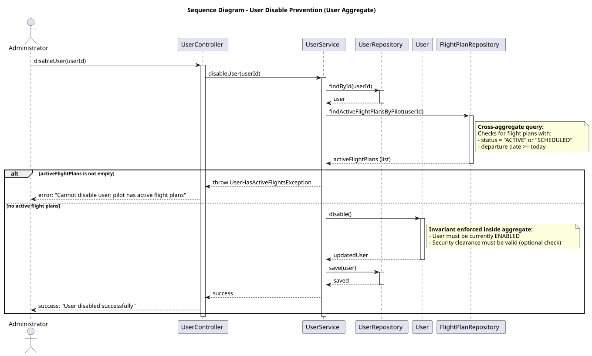

**Explanation:** The `User` Aggregate Root is responsible for managing its own lifecycle. When an `Administrator` requests to disable a user, the `User` aggregate root is loaded via the `UserRepository`. The `disable()` method is called on the root. To enforce the invariant, the `User` aggregate must verify that there are no active flight plans associated with it. Since `FlightPlan` belongs to a different aggregate (Route & Flight), the `User` aggregate uses a `FlightPlanRepository` or a Domain Service to query for active flight plans by pilot ID. If active flight plans exist, the operation is rejected with a domain exception. If none exist, the user's status is updated to `DISABLED` and persisted. This ensures that operational integrity is maintained across aggregate boundaries.

---

#### 4.1.2. Aggregate 2: Organisation (`AirTransportCompany`)

**Scenario:** An Air Transport Company Collaborator tries to remove a Pilot from the company's roster. The system must ensure that the Pilot does not have any assigned flight plans before being removed.

**Invariant Enforced:** `A pilot cannot be removed from the company's roster if they have any active flight plans assigned.`

**Diagram:**
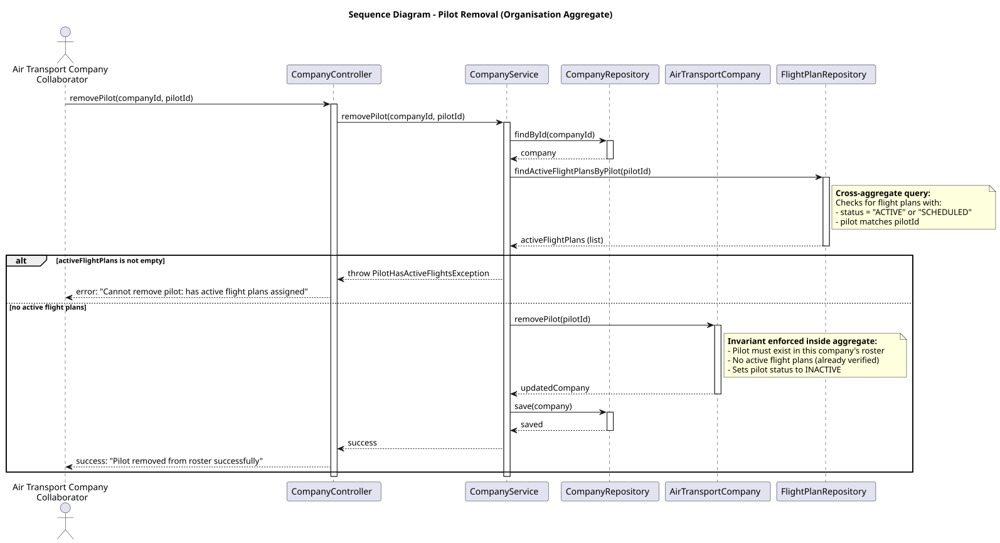

**Explanation:** The `AirTransportCompany` Aggregate Root manages its collection of `Pilot` entities. When a request to remove a pilot is made, the `AirTransportCompany` aggregate is loaded. The `removePilot()` method is called, which must check if the pilot has any active flight plans. Using a `FlightPlanRepository` (or a Domain Service), the aggregate queries for flight plans associated with that pilot. If any exist, the operation is rejected. This prevents the system from entering an inconsistent state where a pilot is no longer in the roster but still has assigned flights.

---

#### 4.1.3. Aggregate 3: Aircraft (`Aircraft`)

**Scenario:** An Air Transport Company Collaborator tries to add a new aircraft to the fleet. The system must ensure that the cabin configuration (number of seats per class) does not exceed the aircraft model's maximum passenger capacity.

**Invariant Enforced:** `The total number of seats (firstClass + businessClass + economyClass) must not exceed the aircraft model's max passenger capacity.`

**Diagram:**
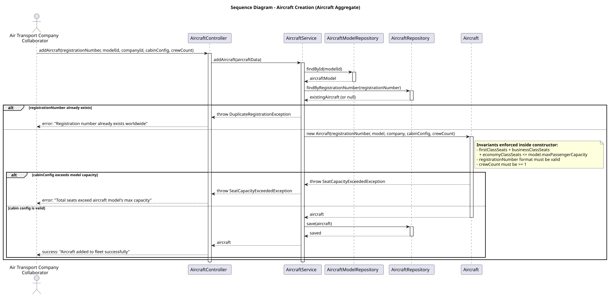

**Explanation:** The `Aircraft` Aggregate Root is responsible for creating and managing physical aircraft instances. When a `Collaborator` requests to add a new aircraft, the `AircraftController` loads the corresponding `AircraftModel` (which may be part of the Fleet aggregate or a separate bounded context) to obtain the maximum passenger capacity. The `Aircraft` aggregate root's constructor or factory method receives the `CabinConfiguration` value object and validates that the total number of seats does not exceed the model's capacity. If the invariant is violated, a domain exception is thrown. If valid, the `Aircraft` is created with a unique registration number and persisted. This ensures that no aircraft is created with an invalid seating configuration.

---

#### 4.1.4. Aggregate 4: Flight (`FlightPlan`)

**Scenario:** A Pilot is creating a new flight for an existing route. The system must
ensure that the flight designator is unique and that the scheduled arrival is after
the departure day/time.

**Invariant Enforced:** `scheduledArrival > departureDay`. This is a core rule for
flight schedule coherence, alongside the uniqueness of the flight designator.

**Diagram:**
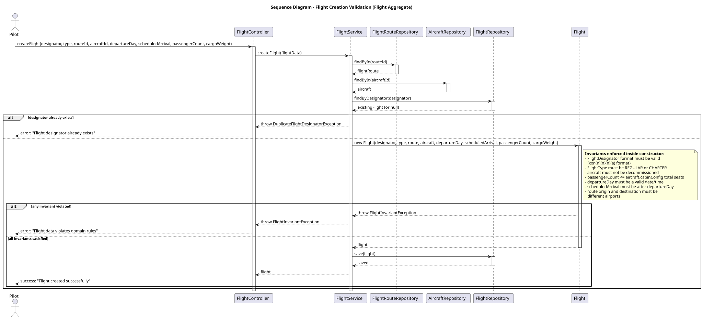

**Explanation:** The `Flight` Aggregate Root is responsible for representing a concrete instance of a `FlightRoute`. When a `Pilot` requests to create a new flight, the `FlightController` delegates to the `FlightService`, which first loads the associated `FlightRoute` via the `FlightRouteRepository` and checks for duplicate designators via the `FlightRepository`. The `Flight` aggregate root's constructor then validates that the `FlightDesignator` follows the correct format(`xxn(n)(n)(n)(a)`), that the `FlightType` is valid, and that `scheduledArrival`is strictly after `departureDay`. If any invariant is violated, a domain exception is thrown. If valid, the `Flight` is persisted. This ensures that no flight is created with an incoherent schedule or a duplicate designator.

---

#### 4.1.5. Aggregate 5: Airport (`Airport`)

**Scenario:** A Backoffice Operator tries to register a new airport. The system must ensure that the ICAO code is unique worldwide and that the airport is associated with a valid air control area.

**Invariant Enforced:** `ICAO code must be unique across all airports in the system.`

**Diagram:**
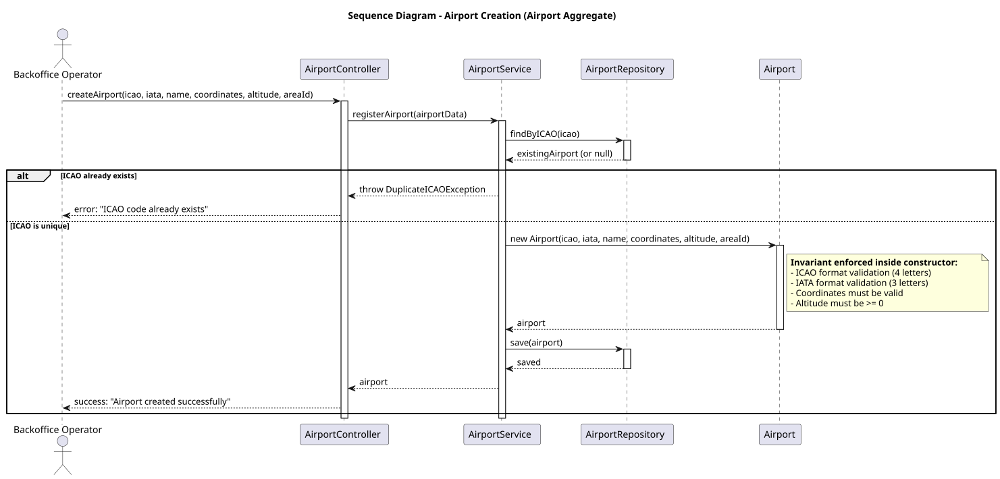

**Explanation:** The `Airport` Aggregate Root is responsible for managing airport definitions. When a `BackofficeOperator` requests to create a new airport, the `AirportController` calls the `AirportRepository` to check if an airport with the same ICAO code already exists. If a duplicate is found, the operation is rejected. If the code is unique, a new `Airport` aggregate is created with its coordinates, altitude, and associated `AirControlArea`. The new airport is then persisted. This ensures the global uniqueness constraint of ICAO codes, which is critical for international flight operations.

---

#### 4.1.6. Aggregate 6: Weather (`WeatherData`)

**Scenario:** A Weather Person tries to register weather data for a specific air control area on a given date. The system must ensure that duplicate data from the same source is not allowed.

**Invariant Enforced:** `For a given air control area, date, and weather source, there must be at most one weather data record.`

**Diagram:**
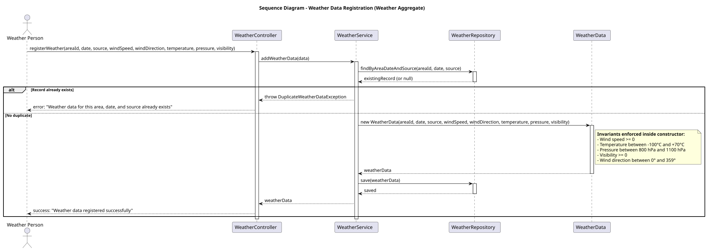

**Explanation:** The `WeatherData` Aggregate Root manages weather records. When a `WeatherPerson` requests to register new weather data, the `WeatherDataController` checks the `WeatherDataRepository` for an existing record with the same `AirControlArea`, `date`, and `WeatherSource`. If a duplicate exists, the operation is rejected (or the existing record is updated, depending on business rules). If no duplicate exists, a new `WeatherData` aggregate is created with wind speed, direction, temperature, pressure, and visibility values. The aggregate validates that all physical values are within plausible ranges before being persisted. This ensures data integrity and prevents conflicting weather information from the same source.

---

#### 4.1.7. Aggregate 7: AircraftModel (`AircraftModel`)

**Scenario:** A Backoffice Operator tries to add a certified engine model to an aircraft model. The system must ensure that the engine type is compatible with the aircraft model and that the same engine is not already certified.

**Invariant Enforced:** `Engine type must be compatible with the aircraft model type, and the same engine model cannot be certified twice for the same aircraft model.`

**Diagram:**
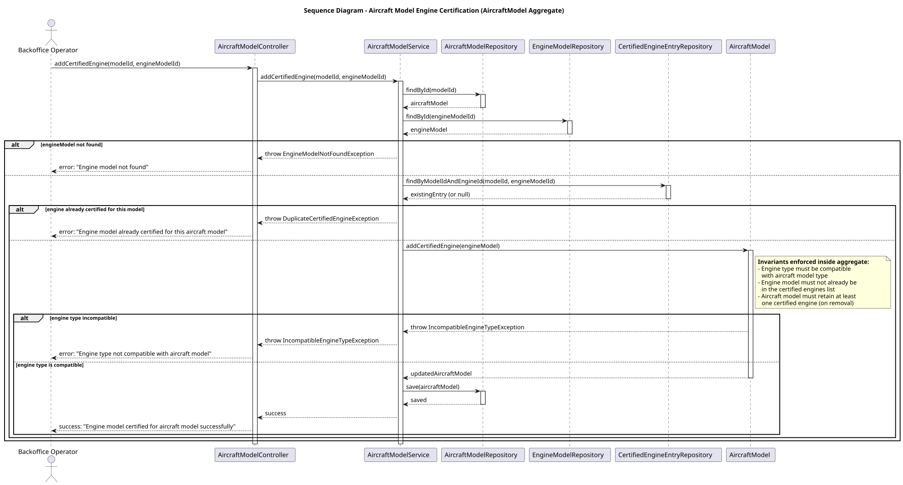

**Explanation:** The `AircraftModel` Aggregate Root manages the list of certified engine configurations. When a `BackofficeOperator` requests to add a certified engine, the `AircraftModelController` loads both the `AircraftModel` and `EngineModel` from their respective repositories. The `AircraftModel` aggregate then validates that the engine type is compatible with the aircraft model and that the engine is not already in the certified list. If either invariant is violated, the operation is rejected. This ensures that only valid engine configurations are associated with each aircraft model.

---

#### 4.1.8. Aggregate 8: FlightRoute (`FlightRoute`)

**Scenario:** An Air Transport Company Collaborator tries to create a new flight route. The system must ensure that the route name is unique and follows the correct format, and that origin and destination are different airports.

**Invariant Enforced:** `Route name must be unique and follow the pattern of 2 letters + up to 4 numbers (e.g., TP123), and origin/destination must be different airports.`

**Diagram:**
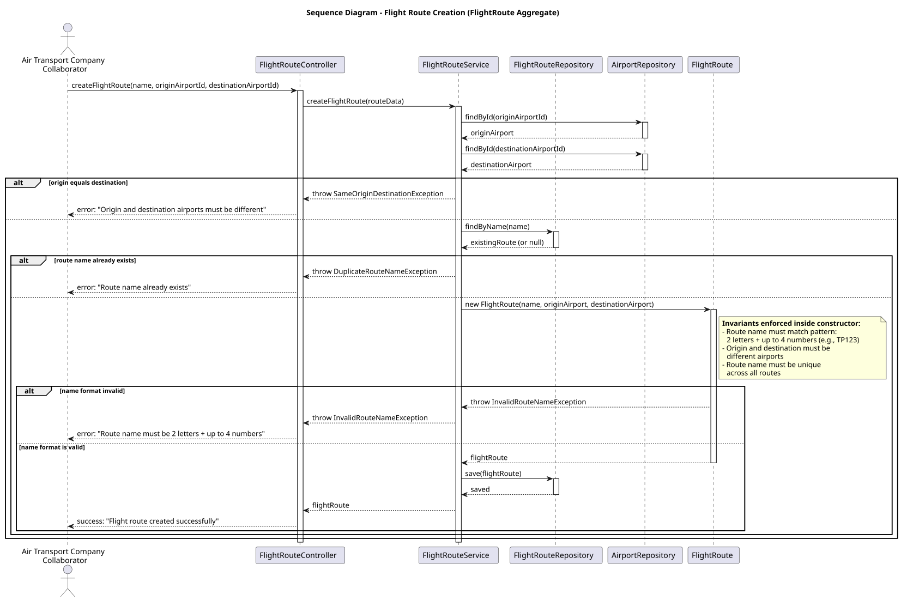

**Explanation:** The `FlightRoute` Aggregate Root manages flight route definitions. When a `Collaborator` requests to create a new route, the `FlightRouteController` validates that the origin and destination airports are different, then checks for duplicate route names via the `FlightRouteRepository`. The `FlightRoute` aggregate constructor validates the name format (2 letters + up to 4 numbers) and ensures uniqueness. If any invariant is violated, a domain exception is thrown. This ensures that all routes have unique, properly formatted names and valid airport pairs.

---

#### 4.1.9. Aggregate 9: AirControlArea (`AirControlArea`)

**Scenario:** A Backoffice Operator tries to register a new air control area. The system must ensure that the area code is unique and that the geographic boundaries are valid.

**Invariant Enforced:** `Area code must be unique, and geographic boundaries must be valid (north > south, east > west).`

**Diagram:**
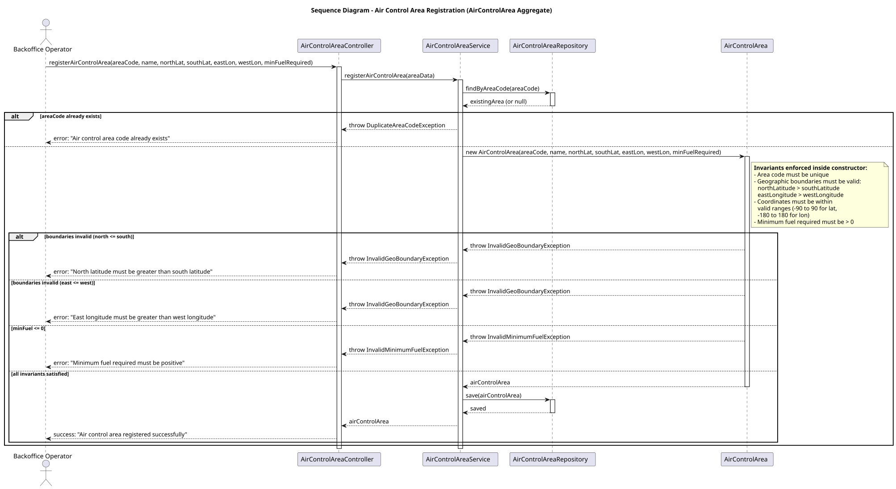

**Explanation:** The `AirControlArea` Aggregate Root manages air control area definitions. When a `BackofficeOperator` requests to register a new area, the `AirControlAreaController` checks the `AirControlAreaRepository` for duplicate area codes. The `AirControlArea` aggregate then validates that the geographic boundaries are logically valid (north latitude > south latitude, east longitude > west longitude) and that the minimum fuel required is positive. If any invariant is violated, the operation is rejected. This ensures that all air control areas have unique codes and valid geographic definitions.

---

#### 4.1.10. US042: Weather Bulk Import (`WeatherData`)

**Scenario:** A Weather Person imports several weather records from a CSV file. The system must parse each external record, resolve the corresponding air control area, create valid weather value objects, and persist only the records that respect the weather aggregate invariants.

**Invariant Enforced:** `WeatherData must always belong to an existing AirControlArea and must contain a valid TimePeriod and physically valid meteorological values.`

**Diagram:**
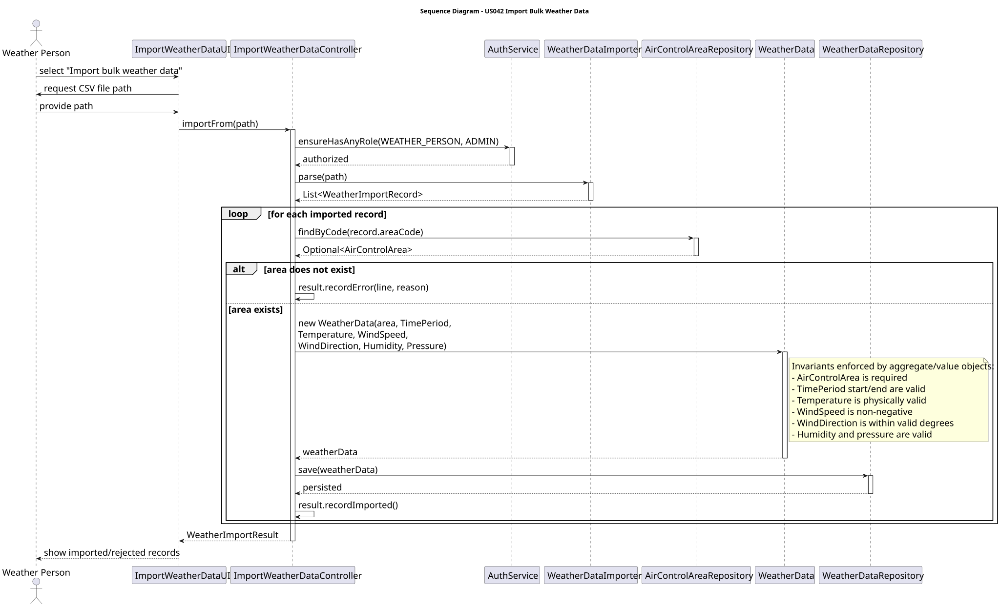

**Explanation:** The `ImportWeatherDataController` coordinates the import without placing parsing logic inside the aggregate. Each parsed record is converted into a `WeatherData` aggregate using `TimePeriod`, `Temperature`, `WindSpeed`, `WindDirection`, `Humidity`, and `Pressure` value objects. Invalid records are rejected individually and reported in the import result, preserving the consistency of persisted weather data.

---

#### 4.1.11. US043: Weather Consultation (`WeatherData`)

**Scenario:** A Weather Person, Pilot, or Flight Control Operator consults weather data for a specific air control area and date.

**Invariant Enforced:** `Weather consultation must be scoped to an existing AirControlArea and to a concrete day interval.`

**Diagram:**
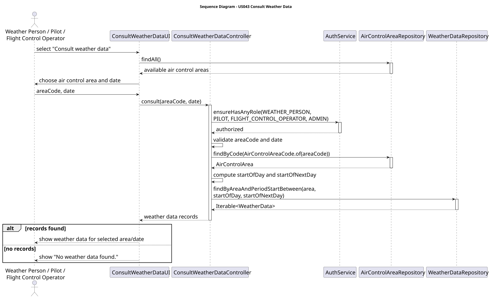

**Explanation:** The `ConsultWeatherDataController` validates the user's role, resolves the selected `AirControlArea`, converts the selected date into a start/end day interval, and asks the `WeatherDataRepository` for records whose period starts within that interval. This keeps consultation consistent with the domain model introduced for weather data.

---

#### 4.1.12. US074: Flight Route Deactivation (`FlightRoute`)

**Scenario:** An Air Transport Company Collaborator deactivates a route from a given date onwards. The system must reject the operation if the route belongs to another company or if planned flights exist from that date onwards.

**Invariant Enforced:** `A FlightRoute cannot be deactivated from a date if planned flight plans already exist on or after that date. Once deactivated, it is unavailable on the deactivation date and later dates.`

**Diagram:**
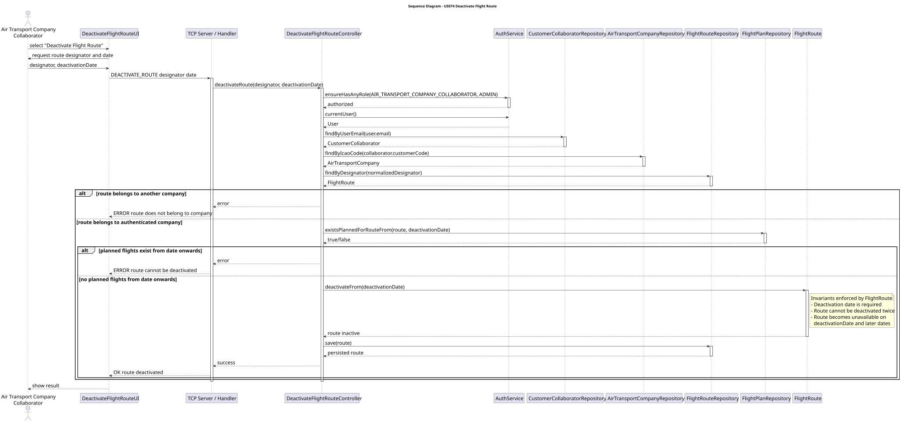

**Explanation:** The `DeactivateFlightRouteController` first establishes the authenticated collaborator's company, then loads the route and checks ownership. Before calling `FlightRoute.deactivateFrom(date)`, it queries `FlightPlanRepository.existsPlannedForRouteFrom(route, date)` to enforce the cross-aggregate rule. The `FlightRoute` aggregate then enforces its own lifecycle invariant by rejecting duplicate deactivation and storing the `deactivatedFrom` date.

---

#### 4.1.13. US082: Insert Weather Data in Flight Plan (`FlightPlan`)

**Scenario:** A Pilot adds an existing weather data record to one of their own flight plans. If the flight plan was previously validated or approved, the validation becomes void.

**Invariant Enforced:** `Only the owner Pilot can add weather data to their flight plan, weather data cannot be duplicated, and adding weather data reverts VALIDATED/APPROVED plans to DRAFT.`

**Diagram:**
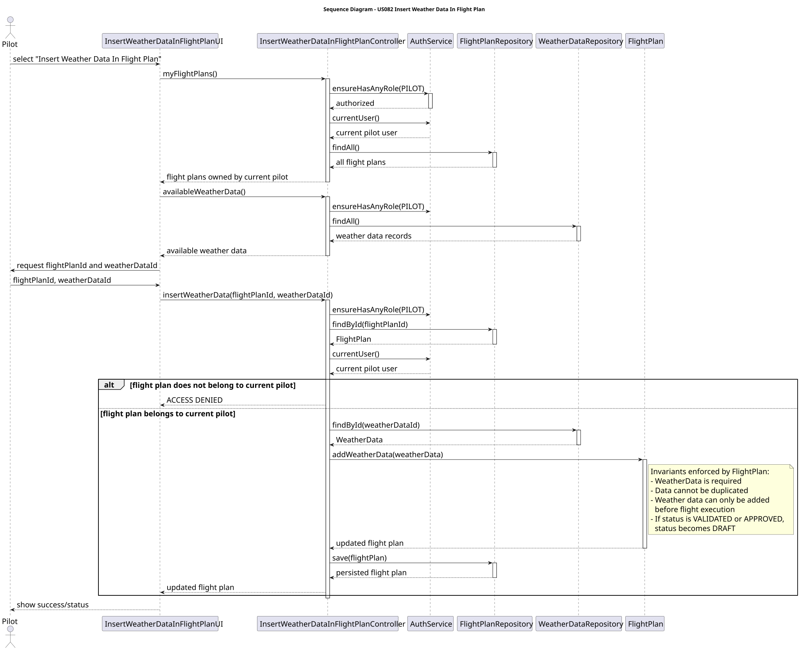

**Explanation:** The `InsertWeatherDataInFlightPlanController` filters the operation by the authenticated pilot and loads both aggregates: `FlightPlan` and `WeatherData`. Ownership is checked at application level because it depends on the authenticated user. The `FlightPlan` aggregate enforces the local invariant through `addWeatherData(weatherData)`: duplicate weather records are rejected, weather cannot be added after flight execution, and a previously validated or approved plan is reverted to `DRAFT`.

### 4.2. Acceptance Tests

*The tests for this user story are primarily focused on the design documentation. The acceptance is based on the presence and quality of the diagrams and explanations.*

**Test 1:** *Verifies that a sequence diagram exists for each identified aggregate and that it clearly shows the interaction to enforce an invariant.*

**Refers to Acceptance Criteria:** US011.1, US011.2, US011.3

**Test 2:** *Verifies that each diagram is accompanied by a short explanation that details the scenario and the invariant being enforced.*

**Refers to Acceptance Criteria:** US011.4

## 5. Implementation

This user story is not about implementing code, but about producing design documentation. The "implementation" of this US consists of creating the markdown document and the corresponding PlantUML diagrams.

*   **Documentation:** The `docs/readme.md` file has been updated to include this user story documentation.
*   **Diagrams:** The following PlantUML source files will be created and placed in the `docs/diagrams` folder:
    *   `sequence-user-disable.puml` (User Aggregate)
    *   `sequence-pilot-removal.puml` (Organisation Aggregate)
    *   `sequence-aircraft-creation.puml` (Aircraft Aggregate)
    *   `sequence-flight-creation.puml` (Flight Aggregate)
    *   `sequence-airport-creation.puml` (Airport Aggregate)
    *   `sequence-weather-registration.puml` (Weather Aggregate)
    *   `sequence-us042-import-bulk-weather-data.puml` (US042 Weather Bulk Import)
    *   `sequence-us043-consult-weather-data.puml` (US043 Weather Consultation)
    *   `sequence-aircraft-model-engine-certification.puml` (AircraftModel Aggregate)
    *   `sequence-flight-route-creation.puml` (FlightRoute Aggregate)
    *   `sequence-us074-deactivate-flight-route.puml` (US074 FlightRoute Deactivation)
    *   `sequence-us082-insert-weather-data-in-flight-plan.puml` (US082 FlightPlan Weather Association)
    *   `sequence-air-control-area-registration.puml` (AirControlArea Aggregate)

## 6. Integration/Demonstration

The result of this user story is documentation that will be used as a blueprint for the implementation of the system. The diagrams and justifications will be referenced by developers when implementing the application and domain layers for other user stories, ensuring that the DDD principles and aggregate boundaries are correctly adhered to throughout the project. The documents are available in the repository for review.

## 7. Observations

The eleven aggregates identified represent a clean separation of concerns based on the domain model. Nine scenarios are covered by sequence diagrams, representing the most critical invariants:

| Aggregate | Complexity | Key Characteristic |
|-----------|------------|---------------------|
| **User** | Medium | Manages user lifecycle and cross-aggregate consistency (with FlightPlan) |
| **Organisation** | Medium | Manages company structure and personnel |
| **Maker** | Low | Simple reference data for manufacturers |
| **AircraftModel** | Medium | Manages model definitions with certified engine configurations |
| **EngineModel** | Low | Manages engine definitions with thrust and efficiency data |
| **Aircraft** | Medium | Manages physical assets with configuration constraints |
| **AirControlArea** | Low | Manages airspace boundaries with geographic constraints |
| **Airport** | Low | Simple reference data with global uniqueness constraints |
| **Flight** | High | Complex validation with cross-aggregate dependencies |
| **FlightRoute** | Low | Manages route definitions with uniqueness constraints |
| **Weather** | Low | Time-series data with source deduplication |

Future iterations may refine these aggregates as new user stories are developed. The principle remains to always ensure transactional consistency within the aggregate boundaries and eventual consistency between aggregates.
