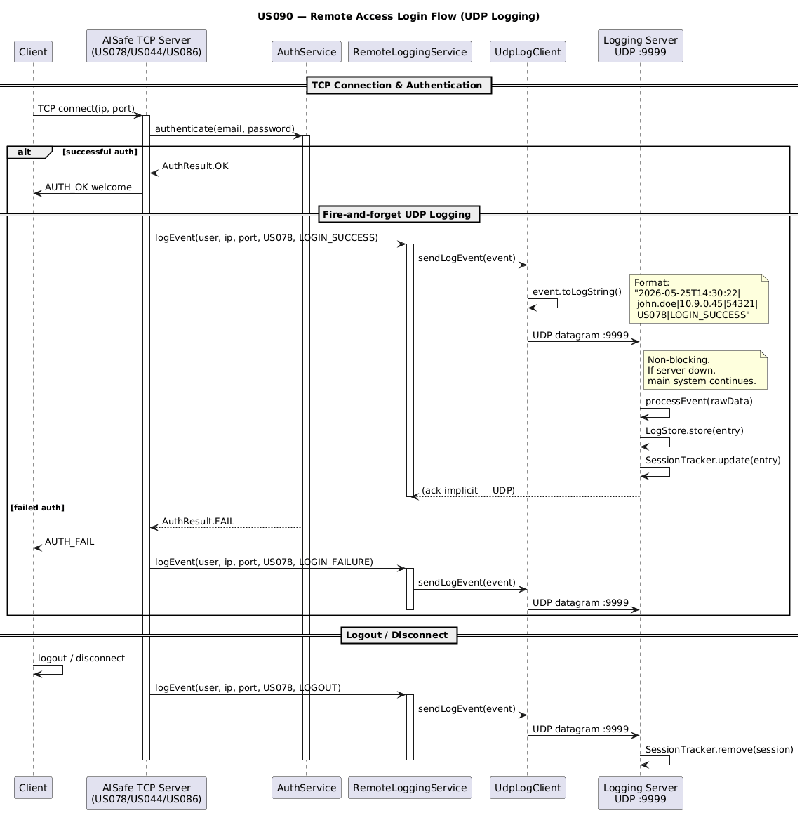

# US090 - External Logging of Remote Accesses

> **🌐 Accessing from home?** Use the **ISEP VPN** (SoftEther/SSTP/OpenVPN → `deinet.dei.isep.ipp.pt:443`) to access the Cloud VS securely. See [`CLOUD_VPN_ACCESS.md`](../global-artifacts/CLOUD_VPN_ACCESS.md) for setup. **Do NOT enable External SSH on the VS.**
>
> **📋 Cloud testing & deployment:** See [`CLOUD_TESTING.md`](../global-artifacts/CLOUD_TESTING.md) for the complete cloud workflow including SSH key setup, deployment scripts, and test scenarios.

## 1. Context

This user story belongs to Sprint 3 and is mandatory for RCOMP. It implements centralized external logging of all remote access events (login, logout, disconnect) from US044, US078, and US086, transmitted via UDP to a dedicated Logging Server on a Cloud VS.

This US is closely related to US091 (visualization) and depends on the remote access TCP servers built in Sprint 2 for US044 (Weather Person), US078 (Air Transport Company Collaborator), and US086 (Pilot).

**Implementation complete.** All 4 phases implemented and compiling.

### 1.1 List of Issues

Analysis: Requirement Summary, Architecture Overview, Cloud Infrastructure

Design: Domain Model & UDP Client, TCP Integration, Logging Server, HTTP Visualization

Implementation: File Summary, Implementation Order, Deployment Scripts

Test: Testing Strategy

Cloud/Network: Log Format, Network Config, Security

---

## 2. Requirements

This user story requires building an external logging infrastructure that captures all remote access events (login, logout, disconnect) from the three remote access services (US044, US078, US086) and transmits them to a dedicated Remote Accesses Logging Server via UDP datagrams.

**US090** As Administrator, I want to have logs for every remote access to the system.

**Acceptance Criteria:**

- US090.1 Remote access events must be transmitted to a remote application, the Remote Accesses Logging Server, using UDP datagrams.

- US090.2 Both successful logins and failed logins should be registered; logouts and disconnects must also be logged.

- US090.3 Logged data must include a timestamp, the username, the client IP address, the client port number, and the service (US044, US078, or US086).

- US090.4 The Remote Accesses Logging Server application should run at a dedicated network node in a cloud.

**Dependencies/References:**

- **US044** (Weather Person remote access) - TCP server whose events must be logged
- **US078** (AT Collaborator remote access) - TCP server whose events must be logged
- **US086** (Pilot remote access) - TCP server whose events must be logged
- **US091** (Remote accesses logging visualization) - HTTP visualization of the logs stored by US090

The Remote Accesses Logging Server is a standalone Java application hosted on a DEI Cloud Virtual Server (Alpine Linux v3.23, Template #127). It consists of:
- A **UDP receiver** (port 9999) that listens for log events from the AISafe system
- A **log store** that persists events to /var/log/aisafe/remote_accesses.log
- An **active session tracker** that maintains in-memory state of current sessions

---

## 3. Analysis

The design follows a fire-and-forget UDP pattern from the AISafe system to the Logging Server. UDP is chosen because log events are non-critical (loss of a single log entry is acceptable) and the lightweight, connectionless nature of UDP avoids coupling the AISafe system to the Logging Server availability.

### 3.1 Architecture

```
+------------------------+  UDP :9999  +-------------------------------+
|  AISafe System         |----------->    |  Remote Accesses Logging      |
|  UdpLogClient          |              |  Server (Cloud VS)            |
|  (fire-and-forget)     |              |  UDP Receiver + HTTP Server   |
+------------------------+              +-------------------------------+ 
```

### 3.2 Communication Flow

1. Client connects to AISafe via TCP (US044/US078/US086)
2. AISafe authenticates the client
3. On login success/failure, AISafe sends UDP datagram to Logging Server
4. Logging Server receives and stores the event
5. On logout/disconnect, AISafe sends another UDP datagram
6. Logging Server updates active sessions
7. Administrator views logs via HTTP browser (auto-refreshed via AJAX) - US091



> **Sequence source:** [`sequence-diagram.puml`](sequence-diagram.puml)

### 3.3 Log Message Format

Events use a pipe-delimited format for simplicity and compactness (suitable for UDP datagrams):

```
TIMESTAMP|USERNAME|CLIENT_IP|CLIENT_PORT|SERVICE|EVENT_TYPE
```

Example:
```
2026-05-25T14:30:22.123|john.doe|10.9.0.45|54321|US044|LOGIN_SUCCESS
```

### 3.4 Event Types

| Event | Description |
|---|---|
| LOGIN_SUCCESS | Client successfully authenticates |
| LOGIN_FAILURE | Client authentication fails |
| LOGOUT | Client explicitly logs out |
| DISCONNECT | Client connection drops/closes |

Service types identify which remote access service triggered the event: US044 (Weather Person), US078 (AT Collaborator), US086 (Pilot).


---

## 4. Design

The solution is implemented in 4 phases: (1) Domain model and UDP client in aisafe.core, (2) Integration into existing TCP servers, (3) Standalone Logging Server application, (4) HTTP visualization server (US091).

### 4.1 Realization

The solution involves two main codebases:

**aisafe.core domain layer** (new files):
- RemoteAccessLogEvent - Value Object representing a log event with timestamp, username, IP, port, service type, and event type
- ServiceType - Enum for US044/US078/US086
- EventType - Enum for LOGIN_SUCCESS/LOGIN_FAILURE/LOGOUT/DISCONNECT

**aisafe.core infrastructure/application layer** (new files):
- UdpLogClient - Fire-and-forget UDP sender (non-blocking)
- RemoteLoggingService - Service facade that creates events and sends via UDP

**aisafe-logging-server** (standalone Maven project on Cloud VS):
- RemoteAccessesLoggingServer - Main entry point, starts UDP receiver and HTTP server
- UdpLogReceiver - Background thread listening for UDP datagrams on port 9999
- LogStore - Thread-safe file storage with in-memory cache of recent entries
- ActiveSessionTracker - ConcurrentHashMap tracking current active sessions
- HttpLogServer - HTTP server with AJAX endpoints (US091)
- LogEntry / ActiveSession - Model classes served via HTTP

**TCP server modifications:**
- US044, US078, US086 connection handlers inject RemoteLoggingService and call it at hook points (login success/failure, logout, disconnect)

### 4.2 Domain Model Diagram

```
+----------------------+       +------------------+
|  RemoteAccessLogEvent |       |   ServiceType    |
|  (ValueObject)        |       |   (Enum)         |
+----------------------+       +------------------+
| - timestamp           |       | US044             |
| - username            |       | US078             |
| - clientIpAddress     |       | US086             |
| - clientPort          |       +------------------+
| - serviceType         |
| - eventType           |       +------------------+
+----------------------+       |   EventType      |
| + toLogString()       |       |   (Enum)         |
| + fromLogString()     |       +------------------+
+----------------------+       | LOGIN_SUCCESS    |
                                | LOGIN_FAILURE    |
+----------------------+       | LOGOUT           |
|  RemoteLoggingService|       | DISCONNECT       |
|  (Application)       |       +------------------+
+----------------------+
| - udpLogClient       |
+----------------------+
| + logEvent(...)      |
| + close()            |
+----------+-----------+
            | uses
            v
+----------------------+
|  UdpLogClient        |
|  (Infrastructure)    |
+----------------------+
| - serverHost         |
| - serverPort         |
| - socket             |
+----------------------+
| + sendLogEvent(...)  |
| + close()            |
+----------------------+
```

### 4.3 Logging Server Architecture Diagram

```
+-----------------------------------------------------------------+
|  RemoteAccessesLoggingServer (Main Entry Point)                 |
+-----------------------------------------------------------------+
|                                                                 |
|  +---------------------+    +------------------------------+   |
|  | LogStore            |    | ActiveSessionTracker         |   |
|  +---------------------+    +------------------------------+   |
|  | + store(entry)      |    | + update(logEntry)           |   |
|  | + getRecent(n)      |    | + getActiveSessions()        |   |
|  +---------+-----------+    +------------------------------+   |
|            |          ^                                         |
|  +---------v-----------+    +------------------------------+   |
|  | UdpLogReceiver      |    | HttpLogServer                |   |
|  | (Runnable/Daemon)   |    | (HttpServer, port 8080)      |   |
|  +---------------------+    +------------------------------+   |
|  | UDP port 9999       |    | /  -> Event logs page        |   |
|  | -> logStore.store() |    | /active -> Sessions page     |   |
|  | -> sessionTracker   |    | /api/logs -> JSON (AJAX)     |   |
|  |   .update()         |    | /api/active -> JSON (AJAX)   |   |
|  +---------------------+    +------------------------------+   |
|                                                                 |
+-----------------------------------------------------------------+
           ^                                |
           | UDP datagram                   | HTTP
           |                                v
+------------------+              +------------------+
| AISafe System    |              | Browser          |
| UdpLogClient     |              | (Administrator)  |
+------------------+              +------------------+
```

### 4.4 Acceptance Tests

**Test 1:** *Verifies that login success events are transmitted via UDP and stored on the Logging Server*

**Refers to Acceptance Criteria:** US090.1, US090.2, US090.3

```
Start UDP receiver on port 9999
Send: "2026-05-25T14:30:22|testuser|127.0.0.1|54321|US044|LOGIN_SUCCESS"
Verify: Log entry appears in log file
Verify: Active session is tracked
```

**Test 2:** *Verifies that failed login events are logged*

**Refers to Acceptance Criteria:** US090.2, US090.3

```
Send: "2026-05-25T14:35:10|baduser|127.0.0.1|54322|US078|LOGIN_FAILURE"
Verify: Log entry stored with event type LOGIN_FAILURE
```

**Test 3:** *Verifies logout events are logged and session is removed*

**Refers to Acceptance Criteria:** US090.2, US090.3

```
Send LOGIN_SUCCESS event -> verify session is active
Send: "...|testuser|...|LOGOUT"
Verify: Session removed from active sessions
Verify: LOGOUT event in log file
```

**Test 4:** *Verifies disconnect events are logged*

**Refers to Acceptance Criteria:** US090.2, US090.3

```

**Test 5:** *Verifies the RemoteAccessLogEvent Value Object validation*

**Refers to Acceptance Criteria:** US090.3

```java
@Test(expected = IllegalArgumentException.class)
public void ensureTimestampCannotBeNull() {
    new RemoteAccessLogEvent(null, "user", "127.0.0.1", 54321, ServiceType.US044, EventType.LOGIN_SUCCESS);
}

@Test(expected = IllegalArgumentException.class)
public void ensureUsernameCannotBeEmpty() {
    new RemoteAccessLogEvent(LocalDateTime.now(), "", "127.0.0.1", 54321, ServiceType.US044, EventType.LOGIN_SUCCESS);
}

@Test(expected = IllegalArgumentException.class)
public void ensurePortMustBeValid() {
    new RemoteAccessLogEvent(LocalDateTime.now(), "user", "127.0.0.1", 0, ServiceType.US044, EventType.LOGIN_SUCCESS);
}
```

**Test 6:** *Verifies serialization/deserialization roundtrip*


### 5.2 Key Design Decisions

- **UDP over TCP for logging:** Fire-and-forget pattern ensures logging never blocks the main system
- **Pipe-delimited format:** Simple, compact, fits within UDP datagram size limit (1024 bytes)
- **In-memory cache:** CopyOnWriteArrayList for thread-safe reads without blocking writes
- **ConcurrentHashMap for sessions:** Thread-safe active session tracking
- **File persistence:** Events appended to /var/log/aisafe/remote_accesses.log
- **Dedicated Cloud VS:** Isolates logging infrastructure from the main system

### 5.3 Cloud Infrastructure

| Parameter | Value |
|---|---|
| Template | #127 - Alpine Linux v3.23 |
| Container Type | 11 - INCUS |
| Cost | 5 credits |
| Network | VNET1 (10.9.0.0/16) |

### 5.4 Network Security

- Only UDP port 9999 and TCP port 8080 are open
- Logging Server runs on isolated VNET1 network
- No passwords are logged (only usernames and connection metadata)
- SSH key-based authentication to the Cloud VS

### 5.5 File Summary

**New files in aisafe.core module:**

| # | File Path | Purpose |
|---|---|---|
| 1 | eapli/aisafe/remotelogging/domain/RemoteAccessLogEvent.java | Log event Value Object |
| 2 | eapli/aisafe/remotelogging/domain/ServiceType.java | Service enum |
| 3 | eapli/aisafe/remotelogging/domain/EventType.java | Event type enum |
| 4 | eapli/aisafe/remotelogging/infrastructure/UdpLogClient.java | UDP sender client |
| 5 | eapli/aisafe/remotelogging/application/RemoteLoggingService.java | Service facade |

**New files for standalone aisafe-logging-server:**

| # | File Path | Purpose |
|---|---|---|
| 6 | eapli/aisafe/logging/RemoteAccessesLoggingServer.java | Main entry point |
| 7 | eapli/aisafe/logging/UdpLogReceiver.java | UDP receiver thread |
| 8 | eapli/aisafe/logging/HttpLogServer.java | HTTP server with AJAX |
| 9 | eapli/aisafe/logging/LogStore.java | File-based log storage |
| 10 | eapli/aisafe/logging/ActiveSessionTracker.java | Session tracking |
| 11 | eapli/aisafe/logging/model/LogEntry.java | Log entry model |
| 12 | eapli/aisafe/logging/model/ActiveSession.java | Active session model |

**Files to modify:**

| # | File | Service | Purpose |
|---|---|---|---|
| 1 | US044 TCP handler | Weather Person | Add UDP logging hooks |
| 2 | US078 TCP handler | AT Collaborator | Add UDP logging hooks |
| 3 | US086 TCP handler | Pilot | Add UDP logging hooks |

| SSH | `ssh root@vs{ID}.dei.isep.ipp.pt` (port 22, via VPN) |
| UDP Port | 9999 |
| HTTP Port | 8080 |
| Log File | /var/log/aisafe/remote_accesses.log |

**Refers to Acceptance Criteria:** US090.3


---

## 6. Integration/Demonstration

Integration requires coordination between the AISafe system, the Cloud VS Logging Server, and the administrator's browser.

### 6.1 Deployment Steps

1. **Provision Cloud VS** from template #127 on DEI Cloud Web Interface
2. **Connect via VPN** (SoftEther/SSTP/OpenVPN → `deinet.dei.isep.ipp.pt:443`)
3. **SSH into VS** and install Java 21:
   `ssh root@vs{ID}.dei.isep.ipp.pt` (port 22, via VPN)
   `apk update && apk add openjdk21`
   `mkdir -p /var/log/aisafe /opt/aisafe-logging-server`
4. **Build and deploy** the Logging Server JAR:
   `cd aisafe-logging-server`
   `mvn clean package`
   `scp target/aisafe-logging-server-1.0.0.jar root@vs{ID}:/opt/aisafe-logging-server/`
5. **Start** the server on the VS:
   `cd /opt/aisafe-logging-server && nohup java -jar aisafe-logging-server-1.0.0.jar &`
5. **Configure AISafe system** with Cloud VS IP and port 9999
6. **Inject RemoteLoggingService** into US044, US078, US086 TCP handlers
7. **Open firewall ports** (UDP 9999, TCP 8080) via DEI Cloud Web Interface

### 6.2 Demonstration Steps

For Sprint 3 review, demonstrate:

1. Start the Logging Server on the Cloud VS
2. Connect to AISafe via US044/US078/US086 TCP client
3. Perform login, logout, and disconnect operations
4. Show real-time log events on the HTTP status page (http://<VS-IP>:8080)
5. Show active sessions page (http://<VS-IP>:8080/active)
6. Verify auto-refresh via AJAX (no page reload needed)
7. Show persisted log entries in /var/log/aisafe/remote_accesses.log

### 6.3 Verification Commands

---

## 7. Observations

Additional considerations and references for US090.

### 7.1 Alternative Approaches Considered

- **TCP instead of UDP:** Rejected because logging should never block the main system. If the Logging Server is down, the AISafe system must continue operating. UDP fire-and-forget semantics are ideal.
- **Direct database logging:** Rejected to avoid coupling the Logging Server to the AISafe database schema. File-based storage provides simpler isolation.
- **Third-party logging frameworks (Log4j, SLF4J):** Rejected to keep the implementation transparent and within RCOMP scope. Custom implementation demonstrates understanding of UDP socket programming.

### 7.2 Future Enhancements

- **Log rotation:** Implement daily/weekly log file rotation to prevent disk space exhaustion
- **Log authentication:** Add HMAC or shared-secret authentication to prevent UDP spoofing
- **Database persistence:** Store logs in a database for richer querying capabilities
- **Alerting:** Real-time alerts for suspicious activity (e.g., multiple failed logins)
- **TLS-secured HTTP:** Add HTTPS for the visualization server when deployed outside VNET1

### 7.3 References

- RFC 768 - UDP Protocol specification
- UDP max datagram size: 65,507 bytes (IPv4), limited to 1024 bytes in this implementation
- java.net.DatagramSocket / java.net.DatagramPacket - JDK UDP API
- com.sun.net.httpserver.HttpServer - JDK built-in HTTP server (no external dependencies)


```bash
# Check server is running
ss -ulnp | grep 9999

# Tail log entries
tail -f /var/log/aisafe/remote_accesses.log

# Test UDP reception manually
echo "2026-05-25T14:30:22|test|10.9.0.1|54321|US044|LOGIN_SUCCESS" | nc -u <VS-IP> 9999

# Test HTTP endpoints
curl http://<VS-IP>:8080/api/logs
curl http://<VS-IP>:8080/api/active
```

```java
@Test
public void ensureLogStringRoundtrip() {
    RemoteAccessLogEvent original = new RemoteAccessLogEvent(
        LocalDateTime.of(2026, 5, 25, 14, 30, 22),
        "john.doe", "10.9.0.45", 54321,
        ServiceType.US044, EventType.LOGIN_SUCCESS);
    String logString = original.toLogString();
    RemoteAccessLogEvent parsed = RemoteAccessLogEvent.fromLogString(logString);
    assertEquals(original, parsed);
}
```

---

## 5. Implementation

The implementation follows a 4-phase approach. Phase 1 and 2 are integrated into aisafe.core, while Phase 3 and 4 are a standalone Maven project deployed to a DEI Cloud Virtual Server.

### 5.1 Implementation Phases

| Phase | Description | Deliverable |
|---|---|---|
| Phase 1 | Domain model + UDP client in aisafe.core | RemoteAccessLogEvent, UdpLogClient, RemoteLoggingService |
| Phase 2 | Integration into US044/US078/US086 TCP handlers | Modified TCP handlers with logging hooks |
| Phase 3 | Remote Accesses Logging Server (standalone Java app) | UdpLogReceiver, LogStore, ActiveSessionTracker |
| Phase 4 | HTTP visualization server (US091) | HttpLogServer with AJAX endpoints |

```
Send LOGIN_SUCCESS event
Send: "...|testuser|...|DISCONNECT"
Verify: DISCONNECT event in log file
Verify: Session removed from active sessions
```

