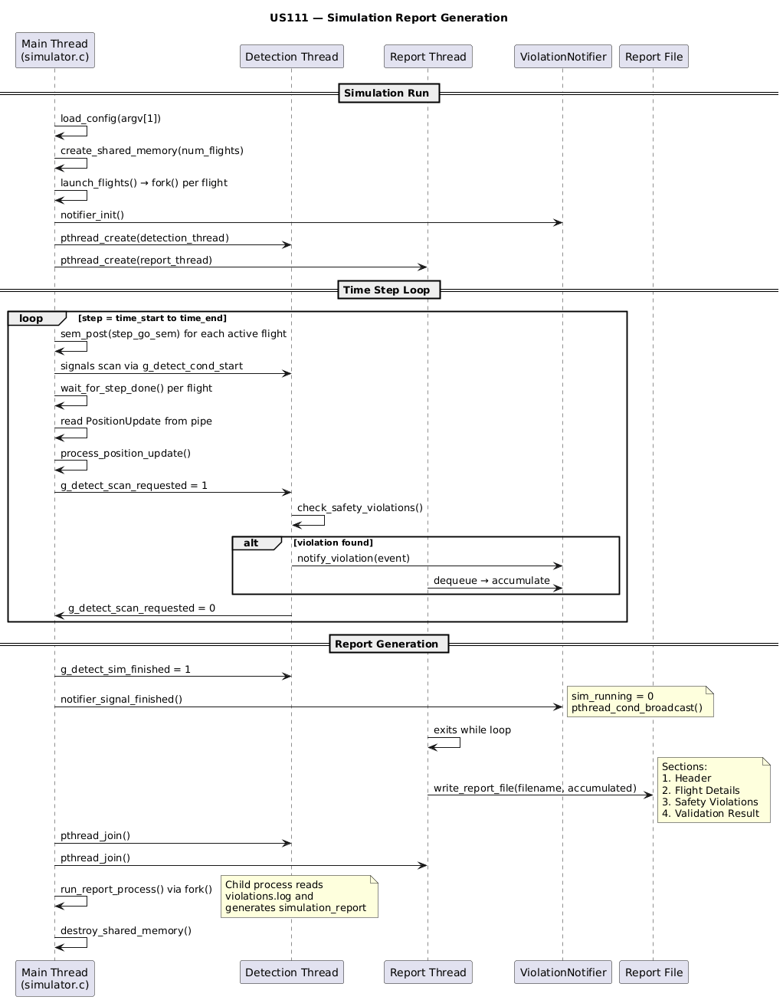

# US111 - Generate a Simulation Report

## 1. Context

Sprint 3 requirement for SCOMP and EAPLI. The Flight Control Operator needs a summary of simulation results to determine if programmed flights are safe. The report file includes total flights, execution status, safety violations with timestamps and positions, and a pass/fail validation result.

US111 extends US109 (fork-based in Sprint 2) to work with US107 thread-based notifications.

### 1.1 List of Issues

**Analysis:** Report content, data aggregation from shared memory and violation queue.
**Design:** Report format, thread-safe collection, file output.
**Implement:** Report generation integrated with US107 condition variables.
**Test:** Report completeness, violation details, pass/fail determination.

---

## 2. Requirements

**US111** As a Flight Control Operator, I want a summary of simulation results to determine if flights are safe.

### Acceptance Criteria

- **US111.1:** System generates a report and stores it in a file.
- **US111.2:** Report includes total flights and execution statuses.
- **US111.3:** Safety violations list timestamps, positions, and velocity vectors (vx,vy,vz).
- **US111.4:** Report indicates pass or fail validation.

### Dependencies

- **US107** (Condition variable notifications)
- **US105** (Shared memory)
- **US109** (Sprint 2 report format reference)
- **US101** (Position tracking)

---

## 3. Analysis

### 3.1 Understanding

US111 produces a human-readable report file after simulation. The report is generated by the report generation thread (US106/US107), receiving violation events in real time via condition variables. When `sim_running` becomes 0, the thread writes the final accumulated report.

### 3.2 Key Decisions

| Decision | Rationale |
|---|---|
| Report thread generates output | Receives real-time data via US107 |
| Plain text format | Human-readable, easy to inspect |
| Timestamped filename | Avoids overwriting previous reports |
| PASS = 0 violations | Clear validation result |

### 3.3 Report Content

1. Header - timestamp, area, time range, threshold, flight count
2. Per-flight status - ID, status, steps, violations, final position
3. Safety violations - timestamp, flight pairs, distance, velocity vectors (vx,vy,vz), positions
4. Validation result - PASS or FAIL

---

## Sequence Diagram



> **Sequence source:** [`sequence-diagram.puml`](sequence-diagram.puml)

---

## 4. Design

### 4.1 Report Generation Flow

```
Simulation completes -> sim_running = 0 -> pthread_cond_broadcast()
    -> Report thread wakes -> writes header + per-flight + violations + result -> closes file
```

### 4.2 Report Format (PASS)

```
========================================
  SIMULATION REPORT (US111 - Thread)
========================================
Generated  : 2026-06-13 01:00:00
Area       : OPO_MAD
Time range : 0 -- 3600 s (step 60 s, 60 steps total)
Threshold  : 50 km
Flights    : 2
----------------------------------------

FLIGHT DETAILS
Flight ID         Status        History steps   Violations  Final position
---------         ------        -------------   ----------  --------------
AA123             COMPLETED     46              0           lat=40.4895 lon=-3.5643 alt=610
AA124             COMPLETED     46              0           lat=40.9895 lon=-3.0643 alt=610

----------------------------------------
SAFETY VIOLATIONS: 0 total

----------------------------------------
VALIDATION RESULT: PASS
========================================
```

### 4.3 Report Format (FAIL)

```
========================================
  SIMULATION REPORT (US111 - Thread)
========================================
Generated  : 2026-06-13 01:05:00
Area       : OPO_MAD
Time range : 0 -- 3600 s (step 60 s, 60 steps total)
Threshold  : 100 km
Flights    : 2
----------------------------------------

FLIGHT DETAILS
Flight ID         Status        History steps   Violations  Final position
---------         ------        -------------   ----------  --------------
AA123             TERMINATED    3               3           lat=41.4398 lon=-8.5232 alt=2272
AA124             TERMINATED    3               3           lat=41.9398 lon=-8.0232 alt=2272

----------------------------------------
SAFETY VIOLATIONS: 3 total

Time step   Flight 1 idx      Flight 2 idx      Distance    Velocity 1 (vx,vy,vz)     Velocity 2 (vx,vy,vz)
---------   ------------      ------------      --------    ----------------------    ----------------------
0           0                 1                 69.43       (0.7,0.7,9180.0)    (0.7,0.7,9180.0)
60          0                 1                 69.41       (0.7,0.7,9180.0)    (0.7,0.7,9180.0)
120         0                 1                 69.39       (0.7,0.7,9180.0)    (0.7,0.7,9180.0)

----------------------------------------
VALIDATION RESULT: FAIL
Reason: 2 flight(s) terminated due to safety violations.
========================================
```

### 4.4 Validation Logic

```c
if (total_violations == 0) result = "PASS";
else result = "FAIL";
```

### 4.5 Integration with US107

Report thread receives `ViolationEvent` structs via condition variable. Each event contains time step, flight indices, distance, and positions. Accumulated in a buffer and written after simulation ends.

---

## 5. Demonstration

```bash
cd scomp && make clean && make

# Normal - PASS
./air_sim config/opo_mad.cfg
cat simulation_report_*.txt

# Violations - FAIL
./air_sim config/collisions.cfg
cat simulation_report_*.txt
```

---

## 6. Tests

| Test | Expected Result |
|---|---|
| Report file created | `simulation_report_*.txt` exists |
| Header correct | Area, time range, threshold, flights |
| Per-flight status | Correct status and position |
| No violations -> PASS | 0 violations = PASS |
| With violations -> FAIL | Violations = FAIL with details |
| Violation details | Timestamps, IDs, distances, velocity vectors correct |

---


## 7. Observations

- US107 provides real-time violation events; US105 provides position data
- Report thread writes after `sim_running = 0` for data consistency
- Future: JSON/HTML formats, report archiving

---

## 8. Implementation (2026-06-07)

### Approach
The report is generated by a dedicated POSIX thread (`report_thread_main`) that receives `ViolationEvent` structs in real time via condition variable from US107. Events are accumulated in a dynamically-growing array. When `sim_running` becomes 0 (via `notifier_signal_finished()`), the thread writes the complete report file.

### Report Format
- **Header:** timestamp, area, time range, threshold, flight count
- **Flight Details:** ID, status (COMPLETED/TERMINATED), history steps, violations, final position
- **Safety Violations:** time step, flight indices, distance, velocity vectors (vx,vy,vz), positions (lat,lon,alt) for both
- **Validation Result:** PASS (0 violations) or FAIL (with reason)

### Files Changed
| File | Change |
|------|--------|
| `report_thread.h` | New — `ReportThreadArgs` + `report_thread_main()` declaration |
| `report_thread.c` | New — cond var wait, accumulation, file writing |
| `simulation.h` | Added `ViolationEvent`, `ViolationNotifier` types |
| `simulation.c` | Report thread creation/join, notifier init/destroy in `main()` |
| `Makefile` | Added `report_thread.o` build rule |

### Verification
```
$ make clean && make
BUILD SUCCESS

$ ./air_sim config/quick_test.cfg
[US111] Report saved to simulation_report_*.txt
VALIDATION RESULT: PASS

$ ./air_sim config/quick_collisions.cfg
VALIDATION RESULT: FAIL
Reason: 2 flight(s) terminated due to safety violations.
```

### Acceptance Criteria
| ID | Criteria | Status |
|----|----------|--------|
| US111.1 | Report file created | ✅ (`simulation_report_us111_YYYYMMDD_HHMMSS.txt`) |
| US111.2 | Flights + statuses | ✅ (FLIGHT DETAILS table) |
| US111.3 | Violations with timestamps + positions | ✅ (SAFETY VIOLATIONS table) |
| US111.4 | Pass/fail validation | ✅ (`VALIDATION RESULT: PASS/FAIL`) |

---

## 9. Fixes (2026-06-13)

### Issues Fixed
1. **CRLF line endings** — `report_thread.c` used `\r\n` (Windows), causing corrupted output on Linux. Replaced all with `\n`.
2. **Missing `total_steps`** — Report header did not show total simulation steps. Added calculation: `(time_end - time_start) / time_step_secs`.
3. **Report filename collision** — US111 and US109 both wrote to `simulation_report_*.txt`, causing one to overwrite the other. US111 now uses `simulation_report_us111_*.txt`.
4. **Queue overflow** — `VIOLATION_QUEUE_SIZE` was 512, silently dropping violations in large simulations. Increased to 2048.

### Files Changed
| File | Change |
|------|--------|
| `report_thread.c` | `\r\n` → `\n`, added `total_steps`, renamed to `us111_` prefix, added velocity vectors (vx,vy,vz) to violation table |
| `simulation.h` | `VIOLATION_QUEUE_SIZE` 512 → 2048 |
| `scomp/.gitattributes` | New — force LF on `*.c` and `*.h` to prevent CRLF regression |

### Verification (WSL 2)
```
$ gcc -Wall -Wextra -std=c11 -D_GNU_SOURCE -o simulator \
    simulation.c flight_process.c report.c report_thread.c -lpthread -lm
BUILD OK

$ ./simulator config/opo_mad.cfg
[US111] Report saved to simulation_report_us111_20260613_010850.txt
VALIDATION RESULT: PASS

$ ./simulator config/collisions.cfg
[US111] Report saved to simulation_report_us111_20260613_011053.txt
VALIDATION RESULT: FAIL
Reason: 2 flight(s) terminated due to safety violations.
```
