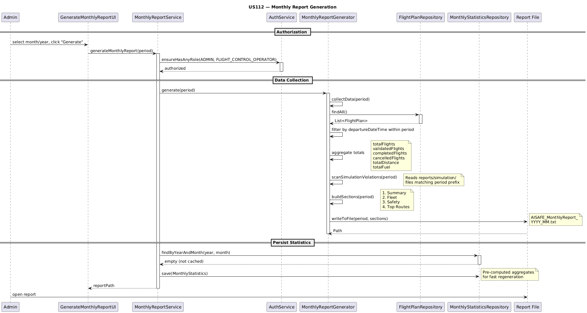

# US112 - Monthly Report Generation

## 1. Context

Sprint 3 requirement for EAPLI. The Flight Control Operator needs monthly statistics reports aggregated from flight plan data. This is foundational for future report types (compliance, incident, etc.) — each with specific data collection, sections, and graphics, but all following consistent branding.

Builds upon US080 (Flight Plan CRUD), US085 (Validation), and US109/111 (Simulation Reports for violation data).

### 1.1 List of Issues

**Analysis:** Report structure, data sources, aggregation metrics, output format.

**Design:** Abstract template method, data collection by month, text output.

**Implement:** MonthlyReportGenerator, MonthlyReportService, console UI.

**Test:** Report accuracy, aggregation, edge cases (empty months, all statuses, fleet diversity).

---

## 2. Requirements

**US112** As a Flight Control Operator, I want to generate a monthly statistics report, foundational for all future report types.

### Acceptance Criteria

- **US112.1:** Generates monthly report from aggregated data.
- **US112.2:** Consistent structure extensible by other report types.
- **US112.3:** Includes aggregated monthly data (flights, violations, aircraft).
- **US112.4:** Works for any past month with data.

### Dependencies

- **US080** (Flight Plan CRUD), **US085** (Validation)
- **US109/US111** (Simulation reports — violation data source)
- **US030** (Auth), **NFR02** (Documentation)
- **US070-US072** (Fleet data), **US075** (Pilot)

---

## 3. Analysis

### 3.1 Understanding

US112 establishes a report generation framework aggregating flight plan data by month. The abstract `ReportGenerator` base enables extensibility for future report types. Data is collected from the `FlightPlanRepository` (H2 database) and simulation report files (violation counts).

---

## Sequence Diagram



> **Sequence source:** [`sequence-diagram.puml`](sequence-diagram.puml)

---

### 3.2 Key Decisions

| Decision | Rationale |
|---|---|
| Abstract ReportGenerator base | Shared header/footer, file output, template method |
| Text output with consistent branding | Readable anywhere, no external libraries |
| Auth-restricted | ADMIN / FLIGHT_CONTROL_OPERATOR only |
| ReportPeriod VO | Encapsulates year/month with date range calculation |
| Violation scan from files | Re-scan simulation files per report generation |

### 3.3 Report Structure

```
========================================
  AISAFE - MONTHLY REPORT
  Period: January 2026 | Generated: 2026-06-12 22:35
========================================

1. SUMMARY: 3 flights | 2 validated | 0 completed | 0 cancelled | 100,0% pass rate
----------------------------------------
2. FLEET: 2 active aircraft types | Most used: A320-200 (Airbus) (2) | Total distance: 0,0 km
----------------------------------------
3. SAFETY: 0,0 km avg distance | 15000,0 kg avg fuel | 0 cancellations | 0 violations
----------------------------------------
4. TOP ROUTES: LIS-OPO(2) OPO-FAO(1)
----------------------------------------

========================================
  END OF REPORT - AISAFE Flight Control
========================================
```

### 3.4 Data Sources

| Source | Data | Access |
|---|---|---|
| FlightPlanRepository | Flights by month, status, aircraft, routes | JPA (H2) |
| Simulation report files | Violation counts | File system (`reports/simulation/`) |
| AircraftModel | Model name, manufacturer | Via FlightPlan.aircraftModel |

### 3.5 Consistent Branding

All report types share unified branding defined in the abstract `ReportGenerator`:

- **Header:** 40 `=` border, `AISAFE - MONTHLY REPORT`, period, generation timestamp
- **Sections:** numbered (1-4), separated by 40 `-` characters
- **Footer:** `END OF REPORT - AISAFE Flight Control` with `=` border
- **File naming:** `AISAFE_MonthlyReport_YYYY_MM.txt`
- **Output directory:** `reports/monthly/`

---

## 4. Design

### 4.1 Class Hierarchy

```
ReportGenerator (abstract)
+-- MonthlyReportGenerator
|   +-- collectData(period)
|   +-- buildSections(period)
|   +-- buildSummarySection()
|   +-- buildFleetSection()
|   +-- buildSafetySection()
|   +-- buildRoutesSection()
|   +-- scanSimulationViolations(period)
+-- ComplianceReportGenerator (future)
+-- IncidentReportGenerator (future)
```

### 4.2 Key Classes

**aisafe.core:**
- `ReportGenerator` — abstract base, template method `generate()`
- `MonthlyReportGenerator` — concrete implementation, data collection + section building
- `MonthlyReportService` — auth + orchestration + persistence
- `ReportPeriod` — value object (year, month, date range)
- `ReportType` — enum (MONTHLY, COMPLIANCE, INCIDENT)
- `MonthlyStatistics` — JPA entity for aggregated cache

**aisafe.backoffice.console:**
- `GenerateMonthlyReportUI` — console UI for report generation
- `ReportsMenuUI` — reports submenu

### 4.3 Authorization

```java
auth.ensureHasAnyRole(Role.ADMIN, Role.FLIGHT_CONTROL_OPERATOR);
```

### 4.4 Data Flow

```
GenerateMonthlyReportUI
  -> MonthlyReportService.generate(period)
    -> auth.ensureHasAnyRole(...)
    -> MonthlyReportGenerator.generate(period)
      -> collectData(period)
        -> flightPlanRepository.findAll()  [filter by date range]
        -> scanSimulationViolations(period)  [read sim files]
      -> buildSections(period)
        -> buildSummarySection()
        -> buildFleetSection()
        -> buildSafetySection()
        -> buildRoutesSection()
      -> writeToFile(sections)
```

---

## 5. Demonstration

```bash
cd aisafe-flight-control
mvn -pl aisafe.app.backoffice.console exec:java -Dexec.mainClass="eapli.aisafe.app.backoffice.console.AISafeBackoffice" -Dexec.classpathScope=runtime
```

```
Login: fco@control.com / Fco12345
Main Menu > 2 (Reports) > 1 (Generate Monthly Report)
Month: 1 | Year: 2026
-> AISAFE_MonthlyReport_2026_01.txt generated in reports/monthly/
```

---

## 6. Tests

### 6.1 Unit Tests (18 tests, 0 failures)

| Test Class | Tests | Coverage |
|---|---|---|
| `ReportPeriodTest` | 9 | Construction, validation, date ranges, equals/hashCode |
| `MonthlyReportGeneratorTest` | 6 | Empty repo, flights, out-of-period, branding, sim violations |
| `MonthlyReportServiceTest` | 3 | Auth, orchestration, persistence |

### 6.2 Manual Validation — Monthly Reports

12 reports generated (one per month, 2026). All validated:

| Month | Flights | Validated | Fleet Types | Pass Rate | Edge Case |
|---|---|---|---|---|---|
| January | 3 | 2 | 2 | 100% | Mixed statuses + 2 aircrafts |
| February | 3 | 2 | 2 | 100% | Approved included |
| March | 4 | 3 | 2 | 100% | 3 routes |
| April | 4 | 2 | 2 | 100% | All 4 reachable statuses |
| May | 3 | 3 | 2 | 100% | 100% validated |
| June | 1 | 1 | 1 | 100% | Single flight |
| July | 0 | 0 | 0 | 0% | Empty month |
| August | 3 | 3 | 3 | 100% | 3 aircraft types |
| September | 0 | 0 | 0 | 0% | Empty month |
| October | 0 | 0 | 0 | 0% | Empty month |
| November | 0 | 0 | 0 | 0% | Empty month |
| December | 0 | 0 | 0 | 0% | Empty month |

### 6.3 Edge Cases Tested

| Edge Case | Expected | Result |
|---|---|---|
| Empty month | 0 flights, N/A, No routes | ✅ |
| All approved | 100% validated | ✅ |
| FAILED status | NOT counted as validated | ✅ |
| Single flight | 1 type, 1 route | ✅ |
| 3 aircraft types | FLEET shows 3 | ✅ |
| Multiple empty months | All show zero values | ✅ |

---

## 7. Observations

### 7.1 Foundation for Future Reports

Template pattern via abstract `ReportGenerator` provides consistent branding, file output, and auth checks. Future types: `ComplianceReportGenerator`, `IncidentReportGenerator`.

### 7.2 Current Limitations

- Text-only output, no graphics
- Monthly granularity only
- `REPORT_DIR` and `SIM_DIR` hardcoded (should be configurable)
- `violationCount` not persisted — re-scanned from files each time
- COMPLETED/CANCELLED/ACTIVE statuses not reachable via bootstrap (domain lacks public transition methods)
- `MonthlyReportGeneratorTest` uses JUnit 4 (rest uses JUnit 5)

### 7.3 Future Extensions

- HTML/PDF output with charts
- Automated scheduled generation
- Email distribution
- Daily/weekly granularity
- Dashboard visualization
- Simulation Summary section (US113 — SCOMP integration)

---
