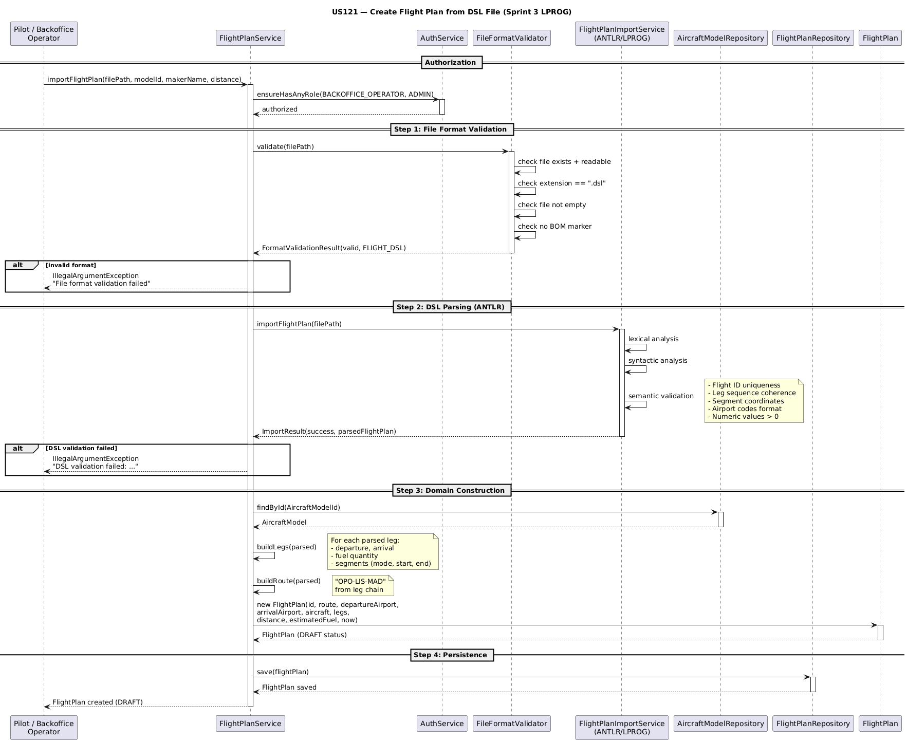

# US121 - Create a Flight Plan from a File (Sprint 3)

## 1. Context

This user story belongs to the Integrative Project (Semester 4) and is part of Sprint 3.

US121 extends the flight plan import pipeline by adding a **file format validation layer** that runs as a first gate before ANTLR parsing. It ensures that only well-formed `.dsl` files reach the DSL processor, providing clear and distinct error messages for format-level issues (unrecognized extensions, empty files, BOM markers) versus syntax/semantic errors from the ANTLR pipeline.

The implementation follows a layered validation architecture:

---

## Sequence Diagram



> **Sequence source:** [`sequence-diagram.puml`](sequence-diagram.puml)

```
UI Layer (ImportFlightPlanUI)
        │
        ▼
Application Layer (FlightPlanService)
        │ FileFormatValidator (gate 1)
        ▼
DSL Processor via ANTLR (gate 2 — lexical, syntactic, semantic)
        │
        ▼
Domain Layer (FlightPlan entity)
```

### 1.1 List of Issues

- **Analysis:** Identify format validation requirements and define error messages per validation layer.
- **Design:** Create `FileFormatType` enum, `FormatValidationResult` VO, and `FileFormatValidator` domain class. Integrate as first gate in `FlightPlanService`. Mark legacy `ImportFlightPlanController` as `@Deprecated`.
- **Implement:** File format validation layer (extension, existence, readability, size, BOM). Wire into service layer.
- **Test:** Unit tests for `FileFormatValidator`. Verify UI lists only `.dsl` files. Regression tests for the full project.

## 2. Requirements

**US121** As a Pilot, I want to create a valid flight plan from a file. There may be multiple file formats, and I want to validate the file format before using it, so that only well-formed flight plan files are imported into the system.

### Acceptance Criteria

- **US121.1** The system must validate the file format before attempting DSL processing (extension, existence, size, BOM).
- **US121.2** Invalid formats must produce clear error messages before reaching the ANTLR parser.
- **US121.3** The import UI must only list `.dsl` files from the examples directory.
- **US121.4** Legacy `ImportFlightPlanController` must be marked as `@Deprecated` in favor of the new `FlightPlanService`.
- **US121.5** Files with BOM (Byte Order Mark) must be rejected with a descriptive error message.

### Error Layers

| Layer | Source | Example |
|-------|--------|---------|
| **Format** | `FileFormatValidator` | "Unrecognized file extension '.txt'. Expected '.dsl'." |
| **Format** | `FileFormatValidator` | "File has a BOM (Byte Order Mark) which may cause parsing issues." |
| **Format** | `FileFormatValidator` | "File is empty: /path/to/file.dsl" |
| **Syntax** | ANTLR Parser | "[SYNTACTIC] line 34:4 — missing ';' at '}'" |
| **Semantic** | Semantic Rules | "[SEMANTIC] line 7:10 — mismatched input 'express'..." |

### Dependencies / References

- **US120** — Flight DSL Specification and Validation. US121 depends on US120 for full ANTLR pipeline. US121 adds the format validation gate *before* the ANTLR pipeline.
- **US083** — Sprint 2 DSL Foundation. The grammar, lexer, parser, and domain model are unchanged.
- **NFR08** — EAPLI Framework. The project uses EAPLI base classes and patterns.

---

## 3. Analysis

### 3.1 Understanding

The project already had a partial import flow via `ImportFlightPlanController` (legacy) and `FlightPlanService` (new). The DSL pipeline from US083/US120 handled lexical, syntactic, and semantic validation. What was missing was a **pre-parsing gate** that rejects files with fundamental format issues before invoking the ANTLR processor.

The following format issues were identified:

| Issue | Previous Behavior | New Behavior |
|-------|-------------------|--------------|
| Wrong extension (.txt) | ANTLR parse error (confusing) | `FileFormatValidator` rejects before ANTLR |
| Empty file | ANTLR parse error | `FileFormatValidator` rejects with clear message |
| Non-existent file | ANTLR IOException | `FileFormatValidator` rejects with path info |
| File with BOM | Silent parse corruption | `FileFormatValidator` rejects with BOM warning |
| UI file listing | Already filtered `.dsl` | No change needed |

### 3.2 Key Decisions

| Decision | Rationale |
|----------|-----------|
| Separate `FileFormatValidator` class | Single Responsibility Principle — format validation is orthogonal to DSL parsing. |
| `FormatValidationResult` as Value Object | Immutable result object following DDD patterns; carries validity, type, and error list. |
| `FileFormatType` enum | Extensible — future formats (e.g., `.json`, `.xml`) can be added without modifying validator logic. |
| Gate pattern in `FlightPlanService` | Format validation runs first; ANTLR processing only happens if format is valid. Clear error separation. |
| `@Deprecated` on legacy controller | Signals to developers that `FlightPlanService` is the correct import path. No breaking change. |
| BOM detection via binary header read | Reading the first 3 bytes (EF BB BF) is the most reliable way to detect UTF-8 BOM. |

---

## 4. Design

### 4.1 Import Pipeline — Full Flow

```
Backoffice Operator selects "Import Flight Plan from DSL"
        │
        ▼
ImportFlightPlanUI.listDslFiles()
        │ filters: isRegularFile AND endsWith(".dsl")
        ▼
Operator selects a .dsl file from the list
        │
        ▼
FlightPlanService.importFlightPlan(filePath, modelId, makerName, distance)
        │
        ├──► FileFormatValidator.validate(filePath)     ◄── GATE 1: Format
        │       ├── null check           → IllegalArgumentException
        │       ├── exists check         → INVALID + "File does not exist"
        │       ├── readable check       → INVALID + "File is not readable"
        │       ├── extension check      → UNKNOWN + "Unrecognized extension"
        │       ├── size check           → INVALID + "File is empty"
        │       ├── BOM check            → INVALID + "File has a BOM..."
        │       └── all pass             → FLIGHT_DSL + valid
        │
        ├──► FlightPlanImportService.importFlightPlan(filePath)  ◄── GATE 2: DSL
        │       ├── Lexical analysis     → DSLErrorListener
        │       ├── Syntactic analysis   → DSLErrorListener
        │       ├── Semantic analysis    → SemanticRule chain
        │       └── Return: ImportResult (success/errors)
        │
        ├──► Build domain objects (FlightPlan, FlightLeg, FlightSegment)
        │
        └──► flightPlanRepository.save(flightPlan)
```

### 4.2 File Format Validation Gate

```
FileFormatValidator.validate(Path)
        │
        ├── null?           → IllegalArgumentException
        ├── not exists?     → FormatValidationResult(false, INVALID, ["File does not exist: ..."])
        ├── not readable?   → FormatValidationResult(false, INVALID, ["File is not readable: ..."])
        ├── wrong ext?      → FormatValidationResult(false, UNKNOWN, ["Unrecognized extension..."])
        ├── empty?          → FormatValidationResult(false, INVALID, ["File is empty: ..."])
        ├── has BOM?        → FormatValidationResult(false, INVALID, ["File has a BOM..."])
        └── all pass        → FormatValidationResult(true, FLIGHT_DSL, [])
```

### 4.3 Architecture — DDD Layers

| Layer | Package | Classes |
|-------|---------|---------|
| **Domain** | `flightplanmanagement.domain` | `FileFormatType`, `FormatValidationResult`, `FileFormatValidator` |
| **Application** | `flightplanmanagement.application` | `FlightPlanService` (gate integration), `ImportFlightPlanController` (@Deprecated) |
| **Presentation** | `backoffice.console.presentation.flightplanmanagement` | `ImportFlightPlanUI` |
| **Infrastructure** | `lprog` (ANTLR) | `FlightDSLListener`, `FlightDSLVisitor`, `SemanticValidator` |

### 4.4 Error Flow

Format validation and DSL validation are independent gates. Each gate collects all its own errors:

```
Gate 1 (Format):     FormatValidationResult.errors  → displayed directly
Gate 2 (DSL):        ImportResult.errors             → displayed as "DSL validation failed"
```

A failure in Gate 1 prevents Gate 2 from running — no point parsing a file with the wrong extension.

### 4.5 BOM Detection

```java
private boolean hasBom(final Path filePath) throws IOException {
    final byte[] header = Files.readAllBytes(filePath);
    return header.length >= 3
            && (header[0] & 0xFF) == 0xEF
            && (header[1] & 0xFF) == 0xBB
            && (header[2] & 0xFF) == 0xBF;
}
```

Reads the first 3 bytes and checks for the UTF-8 BOM signature `EF BB BF`. The `& 0xFF` mask ensures correct unsigned comparison since Java bytes are signed.

---

## 5. Implementation

### 5.1 File Structure

```
aisafe-flight-control/
│
├── aisafe.core/src/main/java/eapli/aisafe/flightplanmanagement/
│   │
│   ├── domain/
│   │   ├── FileFormatType.java                   [NEW] enum: FLIGHT_DSL, UNKNOWN, INVALID
│   │   ├── FormatValidationResult.java            [NEW] VO: valid, formatType, errors
│   │   ├── FileFormatValidator.java               [NEW] validate(Path) with BOM detection
│   │   ├── FlightPlan.java                        (unchanged)
│   │   └── FlightPlanId.java                      (unchanged)
│   │
│   ├── application/
│   │   ├── FlightPlanService.java                 [MODIFIED] format validation gate as 1st step
│   │   └── ImportFlightPlanController.java        [MODIFIED] @Deprecated + Javadoc
│   │
│   └── repositories/
│       └── FlightPlanRepository.java              (unchanged)
│
├── aisafe.core/src/test/java/eapli/aisafe/flightplanmanagement/
│   │
│   ├── domain/
│   │   ├── FileFormatValidatorTest.java           [NEW→EXPANDED] 11 test cases (JUnit 5)
│   │   ├── FlightPlanTest.java                    [EXPANDED] +6 lifecycle tests
│   │   ├── FlightPlanIdTest.java                  (unchanged)
│   │   └── FlightPlanWeatherDataTest.java         (unchanged)
│   │
│   └── application/
│       ├── FlightPlanServiceTest.java             [NEW] 11 test cases
│       ├── ImportFlightPlanControllerTest.java    [MIGRATED] JUnit 4 → 5
│       ├── ValidateFlightPlanControllerTest.java  [EXPANDED] +8 validateById tests
│       ├── CreateFlightPlanControllerTest.java    (unchanged)
│       └── InsertWeatherDataInFlightPlanControllerTest.java (unchanged)
│
├── aisafe.app.backoffice.console/
│   └── presentation/flightplanmanagement/
│       └── ImportFlightPlanUI.java               (unchanged — already filters .dsl)
│
└── aisafe.persistence.impl/
    └── JpaFlightPlanRepository.java              (unchanged)
```

### 5.2 New Files (5)

| File | Type | Description |
|------|------|-------------|
| `FileFormatType.java` | Enum | Recognized file format types (FLIGHT_DSL, UNKNOWN, INVALID) |
| `FormatValidationResult.java` | VO | Immutable validation result (valid, formatType, errors) |
| `FileFormatValidator.java` | Domain | Format validation with BOM detection |
| `FileFormatValidatorTest.java` | Test | 11 unit test cases (JUnit 5) |
| `FlightPlanServiceTest.java` | Test | 11 unit test cases for service layer |

### 5.3 Modified Files (5)

| File | Change |
|------|--------|
| `FlightPlanService.java` | Added `FileFormatValidator` as first gate in `importFlightPlan()` |
| `ImportFlightPlanController.java` | Added `@Deprecated` annotation + Javadoc referencing `FlightPlanService` |
| `FileFormatValidatorTest.java` | Migrated JUnit 4 → 5; added BOM, unmodifiable list, uppercase extension tests |
| `FlightPlanTest.java` | Added lifecycle tests (invalidate, storeDsl, DRAFT→VALIDATED→APPROVED) |
| `ImportFlightPlanControllerTest.java` | Migrated JUnit 4 → 5 |
| `ValidateFlightPlanControllerTest.java` | Added 8 validateById tests (colleague fix #214) |

### 5.4 Gate Integration in FlightPlanService

```java
public FlightPlan importFlightPlan(Path filePath, String modelId, String makerName, double distance) {
    // Gate 1: File format validation
    final var formatResult = fileFormatValidator.validate(filePath);
    if (!formatResult.isValid()) {
        throw new IllegalArgumentException("File format validation failed: " + formatResult.errors());
    }

    // Gate 2: DSL processing (lexical, syntactic, semantic)
    final ImportResult result = importService.importFlightPlan(filePath);
    if (!result.isSuccess()) {
        throw new IllegalArgumentException("DSL validation failed: " + result.getErrors());
    }

    // Domain object creation + persistence
    // ...
}
```

---

## 6. Demonstration

### Successful Import (valid .dsl file)

```
=== Import Flight Plan from DSL ===

Available DSL files:
  1. invalid_flight.dsl
  ...
  11. valid_flight.dsl
  ...
  0. Cancel

Select a file: 11
Selected: aisafe.core\src\test\resources\valid_flight.dsl
Aircraft Model ID (e.g. BOEING-737): BOEING-737
Maker Name (e.g. Boeing): Boeing
Total distance (km): 10000

Success! Flight plan imported:
  FlightPlan{id=..., status=DRAFT, ...}
```

### Format Error — Wrong Extension

```
ERROR: Unrecognized file extension '.txt'. Expected '.dsl'.
```

### Format Error — BOM Detected

```
ERROR: File has a BOM (Byte Order Mark) which may cause parsing issues. Save as UTF-8 without BOM.
```

### DSL Syntax Error (passes format gate, fails DSL gate)

```
ERROR: DSL validation failed:
  - [SYNTACTIC] line 34:4 — missing ';' at '}'
  - [SYNTACTIC] line 36:0 — extraneous input '<EOF>' expecting {LEG, '}'}
```

### DSL Semantic Error

```
ERROR: DSL validation failed:
  - [SEMANTIC] line 7:10 — mismatched input 'express' expecting {REGULAR, CHARTER}
```

---

## 7. Tests

### 7.1 Unit Tests — FileFormatValidatorTest (11 tests)

| Test | Input | Expected |
|------|-------|----------|
| `validate_validDslFile_returnsSuccess` | Valid `.dsl` with content | `isValid=true`, `FLIGHT_DSL`, no errors |
| `validate_uppercaseExtension_returnsSuccess` | `.DSL` uppercase | `isValid=true`, `FLIGHT_DSL` |
| `validate_wrongExtension_returnsUnknown` | `.txt` file | `isValid=false`, `UNKNOWN`, error mentions "extension" |
| `validate_noExtension_returnsUnknown` | File without extension | `isValid=false`, `UNKNOWN` |
| `validate_emptyFile_returnsInvalid` | Empty `.dsl` file | `isValid=false`, `INVALID`, error mentions "empty" |
| `validate_nonExistentFile_returnsInvalid` | Path that doesn't exist | `isValid=false`, `INVALID`, error mentions "does not exist" |
| `validate_nullPath_throwsIllegalArgumentException` | `null` | `IllegalArgumentException` |
| `validate_bomFile_returnsInvalid` | UTF-8 BOM file | `isValid=false`, `INVALID`, error mentions "BOM" |
| `formatValidationResult_equals_sameValues_areEqual` | Two equal results | `equals()` and `hashCode()` match |
| `formatValidationResult_equals_differentValues_areNotEqual` | Different results | `equals()` returns false |
| `formatValidationResult_errors_returnsUnmodifiableList` | Result with errors | `UnsupportedOperationException` on add |

### 7.2 Unit Tests — FlightPlanServiceTest (11 tests)

| Test | Scenario | Expected |
|------|----------|----------|
| `import_wrongExtension_throwsIllegalArgumentException` | `.txt` file | `IllegalArgumentException` |
| `import_nonExistentFile_throwsIllegalArgumentException` | Missing file | `IllegalArgumentException` |
| `import_unauthorized_throwsSecurityException` | Unauthorized role | `SecurityException` |
| `import_unknownAircraftModel_throwsIllegalStateException` | Unknown model | `IllegalStateException` |
| `import_dslWithBom_throwsIllegalArgumentException` | BOM file | `IllegalArgumentException` |
| `import_emptyDslFile_throwsIllegalArgumentException` | Empty `.dsl` | `IllegalArgumentException` |
| `listFlightPlans_returnsAllPlans` | 2 plans in repo | List of 2 |
| `listFlightPlans_emptyRepository_returnsEmptyList` | Empty repo | Empty list |
| `findFlightPlan_existing_returnsPlan` | Existing ID | `Optional.of(plan)` |
| `findFlightPlan_missing_returnsEmpty` | Missing ID | `Optional.empty()` |

### 7.3 Unit Tests — FlightPlanTest — Lifecycle (6 new tests)

| Test | Scenario | Expected |
|------|----------|----------|
| `testFlightPlanInvalidate` | `fp.invalidate()` | Status = `FAILED` |
| `testFlightPlanLifecycle_draftToValidatedToApproved` | `validate()` → `approve()` | DRAFT → VALIDATED → APPROVED |
| `testFlightPlanInvalidate_fromValidated` | `validate()` → `invalidate()` | VALIDATED → FAILED |
| `testFlightPlanStoreDsl` | `storeDsl(validContent)` | `dslContent()` not null |
| `testFlightPlanStoreDsl_null_throwsException` | `storeDsl(null)` | `IllegalArgumentException` |
| `testFlightPlanStoreDsl_blank_throwsException` | `storeDsl("   ")` | `IllegalArgumentException` |

### 7.4 Unit Tests — ValidateFlightPlanControllerTest (8 new tests)

| Test | Scenario | Expected |
|------|----------|----------|
| `validateById_nullId_returnsIoError` | `null` ID | `IO_ERROR` |
| `validateById_blankId_returnsIoError` | Blank ID | `IO_ERROR` |
| `validateById_planNotFound_returnsIoError` | Unknown ID | `IO_ERROR` + "not found" |
| `validateById_noDslStored_returnsIoError` | DSL content null | `IO_ERROR` + "no DSL stored" |
| `validateById_withDslStored_returnsResult` | Valid DSL stored | Not `IO_ERROR` |
| `validateById_withBlankDslStored_returnsIoError` | Blank DSL stored | `IO_ERROR` |
| `validateById_storeDslSucceeds_whenDslIsValid` | Store DSL flow | `storeDsl()` called |
| `validate_flightPlanNotFound_returnsIoError` | Plan not found | `IO_ERROR` + "not found" |

### 7.5 Regression Tests — Full Project (639 tests)

```
Tests run: 639, Failures: 0, Errors: 0, Skipped: 0
BUILD SUCCESS ✅
```

### 7.6 Manual Verification — Console Application

| Scenario | Result |
|----------|--------|
| Login as admin | Successful |
| Flight Plan Management menu | Displays all options |
| Import UI lists only `.dsl` files | 16 `.dsl` files listed, no `.txt` |
| Valid `.dsl` import | Success message |
| Invalid `.dsl` (syntax error) | Clear ANTLR error messages |
| Invalid `.dsl` (semantic error) | Clear semantic rule messages |

---

## 8. Observations

### 8.1 Design Principles Applied

| Principle | Application |
|-----------|-------------|
| **Single Responsibility** | `FileFormatValidator` handles only format validation; ANTLR handles parsing. |
| **Open/Closed** | New file formats can be added via `FileFormatType` enum without modifying validator logic. |
| **Layered Validation** | Format errors caught before parsing, providing clearer error messages. |
| **Ubiquitous Language** | `FileFormatValidator`, `FormatValidationResult`, `FileFormatType` match domain concepts. |
| **Fail Fast** | Format validation runs first; no wasted ANTLR processing on invalid files. |

### 8.2 Deprecated Legacy Controller

The `ImportFlightPlanController` was the original import entry point (Sprint 2). It lacks file format validation. Rather than removing it (which could break existing code), it was marked as `@Deprecated` with a Javadoc reference to the new `FlightPlanService`. This follows backward compatibility practices.

### 8.3 BOM Detection Rationale

UTF-8 BOM (EF BB BF) is common when files are created on Windows with certain editors (Notepad, etc.). The BOM can cause ANTLR to fail on the first token with confusing error messages. By detecting the BOM in the format validation gate, we provide a clear, actionable error message: *"Save as UTF-8 without BOM."*

### 8.4 Test Coverage Strategy

- **Format validation:** 11 direct unit tests covering all validator paths (extension, existence, size, BOM, null, case-insensitive)
- **Service layer:** 11 unit tests covering format gate, auth enforcement, aircraft lookup, list/find operations
- **Domain lifecycle:** 6 tests covering DRAFT→VALIDATED→APPROVED transitions, invalidate, storeDsl
- **Controller:** 8 tests covering validateById null/blank/not-found/no-DSL flows
- **All test classes use JUnit 5 consistently** (migrated from JUnit 4)
- **Integration gaps:** Happy path of `importFlightPlan()` requires lprog ANTLR + C binary working together — integration test recommended for Sprint 4

---
