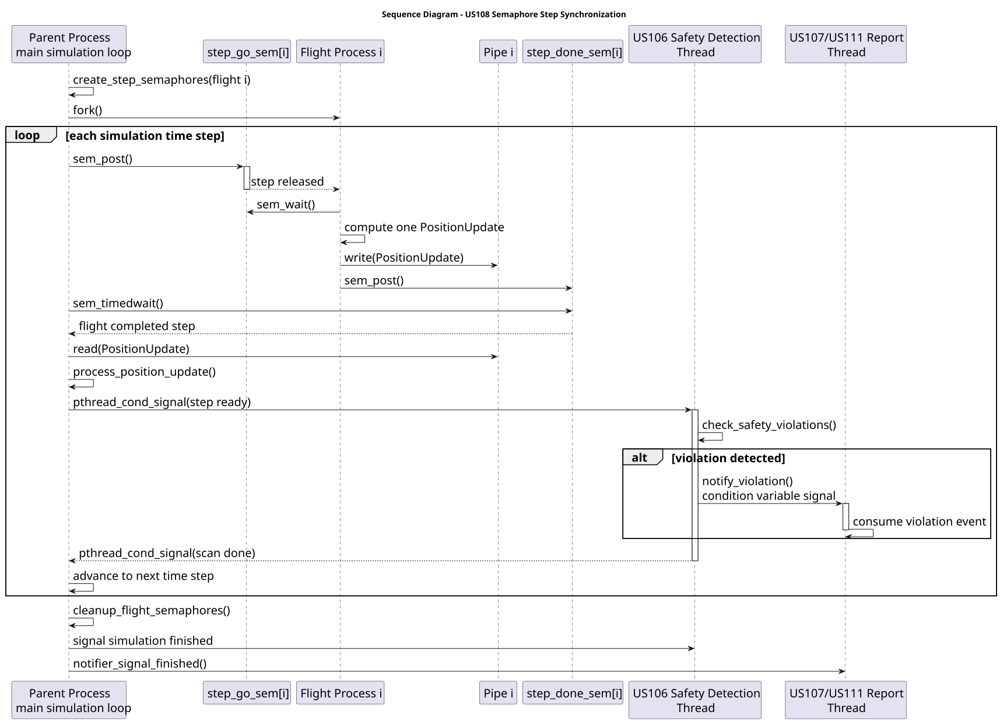

# US108 - Enforce Step-by-Step Simulation Synchronization

## 1. Context

This user story belongs to the SCOMP simulation engine.

The goal is to synchronize the simulation's step-by-step progression using semaphores, so that flight processes only advance when the parent process releases the current simulation time step, and the parent only advances after every active flight has completed that step.

## 1.1 List of Issues

- **Analysis:** Understand the previous pipe/select-based step synchronization and identify where semaphores must control progression.
- **Design:** Define per-flight semaphore ownership, initialization before `fork()`, wait/post order, timeout handling, and cleanup.
- **Implement:** Replace the pipe-based GO mechanism with POSIX semaphore-based step control.
- **Test:** Validate that flight processes wait for the parent and that the parent waits for all active flights before advancing.

## 2. Requirements

**US108** As a PO, I want the simulation engine to synchronize the simulation's step-by-step progression using semaphores, so that all flight processes and parent threads advance in lockstep through each simulation time step.

### Acceptance Criteria

- **US108.1:** Semaphores are used to control the progression of each simulation time step.
- **US108.2:** Each active flight process waits until the parent releases the current step.
- **US108.3:** The parent waits until all active flights report completion of the current step.
- **US108.4:** The simulation advances to the next step only after all active flights are synchronized.
- **US108.5:** Semaphore resources are initialized before the child processes start using them.
- **US108.6:** Semaphore resources are closed and unlinked when the simulation ends.
- **US108.7:** Terminated or inactive flights do not block the next step indefinitely.

### Dependencies / References

- Depends on **US100** because the simulation already validates parameters and creates one process per flight.
- Depends on **US101** because each step produces `PositionUpdate` values.
- Replaces part of the **US103** synchronization mechanism, which previously used pipes/select for step control.
- Related to **US102** because terminated flights and safety-violation signals must not deadlock the step barrier.
- Related to **US109** because the final report must still be generated after semaphore-based synchronization.

## 3. Analysis

### 3.1 Understanding

The existing simulation already progresses in time steps. Previously, the parent sent a GO value through a pipe and used `select()` to wait for updates.

US108 requires semaphores as explicit synchronization primitives. The implemented solution keeps pipes only for data transfer and uses semaphores for execution control.

Each flight has two named POSIX semaphores:

- `step_go_sem`: posted by the parent when that flight may execute the current step;
- `step_done_sem`: posted by the child after it computes and sends its `PositionUpdate`.

This creates a barrier-like behavior:

- no child computes a step before the parent releases it;
- the parent does not run safety checks or advance time until all active children have completed the current step.

### 3.2 Current Scope

The current implementation synchronizes:

- parent process;
- child flight processes;
- the parent-side safety violation detection thread introduced by US106.

The report generation thread introduced by US106/US107 remains event-driven: it waits on a condition variable and processes violation events produced after the synchronized safety scan. It does not control the time-step barrier directly, because its responsibility is report consumption rather than step progression.

### 3.3 Key Decisions

| Decision | Rationale |
|---|---|
| Use POSIX named semaphores | They are available across processes created with `fork()`. |
| Use one GO semaphore per flight | The parent can release each active flight independently. |
| Use one DONE semaphore per flight | The parent can wait for each expected active flight completion. |
| Keep pipes for `PositionUpdate` data | Semaphores synchronize progression; pipes still transfer movement data. |
| Use `sem_timedwait()` in the parent | Prevents deadlock if a child does not report completion. |
| Close and unlink semaphores at cleanup | Prevents leaked `/dev/shm/sem.*` semaphore files between runs. |
| Keep signals for safety and termination events | Existing US102 behavior remains compatible. |

## 4. Design

### 4.1 Realization

The semaphore-based synchronization is implemented in the simulation engine.

Before each `fork()`, the parent creates two named semaphores for the flight. The child process receives the already-open semaphore handles through the inherited process state after `fork()`.

For each simulation time step:

- the parent posts each active flight's `step_go_sem`;
- each child waits on its `step_go_sem`;
- each child computes exactly one movement step;
- each child writes one `PositionUpdate` to the pipe;
- each child posts its `step_done_sem`;
- the parent waits on each active flight's `step_done_sem`;
- the parent reads and stores each update;
- the parent wakes the US106 safety violation detection thread;
- the detection thread checks safety violations for the completed step;
- the parent waits until the detection thread finishes that scan;
- only then does the parent advance to the next time step.

### 4.2 Main Flow



```text
Parent Process -> Simulation: create_step_semaphores(flight)
Parent Process -> Flight Process: fork()
Parent Process -> step_go_sem[i]: sem_post()
Flight Process -> step_go_sem[i]: sem_wait()
Flight Process -> Flight Process: update_position_from_flight_plan()
Flight Process -> Pipe: write(PositionUpdate)
Flight Process -> step_done_sem[i]: sem_post()
Parent Process -> step_done_sem[i]: sem_timedwait()
Parent Process -> Pipe: read(PositionUpdate)
Parent Process -> Simulation: process_position_update()
Parent Process -> Detection Thread: pthread_cond_signal(step ready)
Detection Thread -> Simulation: check_safety_violations()
Detection Thread -> Parent Process: pthread_cond_signal(scan done)
Parent Process -> Simulation: advance to next time step
```

### 4.3 Alternative Flows

**Child terminates during a step:**

The parent receives `SIGCHLD`, reaps the child with `waitpid(..., WNOHANG)`, and marks the corresponding flight inactive.

**Semaphore wait interrupted by signal:**

The child-side `sem_wait()` retries on `EINTR` unless termination was requested.

**Child timeout/failure:**

The parent uses `sem_timedwait()` with a timeout. If the child does not signal completion, the parent sends `SIGTERM`, marks the flight inactive, and continues without deadlock.

**Initialization failure:**

If semaphore creation fails, the simulation aborts before launching the affected child process.

**Normal termination:**

The parent waits for remaining children, generates the US109 report, and cleans semaphore resources.

## 5. Implementation

### 5.1 Key Files

#### scomp

- `simulation.c`
- `simulation.h`
- `flight_process.c`
- `flight_process.h`
- `Makefile`
- `report.c`
- `report.h`

### 5.2 Key Functions

Implemented or changed functions:

- `create_step_semaphores(...)`
- `cleanup_flight_semaphores(...)`
- `wait_for_step_done(...)`
- `wait_for_step_signal(...)`
- `launch_flights(...)`
- `run_simulation(...)`
- `flight_process_run(...)`

### 5.3 Synchronization Rules

The parent:

- initializes semaphores before `fork()`;
- posts one GO semaphore per active flight per step;
- waits for one DONE semaphore per active flight per step;
- reads each `PositionUpdate`;
- processes all updates before requesting the US106 detection thread scan;
- waits for the US106 detection thread to finish scanning the completed step;
- advances only after all active flights complete the current step;
- closes and unlinks semaphores during cleanup.

The child:

- waits on its GO semaphore;
- computes one step;
- writes one `PositionUpdate` to the pipe;
- posts its DONE semaphore;
- exits cleanly when the flight ends or termination is requested.

### 5.4 Pipes, Semaphores, and Signals

Pipes are used for data:

```text
PositionUpdate child -> parent
```

Semaphores are used for synchronization:

```text
step_go_sem   parent -> child
step_done_sem child -> parent
```

Signals are still used for events:

```text
SIGUSR1 safety violation notification
SIGTERM termination
SIGCHLD child exit notification
```

### 5.5 Build Configuration

The `Makefile` links with pthread support because POSIX semaphore functions may require pthread/runtime threading support depending on the platform:

```text
-pthread
```

Required include:

```c
#include <semaphore.h>
```

## 6. Demonstration

Build:

```bash
make clean
make
```

Run a single-flight scenario:

```bash
./air_sim config/single_flight.cfg
```

Expected output pattern:

```text
[US108] === Time step 0 ===
[US108] Parent released flight AA123 for step 0
[US108] AA123 completed step 0 -> lat=... lon=... alt=...
[US108] All active flights completed step 0
[US106] Safety violation detection thread started
```

Run a multi-flight scenario:

```bash
./air_sim config/opo_mad.cfg
```

Run a collision scenario:

```bash
./air_sim config/collisions.cfg
cat violations.log
```

Confirm US109 still works:

```bash
ls simulation_report_*.txt
cat simulation_report_*.txt
```

Confirm semaphore cleanup:

```bash
ls /dev/shm | grep aisafe
```

After normal termination, this command should return no active AISafe semaphore files.

## 7. Tests

The following aspects were tested manually in the VM:

- the simulator builds with semaphore support;
- child processes wait before executing the first step;
- the parent releases one step at a time;
- the parent waits for active children before advancing;
- the US106 detection thread scans only after all active flights complete the current step;
- the parent waits for the US106 detection thread before moving to the next step;
- the report generation from US109 still runs after the simulation;
- semaphore cleanup leaves no stale `aisafe` semaphores in `/dev/shm`.

Example validated command:

```bash
./air_sim config/single_flight.cfg
```

Observed result:

```text
[US108] Parent released flight AA123 for step 0
[US108] AA123 completed step 0
[US108] All active flights completed step 0
[US109] Report saved to simulation_report_YYYYMMDD_HHMMSS.txt
[US100] Simulacao concluida.
```

## 8. Observations

US108 strengthens the synchronization already introduced in US103.

The main conceptual difference is:

```text
US103 focused on step synchronization using pipes/select.
US108 enforces step progression using semaphores.
```

The current implementation synchronizes the parent process, all active flight child processes, and the US106 safety violation detection thread.

Future work after related user stories:

- optionally expose synchronization metrics in the final report.
