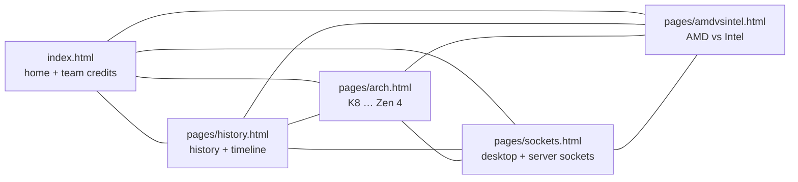

# Architecture — AMD static website (LP1)

> Documentation added in 2026 (portfolio). Reconstructed from the HTML/CSS in the repository; the team's reasoning is not recorded. Portuguese version: [ARCHITECTURE.pt.md](ARCHITECTURE.pt.md).

## 1. Overview

A static multi-page website (HTML + CSS, `lang="pt-pt"`, no build step, no framework): 5 HTML pages (1,595 lines), 8 stylesheets (921 lines in `styles/`), 59 tracked files under `assets/` (about 3.9 MB). The only JavaScript is a ~9-line inline `hamburgerMenu()` function copied into every page. External resources: Font Awesome 6.2.1 (cdnjs) and the Poppins font (Google Fonts `@import` in `styles/styles.css` and `styles/arch/styles.css`).

## 2. Site map

Every page has the same header/nav (home, history, architectures, sockets, AMD vs Intel), the AMD logo linking to `https://www.amd.com/pt`, a footer and the hamburger toggle for narrow screens. There is no shared include: the nav is copy-pasted into the 5 files.

## 3. Pages and styles

| Page | Stylesheets loaded | Notable content |
|---|---|---|
| `index.html` | `styles/styles.css` (twice: `/styles/…` and `./styles/…`) | Home cards to the other pages, team credits with photos |
| `pages/history.html` | `styles/styles.css`, `styles/history.css` | Company history, a table, many Wikipedia/Britannica links |
| `pages/arch.html` | `styles/arch/{arch,styles,responsive}.css` | One section per microarchitecture, 8 images |
| `pages/sockets.html` | `styles/styles.css`, `styles/sockets/{sockets,responsive}.css` | A table plus one block per socket, 37 images, 31 WikiChip/Wikipedia link lines |
| `pages/amdvsintel.html` | `styles/styles.css`, `styles/amdintel/amdintel.css` | Comparison table, 2 images |

Each page group has its own stylesheet folder; `arch.html` does not load the shared `styles/styles.css` but its own `styles/arch/styles.css` (only 15 of its 40 distinct lines also appear in the shared one). Every stylesheet has a single breakpoint, `max-width: 1200px`.

## 4. Assets

`assets/imgs/` holds the page images, `autores/` (team photos), `sockets_desktop/`, `sockets_server/` and `sockets_examples/` (socket photos and diagrams). All 5 pages declare `<meta name="viewport">`. Of the 59 `` tags, 58 have `alt` text (one in `amdvsintel.html` does not).

## 5. Verified issues (read from the code)

| # | Finding | Where |
|---|---|---|
| 1 | Root-absolute URLs (`/styles/…`, `/pages/…`, `/assets/…`) work only when the site is served from the domain root. Under a sub-path (for example a GitHub Pages project site) or from `file://` they resolve to the wrong place | `index.html` (nav, `/styles/styles.css`, favicon), `pages/amdvsintel.html` (`/styles/styles.css`), `pages/history.html` (`/styles/history.css`) |
| 2 | Home page link `/pages/amdvsintel` has no `.html`; the local test server below returned 404 for it (some hosts add the extension, many do not) | `index.html` |
| 3 | `src="../assets/imgs/amd.png"` in a file at the site root climbs above the root; it works over HTTP only because browsers clamp at `/`, and breaks on `file://` | `index.html` |
| 4 | Three images are referenced with upper-case extensions but tracked as lower-case (`K10.PNG`, `TamanhoArchZen.PNG`, `Futuro.PNG` vs `K10.png`, `TamanhoArchZen.png`, `Futuro.png`); they load on Windows/macOS but will 404 on case-sensitive hosts | `pages/arch.html` |
| 5 | The `href="/wiki/amd/packages/socket_strx4"` link lacks the `https://en.wikichip.org` prefix, so it points to a path on this site (404 in the local test) | `pages/sockets.html` |
| 6 | The same `hamburgerMenu()` script is duplicated in 5 files, and the toggle is an `<a href="javascript:void(0);">` | all pages |
| 7 | Three unreferenced assets: `assets/imgs/img.jpg`, `sockets_examples/amd.png`, `sockets_examples/amd2.png` | `assets/` |
| 8 | One `` without `alt` | `pages/amdvsintel.html` |
| 9 | No `.gitignore`, license or tests | project |

TODO: confirmar com o BMS — which pages each member wrote and the source of the images and texts (the folder has no per-author history).
