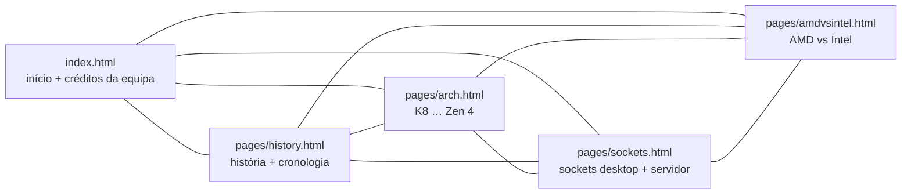

# Arquitetura — Site estático da AMD (LP1)

> Documentação adicionada em 2026 (portfolio). Reconstruída a partir do HTML/CSS do repositório; o raciocínio da equipa não está registado. Versão inglesa: [ARCHITECTURE.md](ARCHITECTURE.md).

## 1. Visão geral

Site estático de várias páginas (HTML + CSS, `lang="pt-pt"`, sem passo de build, sem framework): 5 páginas HTML (1 595 linhas), 8 folhas de estilo (921 linhas em `styles/`), 59 ficheiros versionados em `assets/` (cerca de 3,9 MB). O único JavaScript é uma função `hamburgerMenu()` inline de ~9 linhas copiada para todas as páginas. Recursos externos: Font Awesome 6.2.1 (cdnjs) e a fonte Poppins (`@import` do Google Fonts em `styles/styles.css` e `styles/arch/styles.css`).

## 2. Mapa do site

Todas as páginas têm o mesmo cabeçalho/navegação (início, história, arquiteturas, sockets, AMD vs Intel), o logótipo da AMD com ligação a `https://www.amd.com/pt`, um rodapé e o botão hambúrguer para ecrãs estreitos. Não há includes partilhados: a navegação está copiada nos 5 ficheiros.

## 3. Páginas e estilos

| Página | Folhas de estilo carregadas | Conteúdo relevante |
|---|---|---|
| `index.html` | `styles/styles.css` (duas vezes: `/styles/…` e `./styles/…`) | Cartões para as outras páginas, créditos da equipa com fotografias |
| `pages/history.html` | `styles/styles.css`, `styles/history.css` | História da empresa, uma tabela, muitas ligações Wikipedia/Britannica |
| `pages/arch.html` | `styles/arch/{arch,styles,responsive}.css` | Uma secção por microarquitetura, 8 imagens |
| `pages/sockets.html` | `styles/styles.css`, `styles/sockets/{sockets,responsive}.css` | Uma tabela e um bloco por socket, 37 imagens, 31 linhas com ligações WikiChip/Wikipedia |
| `pages/amdvsintel.html` | `styles/styles.css`, `styles/amdintel/amdintel.css` | Tabela comparativa, 2 imagens |

Cada grupo de páginas tem a sua pasta de estilos; o `arch.html` não carrega o `styles/styles.css` partilhado mas o seu `styles/arch/styles.css` (só 15 das suas 40 linhas distintas também existem no partilhado). Todas as folhas têm um único breakpoint, `max-width: 1200px`.

## 4. Recursos

`assets/imgs/` contém as imagens das páginas, `autores/` (fotografias da equipa), `sockets_desktop/`, `sockets_server/` e `sockets_examples/` (fotografias e diagramas dos sockets). As 5 páginas declaram `<meta name="viewport">`. Das 59 etiquetas ``, 58 têm texto `alt` (uma em `amdvsintel.html` não tem).

## 5. Problemas verificados (lidos no código)

| # | Achado | Onde |
|---|---|---|
| 1 | URLs absolutos à raiz (`/styles/…`, `/pages/…`, `/assets/…`) só funcionam quando o site é servido na raiz do domínio. Num sub-caminho (por exemplo um GitHub Pages de projeto) ou em `file://` resolvem para o sítio errado | `index.html` (navegação, `/styles/styles.css`, favicon), `pages/amdvsintel.html` (`/styles/styles.css`), `pages/history.html` (`/styles/history.css`) |
| 2 | A ligação `/pages/amdvsintel` da página inicial não tem `.html`; o servidor de teste local abaixo devolveu 404 (alguns alojamentos acrescentam a extensão, muitos não) | `index.html` |
| 3 | `src="../assets/imgs/amd.png"` num ficheiro na raiz sobe acima da raiz; só funciona por HTTP porque os browsers limitam em `/`, e falha em `file://` | `index.html` |
| 4 | Três imagens são referenciadas com extensão em maiúsculas mas estão versionadas em minúsculas (`K10.PNG`, `TamanhoArchZen.PNG`, `Futuro.PNG` vs `K10.png`, `TamanhoArchZen.png`, `Futuro.png`); carregam em Windows/macOS mas dão 404 em alojamentos sensíveis a maiúsculas | `pages/arch.html` |
| 5 | A ligação `href="/wiki/amd/packages/socket_strx4"` não tem o prefixo `https://en.wikichip.org`, por isso aponta para um caminho deste site (404 no teste local) | `pages/sockets.html` |
| 6 | O mesmo script `hamburgerMenu()` está duplicado em 5 ficheiros, e o botão é um `<a href="javascript:void(0);">` | todas as páginas |
| 7 | Três recursos sem referência: `assets/imgs/img.jpg`, `sockets_examples/amd.png`, `sockets_examples/amd2.png` | `assets/` |
| 8 | Uma `` sem `alt` | `pages/amdvsintel.html` |
| 9 | Sem `.gitignore`, licença ou testes | projeto |

TODO: confirmar com o BMS — que páginas escreveu cada membro e a origem das imagens e textos (a pasta não tem histórico por autor).
