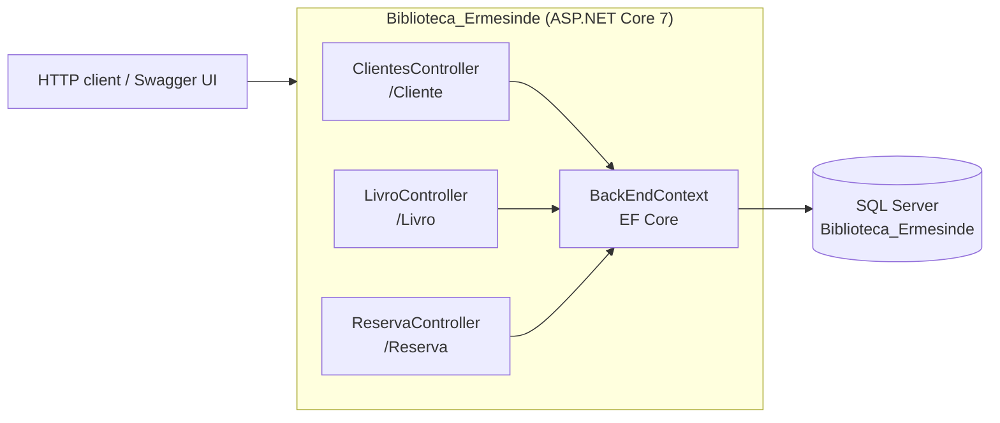
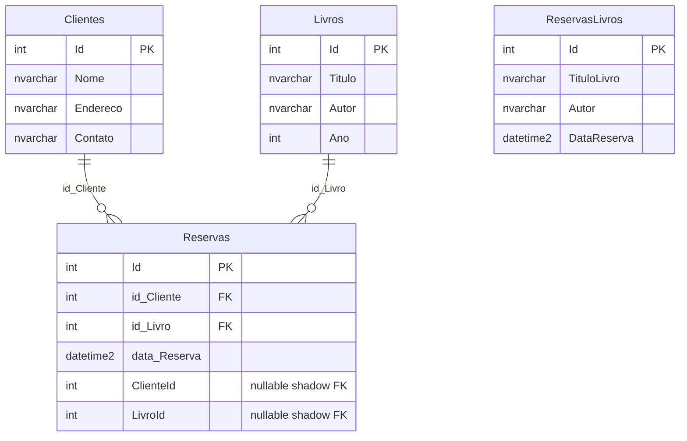
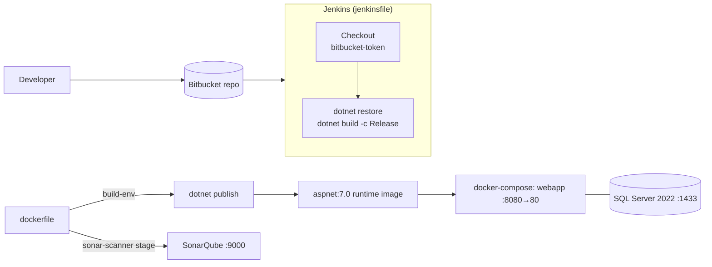

# Architecture — Biblioteca Ermesinde

> Documentation added in 2026 (portfolio). Derived from the source code; nothing here was written by the original team. Portuguese version: [ARCHITECTURE.pt.md](ARCHITECTURE.pt.md).

## Overview

ASP.NET Core 7 Web API (controllers, no separate service layer) over Entity Framework Core and SQL Server. The repository also contains the DevOps toolchain used by the course: Dockerfile, Docker Compose (API, SQL Server, Jenkins, SonarQube), a Jenkins pipeline and a Vagrantfile.



| Layer | Files | Notes |
|---|---|---|
| Host / composition | `Program.cs` | `AddControllers`, `AddDbContext` (SQL Server), Swagger (Development only), HTTPS redirection |
| Controllers | `Controllers/{Clientes,Livro,Reserva}Controller.cs` | Query `BackEndContext` directly and return anonymous objects |
| Domain / persistence | `Models/*.cs`, `Models/BackEndContext.cs` | Entities, request DTO, `DbContext` |
| Migrations | `Migrations/` (`V2`, `V3`, `V4` + snapshot) | EF Core 7.0.0 |
| Unused | `Services/ReservaService.cs`, `Controllers/Class.cs` | Excluded from compilation in the `.csproj` |

## Data model

Derived from `Migrations/BackEndContextModelSnapshot.cs` (tables `Clientes`, `Livros`, `Reservas`, `ReservasLivros`).



- `Reservas` has two foreign keys to each parent: the intended `id_Cliente`/`id_Livro` (cascade delete, required) and the nullable shadow columns `ClienteId`/`LivroId`, generated because `Cliente.Reservas` and `Livro.Reservas` are configured as separate relationships.
- `ReservasLivros` has no foreign keys and no controller uses it.

## API reference

No authentication. Swagger UI is enabled only in the Development environment. Property casing is exactly as in the code (`contato` and `ano` are lower-case).

| Method | Route | Body | Success | Errors |
|---|---|---|---|---|
| GET | `/Cliente/Get/{id}` | – | 200 `{ Nome, Endereco, contato }` | 404 plain text message |
| GET | `/Livro/Get/{id}` | – | 200 `{ Titulo, Autor, ano }` | 404 plain text message |
| POST | `/Reserva/Post` | `ReservaRequest` | 201 `{ Mensagem }` | 400 `{ Mensagem }` |
| GET | `/Reserva/Get/{id}` | – | 200 `{ NomeCliente, TituloLivro, DataReserva }` | 404 `{ Mensagem }`, 400 on exception |
| GET | `/Reserva/Get/{idCliente}/Livros` | – | 200 `{ TituloLivro, Autor, Data_reserva }` | 404 `{ Mensagem }`, 400 on exception |

`ReservaRequest`:

```json
{ "idCliente": 1, "idLivro": 1, "dataReserva": "2024-02-11T00:00:00" }
```

## Delivery pipeline



- Jenkins stages in the `jenkinsfile`: **Checkout** and **Build** only. There is no test or Sonar stage in the pipeline file.
- The SonarQube analysis lives in a separate `sonar-scanner` stage of the `dockerfile`.
- `docker-compose.yml` defines `webapp`, `database` (SQL Server 2022), `jenkins` (LTS, ports 8081/50000) and `sonar_biblioteca` (port 9000) on one bridge network.
- `vagrant/Vagrantfile` is the alternative way to get a SQL Server VM.

## Known issues found while documenting (verified by reading the code)

| # | Finding | Where |
|---|---|---|
| 1 | `PostReserva` validates the requested client/book but then assigns `cliente_todos.First()` / `livros_todos.First()` (the first rows of the tables), not the matching ones. The reservation may be stored against the wrong client or book. Not executed. | `ReservaController.cs` |
| 2 | `OnConfiguring` calls `UseSqlServer` with a hard-coded server address, overriding the connection string registered in `Program.cs`/`appsettings.json`. | `BackEndContext.cs` |
| 3 | `/Reserva/Get/{idCliente}/Livros` returns only the first reservation of the client, despite the route name. | `ReservaController.cs` |
| 4 | Two public constructors per controller; the logger-only one leaves `_dbContext` null. The unit tests use it. | Controllers, `Teste_Biblioteca/UnitTest1.cs` |
| 5 | The unit tests reference `ReservaResponse` and call `GetReservasPorCliente`, which throws `NotImplementedException`; by reading, they are expected to fail. Not run (see [SETUP](SETUP.md)). | `Teste_Biblioteca/UnitTest1.cs` |
| 6 | `Dockerfile` `EXPOSE 8080`, while Compose maps host 8080 to container port 80 (the .NET 7 image default). | `dockerfile`, `docker-compose.yml` |
| 7 | The SonarQube scanner stage uses `http://localhost:9000` and is not a dependency of the final stage; a multi-stage build normally skips unreferenced stages (not verified). | `dockerfile` |
| 8 | `docker-compose.yml` contains a literal SonarQube admin password (`SONAR_PASSWORD`). Move it to an environment variable and rotate it. Value intentionally not repeated here. | `docker-compose.yml` |
| 9 | Test-only packages (`Moq`, `xunit`) and `EntityFrameworkCore.InMemory` are referenced by the API project. | `Biblioteca_Ermesinde.csproj` |
| 10 | `app.UseAuthorization()` is configured without any authentication scheme or `[Authorize]` attribute. | `Program.cs` |

Improvement suggestions per priority are listed in [../../docs/AUDIT.md](../../docs/AUDIT.md#biblioteca-ermesinde).
