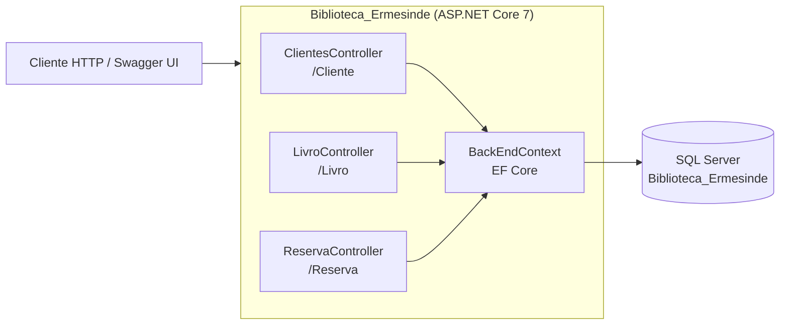
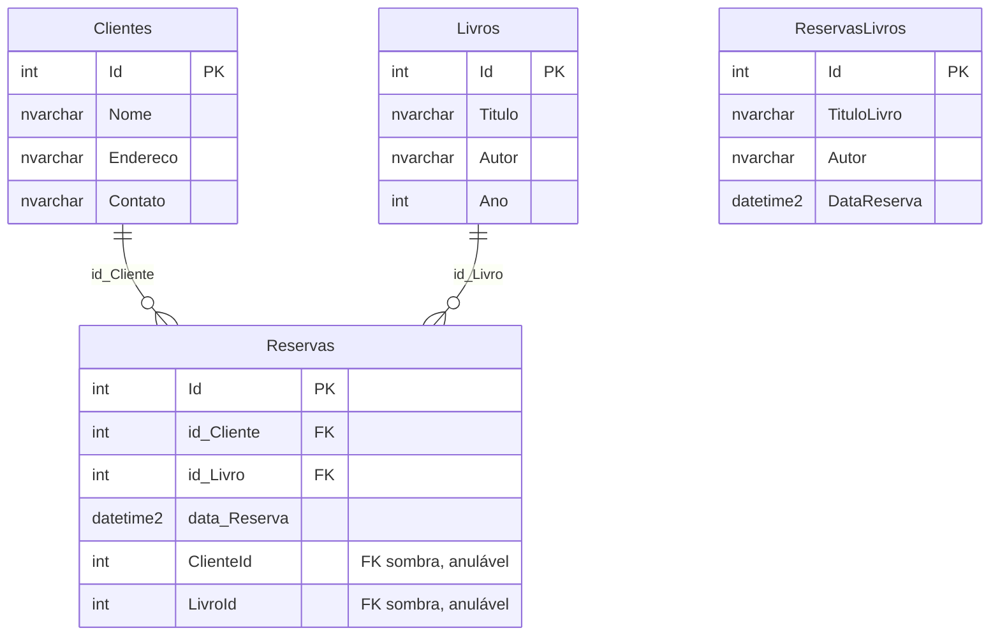
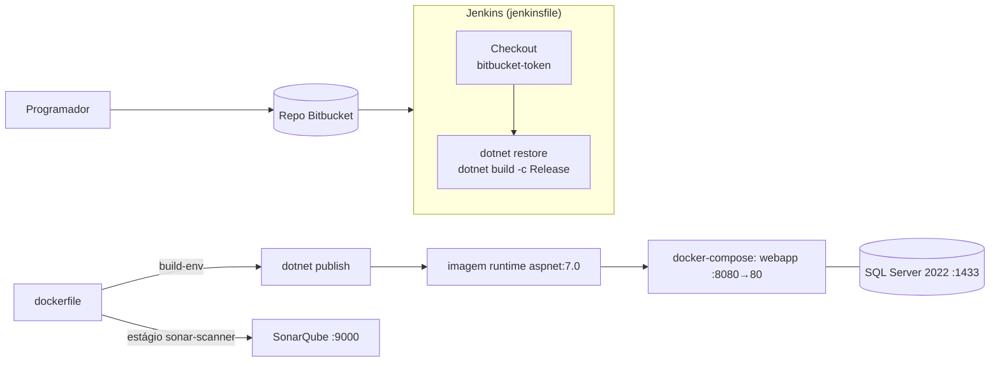

# Arquitetura — Biblioteca Ermesinde

> Documentação adicionada em 2026 (portfolio). Derivada do código-fonte; nada aqui foi escrito pela equipa original. English version: [ARCHITECTURE.md](ARCHITECTURE.md).

## Visão geral

API Web ASP.NET Core 7 (controladores, sem camada de serviços separada) sobre Entity Framework Core e SQL Server. O repositório inclui ainda as ferramentas DevOps usadas na UC: Dockerfile, Docker Compose (API, SQL Server, Jenkins, SonarQube), pipeline Jenkins e Vagrantfile.



| Camada | Ficheiros | Notas |
|---|---|---|
| Host / composição | `Program.cs` | `AddControllers`, `AddDbContext` (SQL Server), Swagger (só em Development), redirecionamento HTTPS |
| Controladores | `Controllers/{Clientes,Livro,Reserva}Controller.cs` | Consultam o `BackEndContext` diretamente e devolvem objetos anónimos |
| Domínio / persistência | `Models/*.cs`, `Models/BackEndContext.cs` | Entidades, DTO de pedido, `DbContext` |
| Migrações | `Migrations/` (`V2`, `V3`, `V4` + snapshot) | EF Core 7.0.0 |
| Não usados | `Services/ReservaService.cs`, `Controllers/Class.cs` | Excluídos da compilação no `.csproj` |

## Modelo de dados

Derivado de `Migrations/BackEndContextModelSnapshot.cs` (tabelas `Clientes`, `Livros`, `Reservas`, `ReservasLivros`).



- `Reservas` tem duas chaves estrangeiras para cada tabela-pai: as pretendidas `id_Cliente`/`id_Livro` (apagamento em cascata, obrigatórias) e as colunas-sombra anuláveis `ClienteId`/`LivroId`, geradas porque `Cliente.Reservas` e `Livro.Reservas` estão configuradas como relações separadas.
- `ReservasLivros` não tem chaves estrangeiras e nenhum controlador a usa.

## Referência da API

Sem autenticação. O Swagger UI só está ativo no ambiente Development. A capitalização das propriedades é exatamente a do código (`contato` e `ano` em minúsculas).

| Método | Rota | Corpo | Sucesso | Erros |
|---|---|---|---|---|
| GET | `/Cliente/Get/{id}` | – | 200 `{ Nome, Endereco, contato }` | 404 mensagem em texto |
| GET | `/Livro/Get/{id}` | – | 200 `{ Titulo, Autor, ano }` | 404 mensagem em texto |
| POST | `/Reserva/Post` | `ReservaRequest` | 201 `{ Mensagem }` | 400 `{ Mensagem }` |
| GET | `/Reserva/Get/{id}` | – | 200 `{ NomeCliente, TituloLivro, DataReserva }` | 404 `{ Mensagem }`, 400 em exceção |
| GET | `/Reserva/Get/{idCliente}/Livros` | – | 200 `{ TituloLivro, Autor, Data_reserva }` | 404 `{ Mensagem }`, 400 em exceção |

`ReservaRequest`:

```json
{ "idCliente": 1, "idLivro": 1, "dataReserva": "2024-02-11T00:00:00" }
```

## Pipeline de entrega



- Estágios do Jenkins no `jenkinsfile`: apenas **Checkout** e **Build**. O ficheiro não tem estágio de testes nem de Sonar.
- A análise SonarQube está num estágio `sonar-scanner` separado do `dockerfile`.
- O `docker-compose.yml` define `webapp`, `database` (SQL Server 2022), `jenkins` (LTS, portas 8081/50000) e `sonar_biblioteca` (porta 9000) numa rede bridge.
- `vagrant/Vagrantfile` é a alternativa para obter uma VM com SQL Server.

## Problemas conhecidos encontrados ao documentar (verificados na leitura do código)

| # | Constatação | Onde |
|---|---|---|
| 1 | `PostReserva` valida o cliente/livro pedidos mas depois atribui `cliente_todos.First()` / `livros_todos.First()` (as primeiras linhas das tabelas), não as correspondentes. A reserva pode ficar associada ao cliente ou livro errado. Não executado. | `ReservaController.cs` |
| 2 | `OnConfiguring` chama `UseSqlServer` com um endereço de servidor fixo, sobrepondo-se à connection string registada em `Program.cs`/`appsettings.json`. | `BackEndContext.cs` |
| 3 | `/Reserva/Get/{idCliente}/Livros` devolve só a primeira reserva do cliente, apesar do nome da rota. | `ReservaController.cs` |
| 4 | Dois construtores públicos por controlador; o que só recebe o logger deixa `_dbContext` nulo. Os testes unitários usam-no. | Controladores, `Teste_Biblioteca/UnitTest1.cs` |
| 5 | Os testes referem `ReservaResponse` e chamam `GetReservasPorCliente`, que lança `NotImplementedException`; pela leitura, esperam-se falhas. Não corridos (ver [SETUP](SETUP.pt.md)). | `Teste_Biblioteca/UnitTest1.cs` |
| 6 | O `Dockerfile` faz `EXPOSE 8080`, mas o Compose mapeia o 8080 do host para a porta 80 do contentor (por omissão na imagem .NET 7). | `dockerfile`, `docker-compose.yml` |
| 7 | O estágio do scanner SonarQube usa `http://localhost:9000` e não é dependência do estágio final; um build multi-estágio normalmente salta estágios não referenciados (não verificado). | `dockerfile` |
| 8 | O `docker-compose.yml` contém uma password de admin do SonarQube em texto simples (`SONAR_PASSWORD`). Passar para variável de ambiente e rodar a password. Valor intencionalmente não repetido aqui. | `docker-compose.yml` |
| 9 | Pacotes só de testes (`Moq`, `xunit`) e `EntityFrameworkCore.InMemory` estão referenciados no projeto da API. | `Biblioteca_Ermesinde.csproj` |
| 10 | `app.UseAuthorization()` está configurado sem esquema de autenticação nem `[Authorize]`. | `Program.cs` |

As sugestões de melhoria por prioridade estão em [../../docs/AUDIT.pt.md](../../docs/AUDIT.pt.md#biblioteca-ermesinde).
