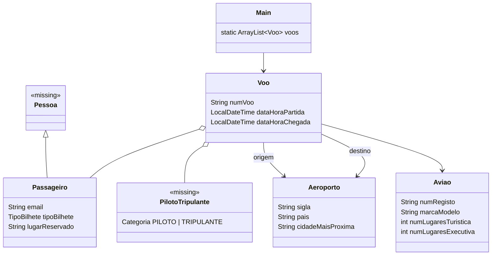

# Arquitetura — Companhia Aérea (versão inicial)

> Documentação adicionada em 2026 (portfolio). Reconstruída a partir do código-fonte; o raciocínio da equipa não está registado. Versão inglesa: [ARCHITECTURE.md](ARCHITECTURE.md).

## 1. Visão geral

Projeto Maven de consola com um só módulo (Java 17, sem dependências) no pacote `org.example`: 5 classes, 711 linhas. É um **retrato inacabado**: o modelo de domínio está esboçado, mas só "adicionar voo" está ligado ao menu, e o código não compila tal como está commitado (ver secção 4). A refatoração concluída é a [`apoo-lp1-companhia-aerea`](../../apoo-lp1-companhia-aerea/docs/ARCHITECTURE.pt.md).

| Classe | Papel |
|---|---|
| `Main` | Texto do menu, `switch` de uma só passagem e todos os leitores de consola (`lerNumVoo`, `lerAviao`, `lerAeroporto`, `lerDataHora`, `lerPassageiros`, `lerTripulacao`) |
| `Voo` | Voo: número, avião, aeroporto de origem/destino, partida/chegada, lista de passageiros, lista de tripulação |
| `Aviao` | Matrícula, marca/modelo, lugares em classe turística e executiva |
| `Aeroporto` | Sigla, país, cidade mais próxima |
| `Passageiro` | Declarado `extends Pessoa`; acrescenta e-mail, tipo de bilhete (`TURISTICA`/`EXECUTIVA`) e lugar |

## 2. Diagrama de classes

As classes marcadas `<<missing>>` são referenciadas pelo código mas **não existem no repositório**.

## 3. Fluxo pretendido (opção 1, "adicionar voo")

`Main.adicionarVoo()` constrói um `Voo` chamando os leitores pela ordem dos argumentos e depois faz `voos.add(voo)`. O menu imprime 11 opções, mas o `switch` só implementa o caso 1; os casos 2–12 estão vazios e nada volta ao menu, pelo que o `main` termina após uma ação.

## 4. Problemas verificados (lidos no código)

| # | Achado | Onde |
|---|---|---|
| 1 | `Pessoa` e `PilotoTripulante` são usadas (`Passageiro extends Pessoa`, `Voo.tripulacao`, `Main.lerTripulacao`) mas não há esses ficheiros versionados (`git ls-files`), logo o projeto não compila tal como está commitado | `Passageiro.java`, `Voo.java`, `Main.java` |
| 2 | `Main.voos` é declarado mas nunca inicializado, por isso `voos.add(...)` lançaria `NullPointerException` depois de ler todos os dados | `Main.java` |
| 3 | `lerTripulacao` constrói cada `PilotoTripulante` mas nunca o acrescenta à lista devolvida, logo a tripulação fica sempre vazia | `Main.java` |
| 4 | `lerDataHora` chama `scanner.next("")` (padrão que só aceita o token vazio) sobre um valor com espaço (`dd-MM-yyyy HH:mm`), pelo que não consegue ler uma data-hora válida | `Main.java` |
| 5 | A entrada usa `Scanner.next()` (palavras soltas): nomes, moradas e "marca-modelo" não podem ter espaços; sem validação de números ou datas | `Main.java` |
| 6 | O menu corre uma vez (sem ciclo); as opções 2–11 são impressas mas estão vazias, e o `case 12` não tem entrada no menu | `Main.java` |
| 7 | Sem persistência apesar das entradas "guardar/ler ficheiro"; sem testes; sem `.gitignore` no projeto | projeto |

TODO: confirmar com o BMS — se `Pessoa.java` / `PilotoTripulante.java` existiam localmente e ficaram de fora da importação.
