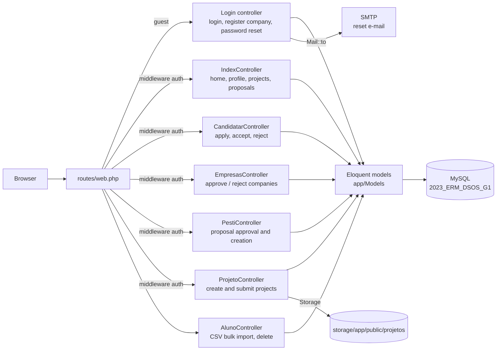
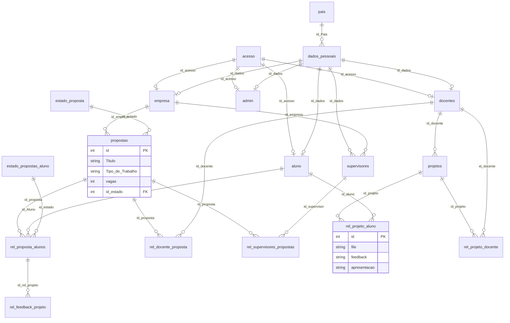

# Architecture — Project Proposals Platform (DSOS)

> Documentation added in 2026 (portfolio). Derived from the source code, migrations and SQL dump; nothing here was written by the original team. Portuguese version: [ARCHITECTURE.pt.md](ARCHITECTURE.pt.md).

## Overview

Server-rendered Laravel 10 web application (PHP 8.1+, MySQL, Blade views, prebuilt Material Dashboard assets) that connects companies, teachers and students around internship and project proposals. There is no API layer and no service layer: controllers use Eloquent models directly and return Blade views. The Laravel app lives in `DSOS-grupo1-Bombastico/`; the database dump is `DB/2023_ERM_DSOS_G1.sql`.



## Roles

There is no role column. After `Auth::attempt` on the `acesso` table, `Login::authenticate` looks the user up in `aluno`, `empresa`, `admin` and `docentes` (in that order) and stores `user_type` and `id_dados` in the session.

| Role | Source table | Lands on | Main capabilities seen in the code |
|---|---|---|---|
| Student (`aluno`) | `aluno` | `app.main` | Browse proposals, apply (`vagas` is decremented), deliver project files, see feedback |
| Company (`empresa`) | `empresa` (`aprovada`) | `app.projeto` | Register (the only public sign-up), create proposals, accept or reject student applications |
| Teacher (`docente`) | `docentes` | `app.main` | Apply as supervisor to a proposal, create projects, give feedback |
| Admin | `admin` | `app.main` | Approve or reject companies (`/aprovar`, `/rejeitar`) and proposals (`/pesti`) |

All protected routes use only the `auth` middleware: the controllers decide what to show by role, but the route groups do not enforce it (see Known issues).

## Routes (`routes/web.php`)

| Group | Examples | Controller |
|---|---|---|
| `site.*` (public) | `/`, `/login`, `/registar`, `/lembrar`, `/password/reset/{token}/{email}`, `/logout` | `Login`, `ResetPasswordController` |
| `app.*` (auth) | `/home`, `/perfil`, `/edit-profile`, `/alunos`, `/pesti`, `/projeto`, `/proposta/{id}`, `/proposta/{id}/Candidatar`, `/proposta/{id}/aceitar_aluno`, `/projeto/{id}/entregar`, `/feedback/submit/{id_projeto}` | `IndexController`, `CandidatarController`, `ProjetoController`, `AlunoController` |
| `empresas.*` (auth) | `/lista`, `PUT /aprovar/{id}`, `PUT /rejeitar/{id}` | `EmpresasController` |
| `pesti.*` (auth) | `/lista-pesti`, `PUT /propostas/{id}/aprovar`, `DELETE /propostas/{id}/rejeitar`, `/criar-proposta-pesti`, `/salvar-proposta` | `PestiController` |
| `projetos.*` (auth) | `/projetos/criar`, `/projetos/criar/sucesso` | `ProjetoController` |
| `aluno.upload` (no middleware) | `POST /aluno/upload` | `AlunoController::upload` (CSV import of students) |

## Main flows

### Proposal lifecycle

```mermaid
stateDiagram-v2
    [*] --> EmAprovacao: company creates proposal
    EmAprovacao --> ADecorrer: admin approves (PestiController::aprovarProposta)
    EmAprovacao --> [*]: admin rejects (row deleted)
    ADecorrer --> Finalizado
```

States come from `estado_proposta`: 1 Em Aprovação, 2 A decorrer, 3 Finalizado. Which code moves a proposal to state 3 was not found. TODO: confirmar com o BMS.

### Student application

1. `CandidatarController::index` checks `propostas.vagas > 0`, inserts a `rel_proposta_aluno` row with `id_estado = 1` ("Em Espera") and decrements `vagas`.
2. The company accepts or rejects (`aprovarPropostaaluno` / `rejeitarPropostaaluno`); `estado_propostas_aluno` is 1 Em Espera, 2 Aprovado, 3 Rejeitado.
3. A teacher can volunteer as supervisor (`candidatarDocente` → `rel_docente_proposta`).

### Project delivery and feedback

Students upload a file with `ProjetoController::submeter_projeto` (stored under `public/projetos/<name>/proposta-id<id>`), the project record is `rel_projeto_aluno`, and feedback goes to `rel_feedback_projeto` via `IndexController::submitFeedback`.

### Password reset

`Login::authenticateLembrar` creates a token and sends `ResetPasswordEmail` with a link to `site.password.reset`; `ResetPasswordController` resets it.

## Data model

Source: `DB/2023_ERM_DSOS_G1.sql` (MySQL dump with data; 24 tables, 26 foreign keys). Laravel framework tables (`users`, `failed_jobs`, `migrations`, `password_resets`, `password_reset_tokens`, `personal_access_tokens`) are omitted below.



Observations:

- Identity is split in two: `acesso` (username + bcrypt hash) and `dados_pessoais` (name, e-mail, NIF, country, city, phone, image). Each role table points to both.
- `rel_feedback_projeto.id_rel_projeto` references `rel_proposta_alunos`, while the delivery table is `rel_projeto_aluno`; the name suggests the opposite. TODO: confirmar com o BMS.
- The model `Candidatura_pdf` maps the table `rel_proposta_aluno_pdf`, which is in neither the dump nor the migrations.
- The migrations declare the column `Tipo de Trabalho` (with spaces) in `propostas`, while the dump and the code use `Tipo_de_Trabalho`. The dump is the reliable source (see [SETUP](SETUP.md)).
- `supervisores` and `rel_supervisores_propostas` (company-side supervisors) and `rel_projeto_docente` exist in the schema; the controllers mainly use `docentes` and `rel_docente_proposta`.

## Dependencies

`composer.json`: PHP ^8.1, `laravel/framework` ^10.10, `laravel/sanctum` ^3.2, `inertiajs/inertia-laravel` ^0.6.8, `minimum-stability: dev`. `package.json` (Vite, Vue 3, Inertia, Tailwind, Bootstrap, Sass) has an empty `scripts` block; the Blade views use the prebuilt assets in `public/assets`. Whether the Inertia/Vue code in `resources/js` is used by any route was not verified.

## Known issues (verified in the code, not fixed)

| # | Issue | Evidence |
|---|---|---|
| 1 | Authorization is not enforced by routes: any logged-in user can call `PUT /aprovar/{id}` or `/rejeitar/{id}` (company approval) and the `/pesti` approve/reject routes. | `routes/web.php`, `EmpresasController::aprovarEmpresa` |
| 2 | `POST /aluno/upload` is outside the `auth` group, so the student CSV import is reachable without login. | `routes/web.php` |
| 3 | CSV import stores the password column as received, without hashing, while login uses bcrypt (`Auth::attempt`). | `AlunoController.php` line 46 |
| 4 | `ProjetoController::submeter_projeto` uses an undefined `$empresa`, joins the table as `Projeto` and filters by a non-existing column, so delivery is expected to fail at runtime (not executed). | `ProjetoController.php` |
| 5 | `aprovarPropostaaluno` chains `->first()->where(...)`, which calls `where` on a model instance. | `CandidatarController.php` |
| 6 | The dump contains real-looking personal data, password hashes and `password_reset_tokens` rows. | `DB/2023_ERM_DSOS_G1.sql` |
| 7 | `.env.example` is committed with non-empty values for `DB_PASSWORD` and `APP_KEY` (values not reproduced here). TODO: confirmar com o BMS and rotate if real. | `DSOS-grupo1-Bombastico/.env.example` |
| 8 | Duplicated route `Candidatar` and a duplicated `logout`/`login` name; routes at the bottom use the Laravel 7 string syntax (`'ResetPasswordController@showResetForm'`) that Laravel 10 does not resolve. | `routes/web.php` |
| 9 | Only the Laravel example tests exist; there is no CI. | `tests/` |
