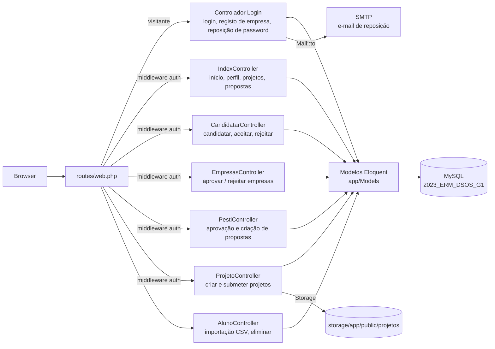
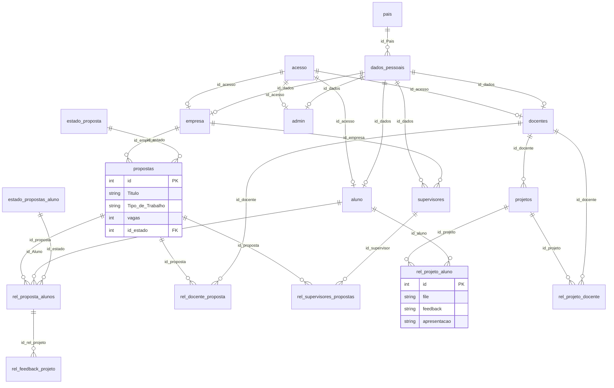

# Arquitetura — Plataforma de Propostas de Projeto (DSOS)

> Documentação adicionada em 2026 (portfolio). Derivada do código-fonte, das migrações e do dump SQL; nada aqui foi escrito pela equipa original. English version: [ARCHITECTURE.md](ARCHITECTURE.md).

## Visão geral

Aplicação web Laravel 10 renderizada no servidor (PHP 8.1+, MySQL, vistas Blade, assets Material Dashboard já compilados) que liga empresas, docentes e alunos em torno de propostas de estágio e de projeto. Não há camada de API nem de serviços: os controladores usam diretamente os modelos Eloquent e devolvem vistas Blade. A app Laravel vive em `DSOS-grupo1-Bombastico/`; o dump da base de dados é `DB/2023_ERM_DSOS_G1.sql`.



## Papéis

Não há coluna de papel. Depois de `Auth::attempt` sobre a tabela `acesso`, o `Login::authenticate` procura o utilizador em `aluno`, `empresa`, `admin` e `docentes` (por esta ordem) e guarda `user_type` e `id_dados` na sessão.

| Papel | Tabela de origem | Destino após login | Capacidades principais vistas no código |
|---|---|---|---|
| Aluno (`aluno`) | `aluno` | `app.main` | Ver propostas, candidatar-se (`vagas` desce), entregar ficheiros de projeto, ver feedback |
| Empresa (`empresa`) | `empresa` (`aprovada`) | `app.projeto` | Registar-se (único registo público), criar propostas, aceitar ou rejeitar candidaturas de alunos |
| Docente (`docente`) | `docentes` | `app.main` | Candidatar-se como orientador de uma proposta, criar projetos, dar feedback |
| Admin | `admin` | `app.main` | Aprovar ou rejeitar empresas (`/aprovar`, `/rejeitar`) e propostas (`/pesti`) |

Todas as rotas protegidas usam apenas o middleware `auth`: os controladores decidem o que mostrar por papel, mas os grupos de rotas não o impõem (ver Problemas conhecidos).

## Rotas (`routes/web.php`)

| Grupo | Exemplos | Controlador |
|---|---|---|
| `site.*` (público) | `/`, `/login`, `/registar`, `/lembrar`, `/password/reset/{token}/{email}`, `/logout` | `Login`, `ResetPasswordController` |
| `app.*` (auth) | `/home`, `/perfil`, `/edit-profile`, `/alunos`, `/pesti`, `/projeto`, `/proposta/{id}`, `/proposta/{id}/Candidatar`, `/proposta/{id}/aceitar_aluno`, `/projeto/{id}/entregar`, `/feedback/submit/{id_projeto}` | `IndexController`, `CandidatarController`, `ProjetoController`, `AlunoController` |
| `empresas.*` (auth) | `/lista`, `PUT /aprovar/{id}`, `PUT /rejeitar/{id}` | `EmpresasController` |
| `pesti.*` (auth) | `/lista-pesti`, `PUT /propostas/{id}/aprovar`, `DELETE /propostas/{id}/rejeitar`, `/criar-proposta-pesti`, `/salvar-proposta` | `PestiController` |
| `projetos.*` (auth) | `/projetos/criar`, `/projetos/criar/sucesso` | `ProjetoController` |
| `aluno.upload` (sem middleware) | `POST /aluno/upload` | `AlunoController::upload` (importação CSV de alunos) |

## Fluxos principais

### Ciclo de vida de uma proposta

```mermaid
stateDiagram-v2
    [*] --> EmAprovacao: a empresa cria a proposta
    EmAprovacao --> ADecorrer: o admin aprova (PestiController::aprovarProposta)
    EmAprovacao --> [*]: o admin rejeita (linha apagada)
    ADecorrer --> Finalizado
```

Os estados vêm de `estado_proposta`: 1 Em Aprovação, 2 A decorrer, 3 Finalizado. Não foi encontrado o código que passa uma proposta ao estado 3. TODO: confirmar com o BMS.

### Candidatura de um aluno

1. `CandidatarController::index` verifica `propostas.vagas > 0`, insere uma linha em `rel_proposta_aluno` com `id_estado = 1` ("Em Espera") e decrementa `vagas`.
2. A empresa aceita ou rejeita (`aprovarPropostaaluno` / `rejeitarPropostaaluno`); `estado_propostas_aluno` é 1 Em Espera, 2 Aprovado, 3 Rejeitado.
3. Um docente pode oferecer-se como orientador (`candidatarDocente` → `rel_docente_proposta`).

### Entrega de projeto e feedback

Os alunos carregam um ficheiro com `ProjetoController::submeter_projeto` (guardado em `public/projetos/<nome>/proposta-id<id>`), o registo do projeto é `rel_projeto_aluno` e o feedback vai para `rel_feedback_projeto` através de `IndexController::submitFeedback`.

### Reposição de password

`Login::authenticateLembrar` cria um token e envia `ResetPasswordEmail` com uma ligação para `site.password.reset`; o `ResetPasswordController` faz a reposição.

## Modelo de dados

Fonte: `DB/2023_ERM_DSOS_G1.sql` (dump MySQL com dados; 24 tabelas, 26 chaves estrangeiras). As tabelas da framework Laravel (`users`, `failed_jobs`, `migrations`, `password_resets`, `password_reset_tokens`, `personal_access_tokens`) foram omitidas abaixo.



Observações:

- A identidade está dividida em duas: `acesso` (username + hash bcrypt) e `dados_pessoais` (nome, e-mail, NIF, país, cidade, telefone, imagem). Cada tabela de papel aponta para ambas.
- `rel_feedback_projeto.id_rel_projeto` referencia `rel_proposta_alunos`, enquanto a tabela de entrega é `rel_projeto_aluno`; o nome sugere o contrário. TODO: confirmar com o BMS.
- O modelo `Candidatura_pdf` mapeia a tabela `rel_proposta_aluno_pdf`, que não está no dump nem nas migrações.
- As migrações declaram a coluna `Tipo de Trabalho` (com espaços) em `propostas`, enquanto o dump e o código usam `Tipo_de_Trabalho`. O dump é a fonte fiável (ver [SETUP](SETUP.pt.md)).
- `supervisores`, `rel_supervisores_propostas` (orientadores do lado da empresa) e `rel_projeto_docente` existem no esquema; os controladores usam sobretudo `docentes` e `rel_docente_proposta`.

## Dependências

`composer.json`: PHP ^8.1, `laravel/framework` ^10.10, `laravel/sanctum` ^3.2, `inertiajs/inertia-laravel` ^0.6.8, `minimum-stability: dev`. O `package.json` (Vite, Vue 3, Inertia, Tailwind, Bootstrap, Sass) tem o bloco `scripts` vazio; as vistas Blade usam os assets já compilados em `public/assets`. Não foi verificado se o código Inertia/Vue de `resources/js` é usado por alguma rota.

## Problemas conhecidos (verificados no código, não corrigidos)

| # | Problema | Evidência |
|---|---|---|
| 1 | A autorização não é imposta pelas rotas: qualquer utilizador autenticado pode chamar `PUT /aprovar/{id}` ou `/rejeitar/{id}` (aprovação de empresas) e as rotas de aprovar/rejeitar de `/pesti`. | `routes/web.php`, `EmpresasController::aprovarEmpresa` |
| 2 | `POST /aluno/upload` está fora do grupo `auth`, logo a importação CSV de alunos é acessível sem login. | `routes/web.php` |
| 3 | A importação CSV guarda a coluna da password tal como recebida, sem hash, enquanto o login usa bcrypt (`Auth::attempt`). | `AlunoController.php` linha 46 |
| 4 | `ProjetoController::submeter_projeto` usa um `$empresa` indefinido, faz join à tabela como `Projeto` e filtra por uma coluna inexistente, por isso a entrega deve falhar em execução (não executado). | `ProjetoController.php` |
| 5 | `aprovarPropostaaluno` encadeia `->first()->where(...)`, o que chama `where` sobre uma instância de modelo. | `CandidatarController.php` |
| 6 | O dump contém dados pessoais de aspeto real, hashes de passwords e linhas de `password_reset_tokens`. | `DB/2023_ERM_DSOS_G1.sql` |
| 7 | O `.env.example` está versionado com valores não vazios em `DB_PASSWORD` e `APP_KEY` (valores não reproduzidos aqui). TODO: confirmar com o BMS e rodar se forem reais. | `DSOS-grupo1-Bombastico/.env.example` |
| 8 | Rota `Candidatar` duplicada e nomes `login`/`logout` duplicados; as rotas do fim usam a sintaxe de string do Laravel 7 (`'ResetPasswordController@showResetForm'`) que o Laravel 10 não resolve (o `RouteServiceProvider` não define namespace). | `routes/web.php`, `RouteServiceProvider.php` |
| 9 | Só existem os testes de exemplo do Laravel; não há CI. | `tests/` |
