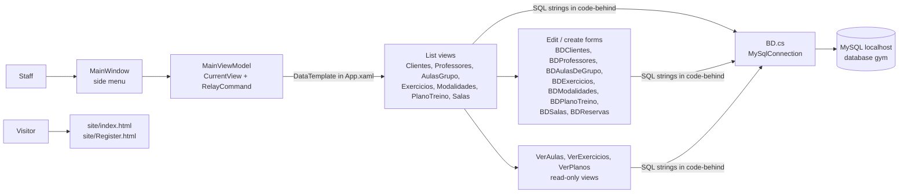
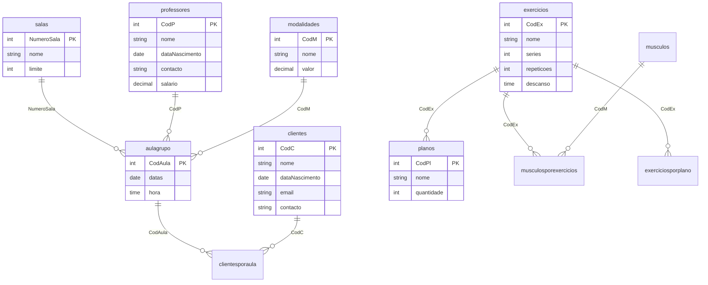

# Architecture — PAP Gym (Spump)

> Documentation added in 2026 (portfolio). Derived from the source code and the team's own database diagram (`img/BD/BD.PNG`); nothing here was written by the original author. There is no SQL script in the repository, so the data model is read from that diagram and cross-checked against the SQL in the code. Portuguese version: [ARCHITECTURE.pt.md](ARCHITECTURE.pt.md).

## Overview

Two independent deliverables:

- **`spump/`** — a WPF desktop application (C#, .NET Framework 4.8) for gym staff. It talks directly to a local MySQL database `gym` through `MySql.Data`.
- **`site/`** — a static promotional website (two HTML pages, Bootstrap 5.0.2, no backend).

## Layers and files

| Path | Role |
|---|---|
| `spump/spump/MainWindow.xaml(.cs)` | Shell with the side menu and a `ContentControl` bound to the current view model |
| `spump/spump/MVM/ViewModel/` | `MainViewModel` (navigation commands, `CurrentView`) and one near-empty view model per screen (12 lines each, only used to select a view) |
| `spump/spump/App.xaml` | `DataTemplate`s that map each view model to its view |
| `spump/spump/MVM/View/` | 20 views with code-behind: lists (`ClientesView`, ...), read-only screens (`VerAulas`, `VerPlanos`, `VerExercicios`) and edit/create forms with the `BD` prefix (`BDClientes`, `BDReservas`, ...) |
| `spump/spump/Core/` | `ObeservableObject` (`INotifyPropertyChanged`) and `RelayCommand` (`ICommand`) |
| `spump/spump/BD.cs` | Builds the connection string (`server=localhost;database=gym;userid=root;password=` + `GYM_DB_PASSWORD`, `SslMode=none`) and opens/closes the connection; each screen creates its own `new BD()` |
| `spump/spump/Theme/`, `Images/` | WPF styles and the exercise pictures |
| `site/` | `index.html`, `Register.html`, `style.css` |
| `img/` | Screenshots (`img/App`), database diagrams (`img/BD`), examples (`img/anexos`) |

MVVM is used for **navigation only**. The data logic lives in the views' code-behind, which runs SQL directly through `MySqlCommand` / `MySqlDataAdapter` and fills `DataGrid`s from `DataTable`s.

## Features and where they live

| Feature | View(s) |
|---|---|
| Clients, teachers, rooms, modalities, exercises CRUD with search | `ClientesView` + `BDClientes`, `ProfessoresView` + `BDProfessores`, `SalasView` + `BDSalas`, `ModalidadesView` + `BDModalidades`, `ExerciciosView` + `BDExercicios` |
| Group class scheduling | `AulasGrupoView` + `BDAulasDeGrupo` (offers only rooms not already booked at that date and hour) |
| Class enrolment | `BDReservas` (writes `clientesporaula`, checks the room limit) |
| Training plans | `PlanoTreinoView` + `BDPlanoTreino`, `VerPlanos` |
| Class schedules by date | `VerAulas` (joins `aulagrupo` with room, teacher and modality; filters by date prefix). `HomeView` runs no queries. |

## Data model

Source: `img/BD/BD.PNG` (MySQL Workbench diagram), verified against the column order used by the `INSERT` statements in the code.

Observations:

- **A training plan is a set of rows in `planos` sharing the same `nome`**, one row per exercise (`CodEx`). There is no plan header table; renaming a plan updates every row by name (`UPDATE planos SET nome=... WHERE nome=...`), and plans are identified by name.
- `quantidade` is inserted as the constant `7` by `BDPlanoTreino` (`insert into planos values (null, {CodEx}, 7, '{nome}')`).
- `musculos`, `musculosporexercicios` and `exerciciosporplano` exist in the diagram but are **not referenced by any code**.
- The diagram's `modalidades.valor` is a price; `aulagrupo` links a class to a modality, room and teacher.
- Rooms have a capacity (`salas.limite`); a class has no capacity of its own.

## Dependencies

`MySql.Data` 8.0.26 (a plain assembly reference in `spump.csproj`, without a NuGet `packages.config`), WPF and the .NET Framework 4.8. The site loads Bootstrap 5.0.2 and a Font Awesome kit from CDNs.

## Known issues (verified in the code, not fixed)

| # | Issue | Evidence |
|---|---|---|
| 1 | Every query is built with `string.Format` / concatenation of user input, so all search boxes and forms are open to SQL injection (and a name with a quote breaks the query). | `MVM/View/*.cs` |
| 2 | The class capacity check is done in the UI with an in-memory counter; the database has no constraint, so two operators can overbook a class, and the counter restarts when the form is reopened. | `BDReservas.xaml.cs` |
| 3 | The application connects as `root` with `SslMode=none`; a missing `GYM_DB_PASSWORD` silently becomes an empty password. | `BD.cs` |
| 4 | There is no login or role in the application. | `MainWindow.xaml.cs` |
| 5 | `MySql.Data` is not restorable from NuGet as committed (no `packages.config`, no `HintPath`), so a clean machine fails to build until the connector is installed. | `spump.csproj` |
| 6 | The README says .NET Framework 4.7.2; the project targets 4.8 (`spump.csproj`, `App.config`). | `README.md` |
| 7 | The registration form on the website has no `action` or script: submitting it does nothing. | `site/Register.html` |
| 8 | Each screen opens its own connection and reports errors only with a message box (no logging, no retry). | `MVM/View/*.cs` |
| 9 | No tests, no CI. | repository root |
