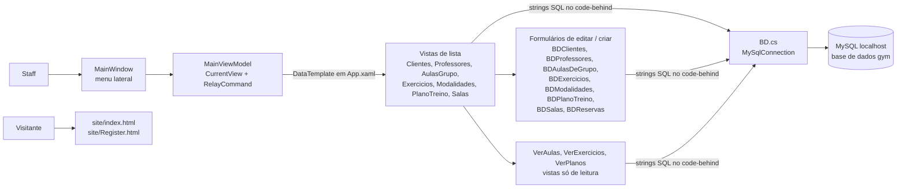
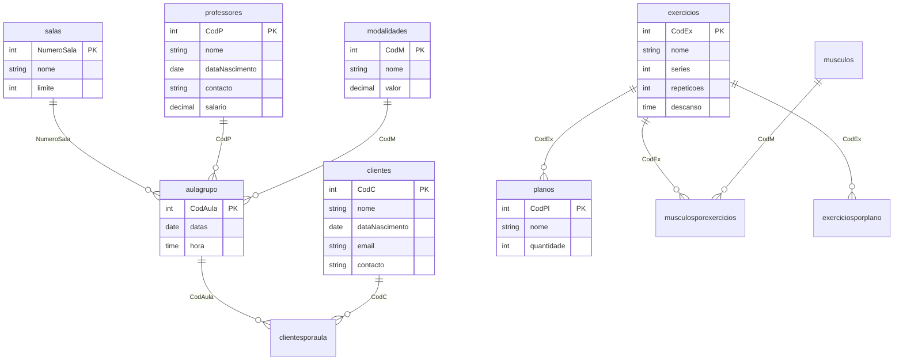

# Arquitetura — PAP Gym (Spump)

> Documentação adicionada em 2026 (portfolio). Derivada do código-fonte e do diagrama de base de dados da própria equipa (`img/BD/BD.PNG`); nada aqui foi escrito pelo autor original. Não há script SQL no repositório, por isso o modelo de dados é lido desse diagrama e confrontado com o SQL do código. English version: [ARCHITECTURE.md](ARCHITECTURE.md).

## Visão geral

Dois entregáveis independentes:

- **`spump/`** — uma aplicação desktop WPF (C#, .NET Framework 4.8) para o staff do ginásio. Fala diretamente com uma base de dados MySQL local `gym` através do `MySql.Data`.
- **`site/`** — um website promocional estático (duas páginas HTML, Bootstrap 5.0.2, sem backend).

## Camadas e ficheiros

| Caminho | Papel |
|---|---|
| `spump/spump/MainWindow.xaml(.cs)` | Janela principal com o menu lateral e um `ContentControl` ligado ao view model atual |
| `spump/spump/MVM/ViewModel/` | `MainViewModel` (comandos de navegação, `CurrentView`) e um view model quase vazio por ecrã (12 linhas cada, só serve para escolher a vista) |
| `spump/spump/App.xaml` | `DataTemplate`s que ligam cada view model à sua vista |
| `spump/spump/MVM/View/` | 20 vistas com code-behind: listas (`ClientesView`, ...), ecrãs só de leitura (`VerAulas`, `VerPlanos`, `VerExercicios`) e formulários de editar/criar com o prefixo `BD` (`BDClientes`, `BDReservas`, ...) |
| `spump/spump/Core/` | `ObeservableObject` (`INotifyPropertyChanged`) e `RelayCommand` (`ICommand`) |
| `spump/spump/BD.cs` | Constrói a string de ligação (`server=localhost;database=gym;userid=root;password=` + `GYM_DB_PASSWORD`, `SslMode=none`) e abre/fecha a ligação; cada ecrã cria o seu `new BD()` |
| `spump/spump/Theme/`, `Images/` | Estilos WPF e as fotografias dos exercícios |
| `site/` | `index.html`, `Register.html`, `style.css` |
| `img/` | Capturas de ecrã (`img/App`), diagramas da base de dados (`img/BD`), exemplos (`img/anexos`) |

O MVVM é usado **só para a navegação**. A lógica de dados está no code-behind das vistas, que executa SQL diretamente com `MySqlCommand` / `MySqlDataAdapter` e preenche `DataGrid`s a partir de `DataTable`s.

## Funcionalidades e onde vivem

| Funcionalidade | Vista(s) |
|---|---|
| CRUD de clientes, professores, salas, modalidades e exercícios com pesquisa | `ClientesView` + `BDClientes`, `ProfessoresView` + `BDProfessores`, `SalasView` + `BDSalas`, `ModalidadesView` + `BDModalidades`, `ExerciciosView` + `BDExercicios` |
| Marcação de aulas de grupo | `AulasGrupoView` + `BDAulasDeGrupo` (só oferece salas não ocupadas nessa data e hora) |
| Inscrição em aulas | `BDReservas` (escreve em `clientesporaula`, verifica o limite da sala) |
| Planos de treino | `PlanoTreinoView` + `BDPlanoTreino`, `VerPlanos` |
| Horário das aulas por data | `VerAulas` (junta `aulagrupo` com sala, professor e modalidade; filtra pelo prefixo da data). A `HomeView` não executa consultas. |

## Modelo de dados

Fonte: `img/BD/BD.PNG` (diagrama do MySQL Workbench), verificado com a ordem das colunas usada pelos `INSERT` do código.

Observações:

- **Um plano de treino é um conjunto de linhas em `planos` com o mesmo `nome`**, uma linha por exercício (`CodEx`). Não há tabela de cabeçalho do plano; mudar o nome de um plano atualiza todas as linhas por nome (`UPDATE planos SET nome=... WHERE nome=...`), e os planos identificam-se pelo nome.
- `quantidade` é inserida como a constante `7` pelo `BDPlanoTreino` (`insert into planos values (null, {CodEx}, 7, '{nome}')`).
- `musculos`, `musculosporexercicios` e `exerciciosporplano` existem no diagrama mas **não são referenciadas por nenhum código**.
- O `modalidades.valor` do diagrama é um preço; `aulagrupo` liga uma aula a uma modalidade, sala e professor.
- As salas têm capacidade (`salas.limite`); uma aula não tem capacidade própria.

## Dependências

`MySql.Data` 8.0.26 (referência simples a um assembly em `spump.csproj`, sem `packages.config` do NuGet), WPF e .NET Framework 4.8. O site carrega Bootstrap 5.0.2 e um kit do Font Awesome a partir de CDNs.

## Problemas conhecidos (verificados no código, não corrigidos)

| # | Problema | Evidência |
|---|---|---|
| 1 | Todas as consultas são construídas com `string.Format` / concatenação de input do utilizador, por isso todas as caixas de pesquisa e formulários estão abertos a injeção de SQL (e um nome com aspas quebra a consulta). | `MVM/View/*.cs` |
| 2 | A verificação de capacidade da aula é feita na interface com um contador em memória; a base de dados não tem restrição, por isso dois operadores podem sobrelotar uma aula, e o contador recomeça ao reabrir o formulário. | `BDReservas.xaml.cs` |
| 3 | A aplicação liga-se como `root` com `SslMode=none`; um `GYM_DB_PASSWORD` em falta torna-se em silêncio uma password vazia. | `BD.cs` |
| 4 | A aplicação não tem login nem papéis. | `MainWindow.xaml.cs` |
| 5 | O `MySql.Data` não é restaurável pelo NuGet tal como está versionado (sem `packages.config`, sem `HintPath`), por isso numa máquina limpa o build falha até o conector ser instalado. | `spump.csproj` |
| 6 | O README diz .NET Framework 4.7.2; o projeto tem como alvo o 4.8 (`spump.csproj`, `App.config`). | `README.md` |
| 7 | O formulário de registo do website não tem `action` nem script: submetê-lo não faz nada. | `site/Register.html` |
| 8 | Cada ecrã abre a sua própria ligação e reporta erros só com uma caixa de mensagem (sem log, sem nova tentativa). | `MVM/View/*.cs` |
| 9 | Sem testes, sem CI. | raiz do repositório |
