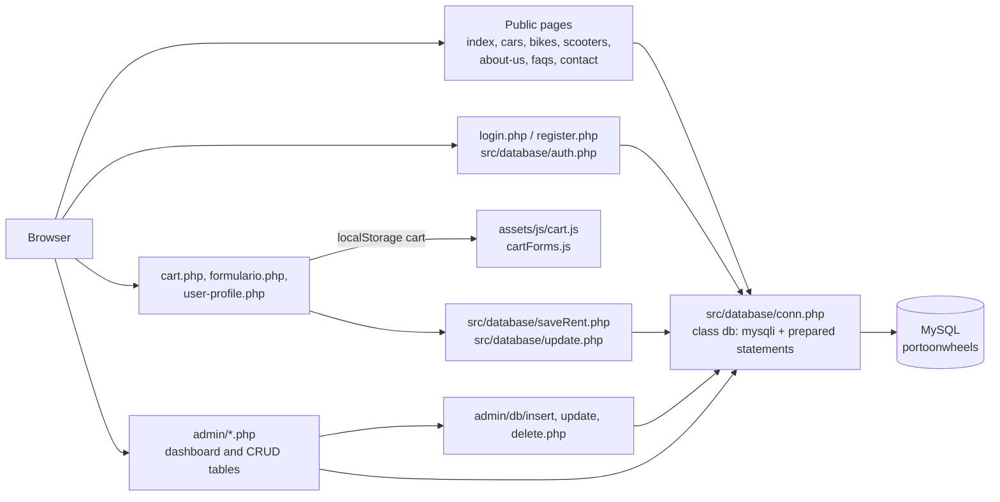
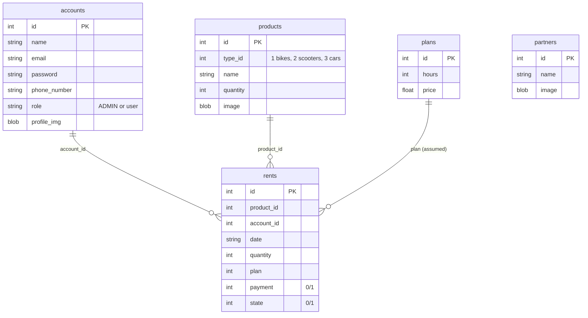

# Architecture — Porto on Wheels

> Documentation added in 2026 (portfolio). Derived from the source code; nothing here was written by the original team. The repository contains **no database schema**, so the data model below is **inferred** from the SQL in the PHP files. Portuguese version: [ARCHITECTURE.pt.md](ARCHITECTURE.pt.md).

## Overview

Server-rendered PHP website (no framework, no Composer) for renting bikes, scooters and cars, with a public site, a logged-in user area and an admin back-office (a Bootstrap "SB Admin 2" template). Pages are PHP files at the repository root; each page opens a MySQL connection through a small hand-written wrapper and queries it inline.

## Files

| Path | Role |
|---|---|
| `index.php`, `cars.php`, `bikes.php`, `scooters.php`, `about-us.php`, `faqs.php`, `contact.php` | Public pages; catalogue pages read `products` by `type_id` |
| `login.php`, `register.php`, `logout.php`, `src/database/auth.php` | Authentication (one script handles both login and register) |
| `cart.php`, `formulario.php`, `src/database/saveRent.php` | Cart (kept in the browser's `localStorage`), booking form, saving rents |
| `user-profile.php`, `src/database/update.php` | Profile and rentals by type; profile update |
| `src/database/db.php` | `class db`: `mysqli` wrapper with `query()` (prepared statements, automatic `bind_param`), `fetchAll()`, `fetchArray()`, `numRows()`, `affectedRows()`, `lastInsertID()` |
| `src/database/conn.php` | Reads `PORTOONWHEELS_DB_HOST` / `_USER` / `_PASSWORD` (defaults `localhost`, `root`, empty) and opens database `portoonwheels` |
| `src/layout/` | Shared header and footer |
| `admin/` | Back-office: `index.php` (dashboard), `tables_{users,cars,bikes,scooters,partners,plans,rents}.php` and `admin/db/{insert,update,delete}.php` |
| `assets/` | CSS, JS and SASS for the public site |

## Main flows

### Login, register and roles

`auth.php` receives `email` and `password`. If `name` is also present it inserts into `accounts` and logs the new user in; otherwise it selects `accounts` by `email` and `password`. The session stores `id`, `role`, `name`, `email`, `phone_number` and `profile_image`; `role == "ADMIN"` redirects to `admin/index.php`.

### Rental

1. The catalogue pages list `products` (type 1 bikes, 2 scooters, 3 cars).
2. The cart lives in `localStorage` (`assets/js/cart.js`); `cart.php` then goes to `formulario.php` (login required).
3. `formulario.php` posts `userID`, `rentDate` and a JSON list of products to `saveRent.php`, which inserts one `rents` row per product (`plan` = rental duration).
4. Admins manage `rents` and mark `payment` / `state` (0 = No, 1 = Yes) in `admin/tables_rents.php`.

## Data model (inferred)

Reconstructed from the `SELECT`/`INSERT`/`UPDATE` statements in the code. Column types and foreign keys are **not known**; relationships below are the joins the code performs.

Notes: images are stored in the database as binary (`file_get_contents` of the upload). The admin rent form hardcodes eight plan options (2 h to 4 days) instead of reading `plans`, so the link `rents.plan` → `plans.id` is an assumption. TODO: confirmar com o BMS (original schema, if still available).

## Dependencies

PHP with `mysqli` and MySQL. The front-end loads Bootstrap 5.3.0-alpha2 and 4.5.0, DataTables 1.13.4 and Font Awesome 4.7.0 from CDNs (internet access is needed), SB Admin 2 assets from `admin/`, and a Mapbox GL map in `contact.php` (token removed). There is no `composer.json` and no `package.json`.

## Known issues (verified in the code, not fixed)

| # | Issue | Evidence |
|---|---|---|
| 1 | Passwords are stored and compared in plain text. | `auth.php`, `admin/db/*.php` |
| 2 | Registration stores the **e-mail** in the password column (`VALUES (?,?,?,?)` is called with `$name, $email, $email, $phone_number`), so a new user cannot log in with the password they chose. | `auth.php` |
| 3 | `admin/db/insert.php`, `update.php` and `delete.php` have no session or role check: anyone who can reach the URL can create, edit or delete accounts, products, plans, partners and rents. | `admin/db/*.php` |
| 4 | Admin pages redirect with `header("Location: ...")` but never `exit`, so the rest of the page still executes and is sent. | `admin/index.php`, `admin/tables_*.php` |
| 5 | The profile update takes the account id from the form (`new_id`) and does not compare it with the session user (anyone logged in can edit any account); it calls `session_destroy()` without `session_start()`. | `src/database/update.php` |
| 6 | `saveRent.php` takes `userID` from a hidden field instead of the session. | `formulario.php`, `saveRent.php` |
| 7 | Registration does not check for an existing e-mail (the code has a `TODO`). | `auth.php` |
| 8 | `db::error()` prints the raw MySQL error and exits. | `db.php` |
| 9 | No `.gitignore`, no schema, no tests, no CI. | repository root |
