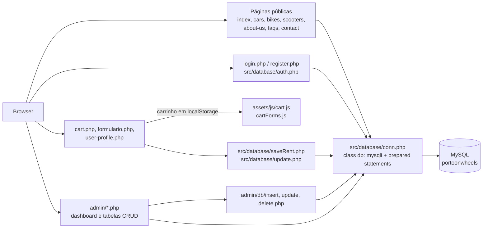
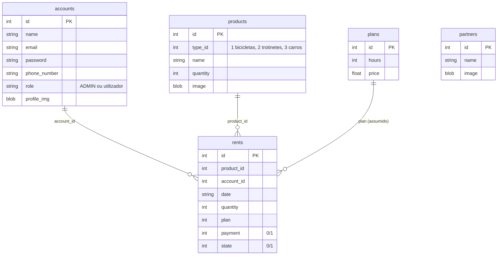

# Arquitetura — Porto on Wheels

> Documentação adicionada em 2026 (portfolio). Derivada do código-fonte; nada aqui foi escrito pela equipa original. O repositório **não contém esquema de base de dados**, por isso o modelo de dados abaixo é **inferido** a partir do SQL nos ficheiros PHP. English version: [ARCHITECTURE.md](ARCHITECTURE.md).

## Visão geral

Website PHP renderizado no servidor (sem framework, sem Composer) para alugar bicicletas, trotinetes e carros, com site público, área de utilizador autenticado e back-office de admin (um template Bootstrap "SB Admin 2"). As páginas são ficheiros PHP na raiz do repositório; cada página abre uma ligação MySQL através de um pequeno wrapper escrito à mão e consulta a base de dados diretamente.

## Ficheiros

| Caminho | Papel |
|---|---|
| `index.php`, `cars.php`, `bikes.php`, `scooters.php`, `about-us.php`, `faqs.php`, `contact.php` | Páginas públicas; as de catálogo leem `products` por `type_id` |
| `login.php`, `register.php`, `logout.php`, `src/database/auth.php` | Autenticação (um só script trata login e registo) |
| `cart.php`, `formulario.php`, `src/database/saveRent.php` | Carrinho (guardado no `localStorage` do browser), formulário de reserva, gravação dos alugueres |
| `user-profile.php`, `src/database/update.php` | Perfil e alugueres por tipo; atualização do perfil |
| `src/database/db.php` | `class db`: wrapper de `mysqli` com `query()` (prepared statements, `bind_param` automático), `fetchAll()`, `fetchArray()`, `numRows()`, `affectedRows()`, `lastInsertID()` |
| `src/database/conn.php` | Lê `PORTOONWHEELS_DB_HOST` / `_USER` / `_PASSWORD` (por omissão `localhost`, `root`, vazio) e abre a base `portoonwheels` |
| `src/layout/` | Cabeçalho e rodapé partilhados |
| `admin/` | Back-office: `index.php` (dashboard), `tables_{users,cars,bikes,scooters,partners,plans,rents}.php` e `admin/db/{insert,update,delete}.php` |
| `assets/` | CSS, JS e SASS do site público |

## Fluxos principais

### Login, registo e papéis

O `auth.php` recebe `email` e `password`. Se vier também `name`, insere em `accounts` e autentica o novo utilizador; caso contrário seleciona `accounts` por `email` e `password`. A sessão guarda `id`, `role`, `name`, `email`, `phone_number` e `profile_image`; `role == "ADMIN"` redireciona para `admin/index.php`.

### Aluguer

1. As páginas de catálogo listam `products` (tipo 1 bicicletas, 2 trotinetes, 3 carros).
2. O carrinho vive no `localStorage` (`assets/js/cart.js`); o `cart.php` segue depois para `formulario.php` (exige login).
3. O `formulario.php` envia `userID`, `rentDate` e uma lista JSON de produtos para `saveRent.php`, que insere uma linha em `rents` por produto (`plan` = duração do aluguer).
4. Os admins gerem `rents` e marcam `payment` / `state` (0 = Não, 1 = Sim) em `admin/tables_rents.php`.

## Modelo de dados (inferido)

Reconstruído a partir das instruções `SELECT`/`INSERT`/`UPDATE` do código. Os tipos das colunas e as chaves estrangeiras **não são conhecidos**; as relações abaixo são os joins que o código faz.

Notas: as imagens são guardadas na base de dados em binário (`file_get_contents` do upload). O formulário de alugueres do admin tem oito planos fixos (2 h a 4 dias) em vez de ler `plans`, por isso a ligação `rents.plan` → `plans.id` é uma suposição. TODO: confirmar com o BMS (esquema original, se ainda existir).

## Dependências

PHP com `mysqli` e MySQL. O front-end carrega Bootstrap 5.3.0-alpha2 e 4.5.0, DataTables 1.13.4 e Font Awesome 4.7.0 a partir de CDNs (é preciso acesso à internet), os assets do SB Admin 2 em `admin/` e um mapa Mapbox GL em `contact.php` (token removido). Não há `composer.json` nem `package.json`.

## Problemas conhecidos (verificados no código, não corrigidos)

| # | Problema | Evidência |
|---|---|---|
| 1 | As passwords são guardadas e comparadas em texto simples. | `auth.php`, `admin/db/*.php` |
| 2 | O registo guarda o **e-mail** na coluna da password (`VALUES (?,?,?,?)` é chamado com `$name, $email, $email, $phone_number`), logo um novo utilizador não consegue entrar com a password que escolheu. | `auth.php` |
| 3 | `admin/db/insert.php`, `update.php` e `delete.php` não têm verificação de sessão nem de papel: quem alcançar o URL pode criar, editar ou apagar contas, produtos, planos, parceiros e alugueres. | `admin/db/*.php` |
| 4 | As páginas de admin redirecionam com `header("Location: ...")` mas nunca fazem `exit`, por isso o resto da página continua a executar e é enviado. | `admin/index.php`, `admin/tables_*.php` |
| 5 | A atualização de perfil lê o id da conta do formulário (`new_id`) e não o compara com o utilizador da sessão (qualquer utilizador autenticado pode editar qualquer conta); chama `session_destroy()` sem `session_start()`. | `src/database/update.php` |
| 6 | O `saveRent.php` lê `userID` de um campo oculto em vez da sessão. | `formulario.php`, `saveRent.php` |
| 7 | O registo não verifica se o e-mail já existe (o código tem um `TODO`). | `auth.php` |
| 8 | `db::error()` imprime o erro MySQL em bruto e termina. | `db.php` |
| 9 | Sem `.gitignore`, sem esquema, sem testes, sem CI. | raiz do repositório |
