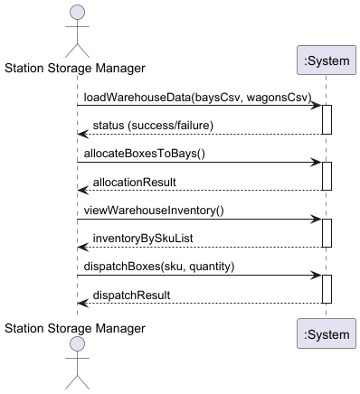

# USEI01 - Warehouse Management - Box Allocation and FEFO/FIFO Dispatch

## 1. Requirements Engineering

### 1.1. User Story Description

As a Station Storage Manager, I want the system to allocate incoming boxes to warehouse bays and manage inventory following FEFO/FIFO rules, so that goods are efficiently stored and dispatched in the correct order.

### 1.2. Customer Specifications and Clarifications 

The system must:

- Import box data from CSV files (wagons.csv) containing boxId, SKU, quantity, and optional expiry dates.
- Import bay data from CSV files (bays.csv) defining warehouse structure with aisles and bay numbers.
- Allocate boxes to bays ensuring each boxId is unique across the entire warehouse.
- Organize inventory following FEFO (First-Expired-First-Out) for perishable goods and FIFO (First-In-First-Out) for non-perishable goods.
- Support dispatch operations that consume stock from the front of the bay list in FEFO/FIFO order.
- Maintain warehouse structure even when bays become empty.

### 1.3. Acceptance Criteria

- Each boxId must be unique across the warehouse.
- Boxes with duplicate IDs must be rejected during allocation.
- Perishable goods (with expiry dates) must be ordered by expiry date ascending.
- Non-perishable goods must be ordered by arrival order.
- Perishable boxes must be positioned before non-perishable boxes in the same bay.
- Dispatch operations must always consume from the front of the list.
- Empty bays remain registered in the system.

### 1.4. Found out Dependencies

- **Business Rules**: BR08, BR09, BR10, BR11, BR12
- **Domain Model**: Warehouse, Bay, Box, Item
- **CSV Import**: CsvImportService for loading data

### 1.5 Input and Output Data

Input Data:
- Wagon/Box data: boxId, SKU, quantity, expiry date (optional), arrival timestamp
- Bay data: warehouse zone, aisle number, bay number, capacity

Output Data:
- Allocation success/failure status
- Warehouse inventory organized by SKU
- Bay contents display
- Dispatch results showing consumed boxes

### 1.6. System Sequence Diagram (SSD)

The SSD shows the main interactions between the Station Storage Manager and the System:
1. **loadWarehouseData**: Import bay structure and box data from CSV files
2. **allocateBoxesToBays**: Allocate boxes following FEFO/FIFO rules with uniqueness validation
3. **viewWarehouseInventory**: Display inventory organized by SKU
4. **dispatchBoxes**: Consume stock in correct FEFO/FIFO order

### 1.7 Other Relevant Remarks

The FEFO/FIFO ordering is critical for warehouse operations to minimize waste and ensure product quality. The system must maintain this ordering consistently across all operations including allocation, relocation, and dispatch.
