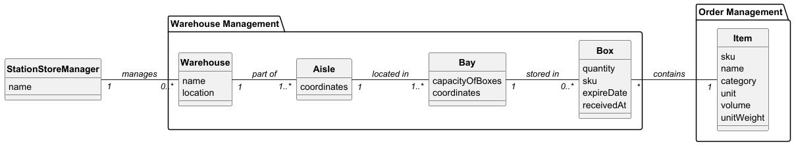

# USEI01 - Warehouse Management - Box Allocation and FEFO/FIFO Dispatch

## 2. Analysis

### 2.1. Relevant Domain Model Excerpt 

The following entities from the domain model are relevant for this use case:

**Warehouse Management Package:**
- **Warehouse**: Storage facility with name and location
  - Contains multiple Aisles (1 -- 1..*)
- **Aisle**: Corridor within warehouse identified by coordinates
  - Part of one Warehouse (1..* -- 1)
  - Contains multiple Bays (1 -- 1..*)
- **Bay**: Storage compartment with capacity and coordinates
  - Located in one Aisle (1..* -- 1)
  - Stores multiple Boxes (1 -- 0..*)
- **Box**: Storage unit with quantity, SKU, expiry date, and received timestamp
  - Stored in one Bay (0..* -- 1)
  - Contains one Item type (0..* -- 1)

**Order Management Package:**
- **Item**: Product definition with SKU, name, category, unit, volume, and unit weight
  - Referenced by multiple Boxes (1 -- 0..*)

**Key Relationships:**
- Warehouse → Aisle → Bay → Box → Item (containment hierarchy)
- Each Box has unique identifier and references a specific Item via SKU
- Boxes are organized within Bays following FEFO/FIFO rules

### 2.2. Other Remarks

The allocation process involves:
1. **Uniqueness Validation**: Each boxId must be unique across all bays in the warehouse.
2. **FEFO/FIFO Ordering**: Boxes are sorted using Box.compareTo() which implements:
   - Perishable boxes (with expiry date) come before non-perishable boxes
   - Among perishable boxes: sort by expiry date ascending
   - Among non-perishable boxes: sort by arrival timestamp ascending
3. **Bay Allocation Strategy**: System tries to place boxes in bays ordered by aisle and bay number.
4. **Capacity Management**: Bays have a maximum capacity that cannot be exceeded.

The dispatch operation ensures that stock is consumed from the front of the sorted list, maintaining the FEFO/FIFO principle.
