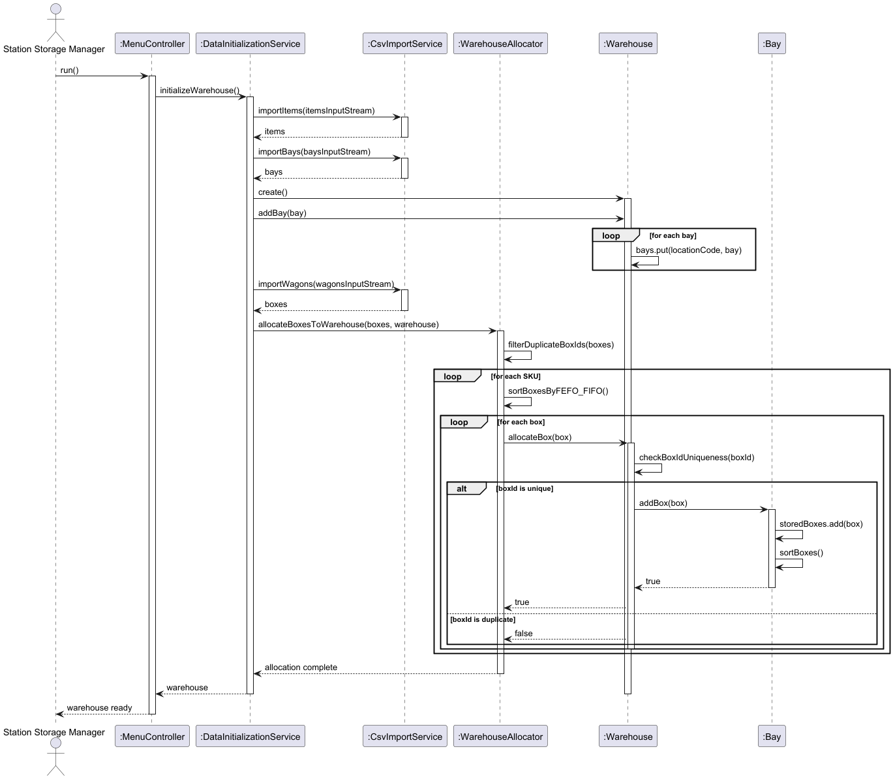
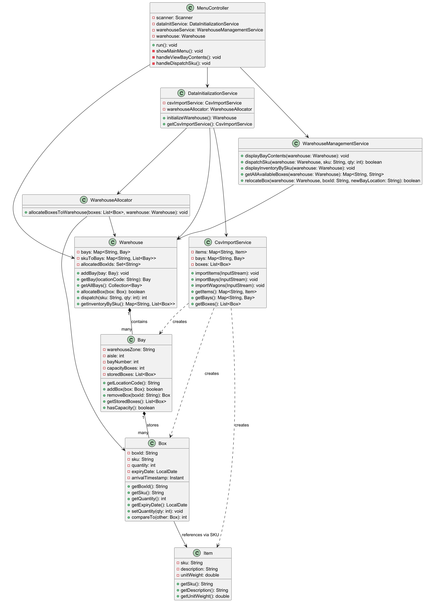

# USEI01 - Warehouse Management - Box Allocation and FEFO/FIFO Dispatch

## 3. Design

### 3.1. Rationale

**The rationale grounds on the SSD interactions and the identified input/output data.**

| Interaction ID | Question: Which class is responsible for... | Answer  | Justification (with patterns)  |
|:-------------  |:--------------------- |:------------|:---------------------------- |

| Step 1  		 | ...coordinating the warehouse initialization? | DataInitializationService | Controller Pattern: coordinates CSV loading and warehouse setup |
| Step 2  		 | ...importing CSV data? | CsvImportService | Information Expert: knows CSV format and parsing |
| Step 3  		 | ...allocating boxes to warehouse? | WarehouseAllocator | Pure Fabrication: dedicated service for allocation logic |
| Step 4  		 | ...validating boxId uniqueness? | Warehouse | Information Expert: warehouse knows all allocated boxIds |
| Step 5  		 | ...storing boxes in correct order? | Bay | Information Expert: bay maintains its box collection |
| Step 6  		 | ...comparing box ordering? | Box | Information Expert: box knows its own expiry date and arrival time |
| Step 7  		 | ...managing dispatch operations? | Warehouse | Information Expert: warehouse coordinates bay operations |
| Step 8  		 | ...displaying inventory and bay contents? | WarehouseManagementService | Pure Fabrication: service layer for business operations |

### Systematization

According to the taken rationale, the conceptual classes promoted to software classes are:

* Warehouse
* Bay
* Box
* Item

Other software classes (i.e. Pure Fabrication) identified:

* DataInitializationService
* CsvImportService
* WarehouseAllocator
* WarehouseManagementService

## 3.2. Sequence Diagram (SD)

## 3.3. Class Diagram (CD)

### 3.4. Design Patterns Applied

- **Information Expert**: Warehouse manages boxId uniqueness, Bay stores and orders boxes
- **Pure Fabrication**: Service classes (DataInitializationService, CsvImportService, WarehouseAllocator) created for specific responsibilities
- **Strategy**: Box.compareTo() implements FEFO/FIFO ordering strategy
- **Repository**: Warehouse acts as repository for bays and inventory
