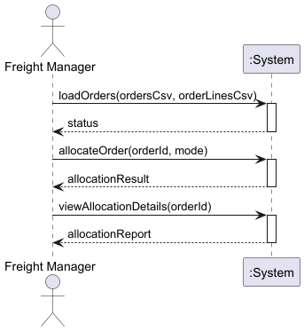

# USEI02 - Order Allocation with STRICT and PARTIAL Modes

## 1. Requirements Engineering

### 1.1. User Story Description

As a Station Storage Manager, I want to process customer orders by allocating available inventory to order lines, with support for both STRICT and PARTIAL fulfillment modes, so that orders can be dispatched efficiently based on available stock.

### 1.2. Customer Specifications and Clarifications 

The system must:

- Process orders from CSV files (orders.csv and order_lines.csv).
- Sort orders by priority (ascending), due date (ascending), and order ID (ascending).
- Sort order lines within each order by line number (ascending).
- Allocate inventory following FEFO/FIFO rules from the warehouse.
- Support STRICT mode: only fully satisfied order lines are eligible.
- Support PARTIAL mode: partially satisfied order lines are allowed.
- Generate allocation fragments showing which boxes and quantities are assigned to each order line.
- Produce eligibility status for each order line (ELIGIBLE, PARTIAL, UNDISPATCHABLE).
- Maintain inventory snapshot during allocation to prevent double allocation.

### 1.3. Acceptance Criteria

- Orders must be processed in the correct sequence: priority → dueDate → orderId.
- Order lines within each order must be processed by lineNo ascending.
- In STRICT mode, an order with any UNDISPATCHABLE line makes the entire order ineligible.
- In PARTIAL mode, partial allocations are retained even if not fully satisfied.
- Stock quantities cannot become negative.
- Each allocation fragment must reference the box, bay, and aisle where the item is located.
- The system must produce a complete AllocationResult with eligibilities and allocations.

### 1.4. Found out Dependencies

- **Business Rules**: BR13, BR14, BR15
- **Domain Model**: Order, OrderLine, Warehouse, Box, AllocationFragment, LineEligibility
- **User Stories**: USEI01 (requires warehouse to be populated)

### 1.5 Input and Output Data

Input Data:
- Orders: orderId, dueDate, priority
- Order lines: orderId, lineNo, SKU, requested quantity
- Warehouse: current inventory state
- Eligibility mode: STRICT or PARTIAL

Output Data:
- AllocationResult containing:
  - List of LineEligibility (orderId, lineNo, status, requested, allocated)
  - List of AllocationFragment (orderId, lineNo, SKU, qty, boxId, aisle, bay)
- Summary statistics: eligible count, partial count, undispatchable count

### 1.6. System Sequence Diagram (SSD)

The SSD shows the main interactions between the Freight Manager and the System:
1. **loadOrders**: Import order and order line data from CSV files
2. **allocateOrder**: Process order allocation with specified mode (STRICT or PARTIAL)
3. **viewAllocationDetails**: Display allocation results with eligibility statuses and fragments

### 1.7 Other Relevant Remarks

The allocation process must respect the FEFO/FIFO ordering from USEI01 and consume stock from the warehouse in the correct sequence. The inventory snapshot ensures that once stock is allocated to an order, it cannot be allocated again within the same processing run.
