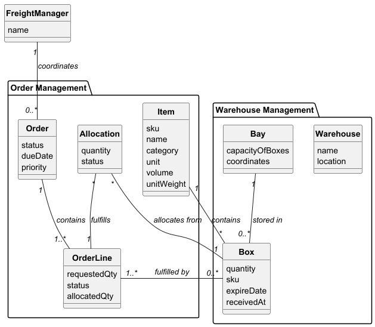

# USEI02 - Order Allocation with STRICT and PARTIAL Modes

## 2. Analysis

### 2.1. Relevant Domain Model Excerpt 

The following entities from the domain model are relevant for this use case:

**Order Management Package:**
- **Order**: Customer request with status, due date, and priority
  - Contains multiple OrderLines (1 -- 1..*)
  - Generates one PickingPlan (1 -- 1)
- **OrderLine**: Individual line item with requested quantity, status, and allocated quantity
  - Part of one Order (1..* -- 1)
  - Fulfilled by multiple Boxes (1..* -- 0..*)
  - Fulfilled by Allocation (many-to-one relationship)
- **Item**: Product definition with SKU, name, category, unit, volume, and unit weight
  - Referenced by OrderLines and Boxes

**Warehouse Management Package:**
- **Warehouse**: Storage facility providing inventory data
  - Part of one Aisle (1 -- 1..*)
- **Bay**: Storage compartment with capacity and coordinates
  - Stores multiple Boxes (1 -- 0..*)
- **Box**: Storage unit with quantity, SKU, expiry date, and received timestamp
  - Stored in one Bay (0..* -- 1)
  - Fulfills multiple OrderLines (0..* -- 1..*)
  - Contains one Item type (0..* -- 1)
- **Allocation**: Represents allocation of inventory with quantity and status
  - Allocates from one Box (many-to-one)
  - Fulfills one OrderLine (many-to-one)

**Key Relationships:**
- Order → OrderLine (1 to many)
- OrderLine ↔ Box (many to many, through Allocation)
- Box → Item (many to one)
- Allocation connects OrderLine with Box inventory

### 2.2. Other Remarks

The allocation process involves:
1. **Order Sorting**: Orders are sorted using Order.compareTo() by priority, dueDate, and orderId.
2. **Inventory Snapshot**: A snapshot of available inventory is created to track allocations.
3. **FEFO/FIFO Consumption**: For each SKU, boxes are consumed in the order returned by the warehouse.
4. **Fragment Creation**: When allocating from a box, an AllocationFragment is created linking the order line to the specific box and location.
5. **Eligibility Determination**:
   - **ELIGIBLE**: Requested quantity fully allocated
   - **PARTIAL**: Some quantity allocated but not all (only in PARTIAL mode)
   - **UNDISPATCHABLE**: No quantity allocated
6. **Mode-Specific Behavior**:
   - **STRICT mode**: If any line is UNDISPATCHABLE, all allocations for that order are discarded
   - **PARTIAL mode**: Partial allocations are kept even if not fully satisfied

The allocation algorithm maintains referential integrity by tracking which boxes and quantities are consumed during the allocation process.
