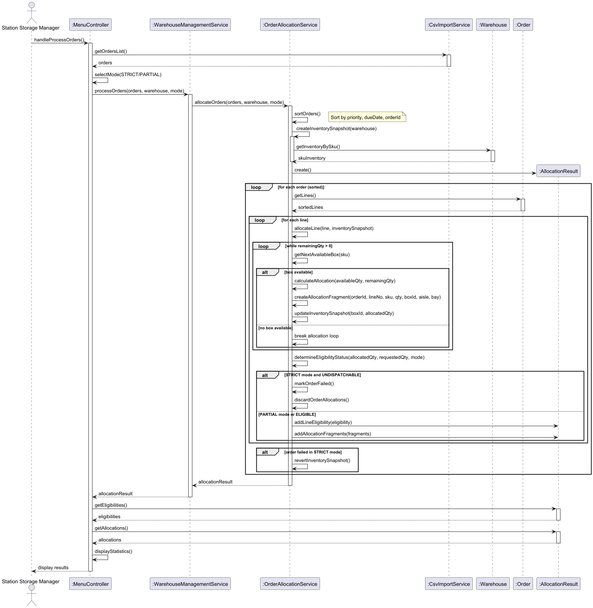
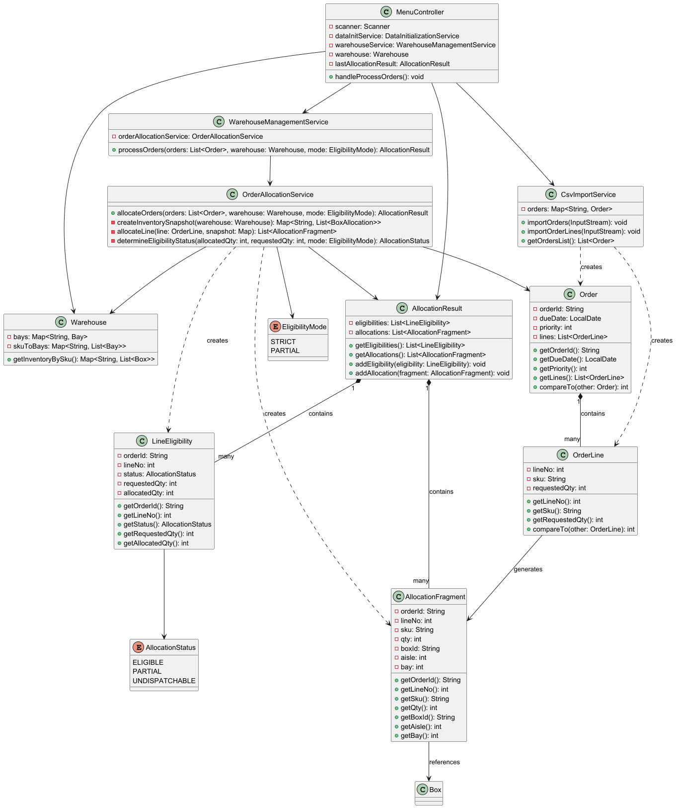

# USEI02 - Order Allocation with STRICT and PARTIAL Modes

## 3. Design

### 3.1. Rationale

**The rationale grounds on the SSD interactions and the identified input/output data.**

| Interaction ID | Question: Which class is responsible for... | Answer                     | Justification (with patterns)                                 |
|:---------------|:--------------------------------------------|:---------------------------|:--------------------------------------------------------------|
| Step 1  		     | ...coordinating order processing?           | MenuController             | Controller Pattern: handles user interaction                  |
| Step 2  		     | ...providing order data?                    | CsvImportService           | Information Expert: knows order data from CSV                 |
| Step 3  		     | ...orchestrating allocation process?        | WarehouseManagementService | Pure Fabrication: business operation service                  |
| Step 4  		     | ...implementing allocation algorithm?       | OrderAllocationService     | Pure Fabrication: dedicated allocation logic                  |
| Step 5  		     | ...sorting orders?                          | Order                      | Information Expert: order knows its own priority and due date |
| Step 6  		     | ...providing inventory by SKU?              | Warehouse                  | Information Expert: warehouse knows current stock             |
| Step 7  		     | ...creating inventory snapshot?             | OrderAllocationService     | Information Expert: needs to track allocation state           |
| Step 8  		     | ...creating allocation fragments?           | OrderAllocationService     | Creator: assembles fragments from box data                    |
| Step 9  		     | ...determining eligibility status?          | OrderAllocationService     | Information Expert: knows allocation rules                    |
| Step 10 		     | ...storing allocation results?              | AllocationResult           | Information Expert: container for eligibilities and fragments |

### Systematization

According to the taken rationale, the conceptual classes promoted to software classes are:

* Order
* OrderLine
* AllocationFragment
* LineEligibility
* AllocationResult

Other software classes (i.e. Pure Fabrication) identified:

* MenuController
* WarehouseManagementService
* OrderAllocationService
* CsvImportService

## 3.2. Sequence Diagram (SD)

## 3.3. Class Diagram (CD)

### 3.4. Design Patterns Applied

- **Information Expert**: Order sorting, Warehouse inventory access
- **Pure Fabrication**: OrderAllocationService for allocation logic
- **Strategy**: Different behavior for STRICT vs PARTIAL mode
- **Creator**: OrderAllocationService creates AllocationFragments
- **Low Coupling**: Service layer separates UI from domain logic
