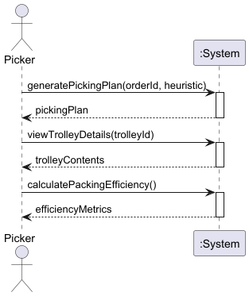

# USEI03 - Trolley Packing with Multiple Heuristics

## 1. Requirements Engineering

### 1.1. User Story Description

As a Picker, I want the system to pack allocation fragments into trolleys using different bin packing heuristics, so that I can optimize the number of trolleys needed and their weight utilization for efficient warehouse picking operations.

### 1.2. Customer Specifications and Clarifications 

The system must:

- Accept allocation fragments from USEI02 as input for packing.
- Calculate the weight of each allocation fragment using item unit weight data.
- Support three bin packing heuristics:
  - **First Fit (FF)**: Place item in first available trolley where it fits.
  - **First Fit Decreasing (FFD)**: Sort items by weight descending, then apply First Fit.
  - **Best Fit Decreasing (BFD)**: Sort items by weight descending, place in trolley with smallest remaining capacity that fits.
- Respect trolley weight capacity constraints (never exceed capacity).
- Split allocations across multiple trolleys if a single allocation exceeds capacity.
- Generate a PickingPlan with trolley assignments and statistics.
- Calculate average trolley utilization percentage.

### 1.3. Acceptance Criteria

- Trolleys must never exceed their specified weight capacity.
- Each allocation fragment must be assigned to one or more trolleys.
- Large allocations exceeding trolley capacity must be split across multiple trolleys.
- The system must calculate and display:
  - Total number of trolleys used
  - Average utilization percentage
  - Current weight and remaining capacity per trolley
- FFD and BFD heuristics should generally produce equal or fewer trolleys than FF.
- The PickingPlan must contain all trolleys with their assigned allocations.

### 1.4. Found out Dependencies

- **Business Rules**: BR16, BR17
- **Domain Model**: AllocationFragment, Item, Trolley, PickingPlan, WeightedAllocation
- **User Stories**: USEI02 (requires allocation fragments), USEI01 (requires item weight data)

### 1.5 Input and Output Data

Input Data:
- List of AllocationFragment from USEI02
- Trolley capacity in kg
- Selected packing heuristic (FF, FFD, or BFD)
- Map of Items with unit weight information

Output Data:
- PickingPlan containing:
  - List of Trolley objects with assigned allocations
  - Total number of trolleys used
  - Average utilization percentage
  - Per-trolley statistics (current weight, remaining capacity)
  - Notes (errors or warnings)

### 1.6. System Sequence Diagram (SSD)

The SSD shows the main interactions between the Picker and the System:
1. **generatePickingPlan**: Create picking plan with specified heuristic (FF, FFD, or BFD) and trolley capacity
2. **viewTrolleyDetails**: Display contents and statistics for specific trolley
3. **calculatePackingEfficiency**: Show overall packing efficiency metrics and utilization
7. System generates PickingPlan with trolley assignments
8. System displays packing statistics and trolley details

### 1.7 Other Relevant Remarks

The bin packing problem is NP-hard, so heuristics provide approximate solutions. FFD and BFD generally produce better results than FF but require sorting overhead. The system must handle edge cases like allocations larger than trolley capacity by splitting them across multiple trolleys.
