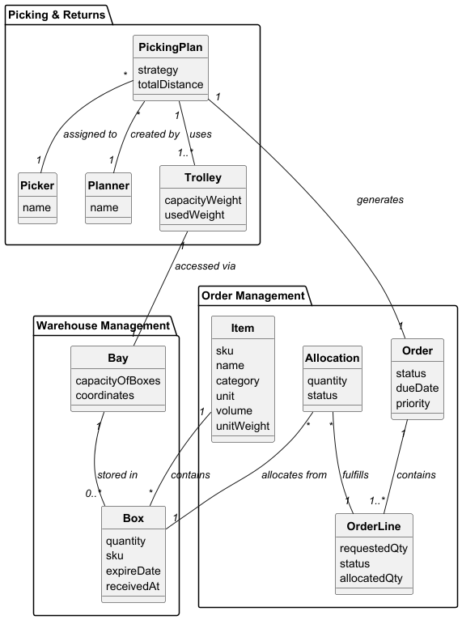

# USEI03 - Trolley Packing with Multiple Heuristics

## 2. Analysis

### 2.1. Relevant Domain Model Excerpt 

The following entities from the domain model are relevant for this use case:

**Picking & Returns Package:**
- **PickingPlan**: Execution plan with strategy and total distance
  - Uses multiple Trolleys (1 -- 1..*)
  - Assigned to one Picker (1..* -- 1)
  - Created by one Planner (1..* -- 1)
- **Trolley**: Transport container with capacity weight and used weight
  - Used by one PickingPlan (1..* -- 1)
  - Accesses one Bay (1 -- 1)

**Order Management Package:**
- **Order**: Customer request that generates PickingPlan
  - Generates one PickingPlan (1 -- 1)
  - Contains multiple OrderLines (1 -- 1..*)
- **OrderLine**: Individual line item with requested and allocated quantities
  - Part of one Order (1..* -- 1)
  - Fulfilled by multiple Boxes (1..* -- 0..*)
- **Item**: Product definition with SKU, name, category, unit, volume, and **unit weight**
  - Referenced by Boxes and OrderLines
- **Allocation**: Represents inventory allocation with quantity and status
  - Allocates from Box (many-to-one)
  - Fulfills OrderLine (many-to-one)

**Warehouse Management Package:**
- **Bay**: Storage location accessed via Trolley
  - Accessed via one Trolley (1 -- 1)
  - Stores multiple Boxes (1 -- 0..*)
- **Box**: Storage unit containing items with quantity
  - Contains one Item type (0..* -- 1)

**Key Relationships:**
- PickingPlan → Trolley (1 to many)
- Order → PickingPlan (1 to 1)
- OrderLine → Allocation → Box → Item (allocation chain)
- Item provides unit weight for packing calculations
- Trolley has capacity constraints for weight-based packing

### 2.2. Other Remarks

The packing process involves:
1. **Weight Calculation**: For each AllocationFragment, calculate total weight = item.unitWeight × allocation.qty. Uses caching to avoid repeated lookups.
2. **Heuristic Selection**:
   - **First Fit (FF)**: Process allocations in original order, place in first trolley with sufficient capacity.
   - **First Fit Decreasing (FFD)**: Sort allocations by weight descending, then apply FF.
   - **Best Fit Decreasing (BFD)**: Sort allocations by weight descending, place in trolley with smallest remaining capacity that fits.
3. **Capacity Constraints**: Each trolley has a maximum weight capacity. If an allocation exceeds capacity, it must be split.
4. **Allocation Splitting**: Large allocations are divided into portions that fit individual trolleys, creating new WeightedAllocations for each portion.
5. **Statistics Calculation**: PickingPlan calculates average utilization = sum(trolley.currentWeight) / (trolley.capacity × trolley.count).

The implementation uses a greedy approach where decisions are made locally without backtracking, providing good performance with reasonable solution quality.
