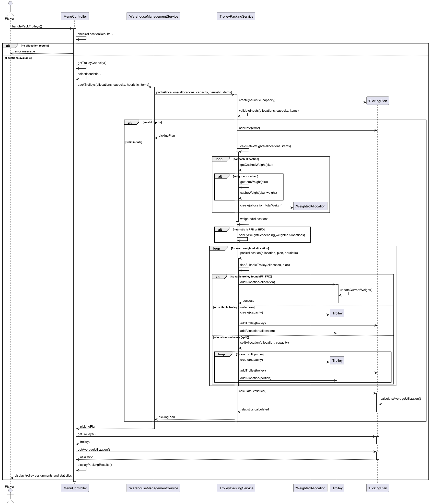
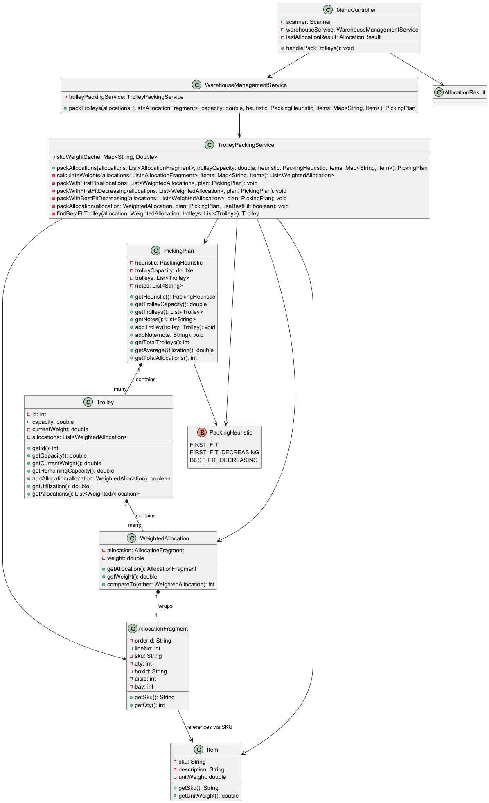

# USEI03 - Trolley Packing with Multiple Heuristics

## 3. Design

### 3.1. Rationale

**The rationale grounds on the SSD interactions and the identified input/output data.**

| Interaction ID | Question: Which class is responsible for... | Answer                     | Justification (with patterns)                               |
|:---------------|:--------------------------------------------|:---------------------------|:------------------------------------------------------------|
| Step 1  		     | ...coordinating trolley packing?            | MenuController             | Controller Pattern: handles user interaction                |
| Step 2  		     | ...validating allocation availability?      | MenuController             | Controller: checks prerequisites                            |
| Step 3  		     | ...orchestrating packing process?           | WarehouseManagementService | Pure Fabrication: business operation service                |
| Step 4  		     | ...implementing packing algorithms?         | TrolleyPackingService      | Pure Fabrication: dedicated packing logic                   |
| Step 5  		     | ...calculating allocation weights?          | TrolleyPackingService      | Information Expert: has access to items and allocations     |
| Step 6  		     | ...caching SKU weights?                     | TrolleyPackingService      | Performance optimization pattern                            |
| Step 7  		     | ...wrapping allocations with weights?       | WeightedAllocation         | Information Expert: knows weight and allocation             |
| Step 8  		     | ...storing packed allocations?              | Trolley                    | Information Expert: trolley knows its contents and capacity |
| Step 9  		     | ...comparing allocation weights?            | WeightedAllocation         | Information Expert: knows its own weight                    |
| Step 10 		     | ...calculating utilization statistics?      | PickingPlan                | Information Expert: knows all trolleys and their weights    |
| Step 11 		     | ...determining best fit trolley?            | TrolleyPackingService      | Strategy Pattern: implements BFD algorithm                  |

### Systematization

According to the taken rationale, the conceptual classes promoted to software classes are:

* AllocationFragment
* Item
* WeightedAllocation
* Trolley
* PickingPlan
* PackingHeuristic (enum)

Other software classes (i.e. Pure Fabrication) identified:

* MenuController
* WarehouseManagementService
* TrolleyPackingService

## 3.2. Sequence Diagram (SD)

## 3.3. Class Diagram (CD)

### 3.4. Design Patterns Applied

- **Strategy Pattern**: Different packing heuristics (FF, FFD, BFD) implemented as strategies
- **Information Expert**: Weight calculation, trolley capacity management
- **Pure Fabrication**: TrolleyPackingService for packing algorithms
- **Caching**: SKU weight cache to avoid repeated lookups
- **Wrapper/Decorator**: WeightedAllocation wraps AllocationFragment with weight information
