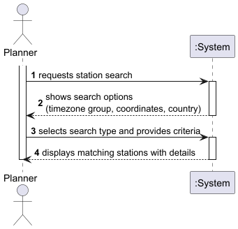

# USEI06 - Station Search Operations

## 1. Requirements Engineering

### 1.1. User Story Description

As a planner, I want to search for railway stations using different criteria (timezone group, coordinates, country), so I can quickly find relevant stations for route planning.

### 1.2. Customer Specifications and Clarifications 

The system must:

- Import station data from CSV files containing station name, coordinates, timezone, and attributes (isCity, isMainStation, isAirport)
- Support search by timezone group (e.g., "CET", "WET/GMT")
- Support search by exact coordinates (latitude, longitude)
- Support search by country code (e.g., "PT", "ES")
- Return results sorted appropriately (by country for timezone searches, by name for others)
- Display comprehensive station information including all attributes

### 1.3. Acceptance Criteria

- Search by timezone group returns all stations in that group, ordered by country
- Search by coordinates handles multiple stations at the same location
- Search by country returns all stations in that country, sorted by name
- Invalid coordinates (lat not in [-90, 90], lon not in [-180, 180]) are rejected
- Empty search criteria are rejected with appropriate error messages
- Statistics are provided showing total timezones, stations, and unique coordinates

### 1.4. Found out Dependencies

- **Domain Model**: Station, TimeZone, Coordinates
- **Data Structures**: BST for timezone indexing, Map for country grouping
- **CSV Import**: CsvImportService for loading station data
- **Repository**: StationsRepository for data storage and retrieval

### 1.5 Input and Output Data

**Input Data:**
- Timezone group string (e.g., "CET", "WET/GMT", "EET")
- Latitude value (range: -90 to 90)
- Longitude value (range: -180 to 180)
- Country code (e.g., "PT", "ES", "FR")

**Output Data:**
- List of stations matching search criteria
- Station details: name, country, coordinates, timezone, attributes (isCity, isMainStation, isAirport)
- Statistics: total timezones, total stations, unique coordinate count

### 1.6. System Sequence Diagram (SSD)

