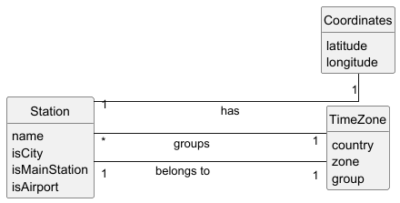

# USEI06 - Station Search Operations

## 2. Analysis

### 2.1. Relevant Domain Model Excerpt 

**Station Management Package:**
- **Station**: Railway station entity
  - Attributes: name, isCity, isMainStation, isAirport
  - Has Coordinates (1 -- 1)
  - Belongs to TimeZone (1 -- 1)
  
- **Coordinates**: Geographic location
  - Attributes: latitude, longitude
  - Validates ranges: lat [-90, 90], lon [-180, 180]
  
- **TimeZone**: Time zone information
  - Attributes: country, zone, group
  - Groups multiple Stations (1 -- 0..*)

**Key Relationships:**
- Station → Coordinates (composition)
- Station → TimeZone (association)
- TimeZone groups stations by country and timezone group

### 2.2. Search Operations

**1. Search by Timezone Group:**
- Iterate through timezone BST in order
- Match timezone group (case-insensitive)
- Collect all stations from matching timezones
- Sort stations by name within each timezone
- Return aggregated results

**2. Search by Coordinates:**
- Validate coordinate ranges
- Iterate through all stations
- Match exact latitude and longitude
- Handle multiple stations at same location
- Sort results by name

**3. Search by Country:**
- Validate country input
- Iterate through timezone-station map
- Match country (case-insensitive)
- Collect all stations from matching timezones
- Sort results by name

### 2.3. Data Structures

- **BST&lt;TimeZone&gt;**: Ordered timezone index for efficient traversal
- **Map&lt;TimeZone, List&lt;Station&gt;&gt;**: Timezone to stations mapping
- **Map&lt;String, BST&lt;Station&gt;&gt;**: Name-based station index (first letter)

### 2.4. Other Remarks

All searches validate input parameters and throw IllegalArgumentException for invalid data. The service layer (StationSearchService) encapsulates all search logic, providing a clean interface for the UI layer.
