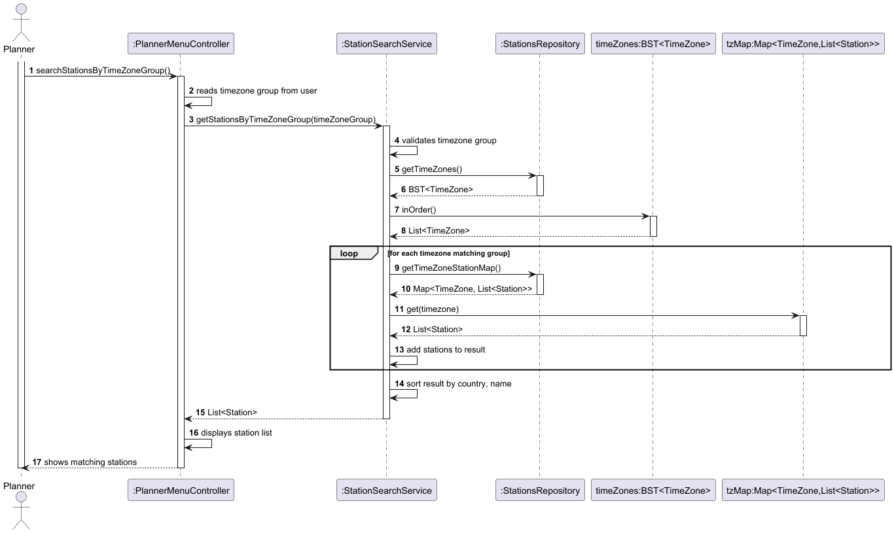
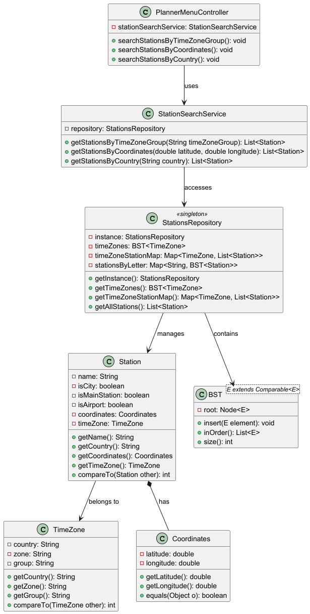

# USEI06 - Station Search Operations

## 3. Design

### 3.1. Rationale

| **Class**             | **Responsibility**                               | **Patterns Applied**             |
|-----------------------|--------------------------------------------------|----------------------------------|
| PlannerMenuController | Handles user input, orchestrates search requests | Controller                       |
| StationSearchService  | Implements search business logic                 | Service, Pure Fabrication        |
| StationsRepository    | Manages station data structures and retrieval    | Repository, Singleton            |
| Station               | Domain entity representing a railway station     | Domain Model, Information Expert |
| TimeZone              | Domain entity representing timezone information  | Domain Model                     |
| Coordinates           | Value object for geographic location             | Value Object                     |
| BST&lt;E&gt;          | Binary search tree data structure                | Generics                         |

### 3.2. Sequence Diagram



### 3.3. Class Diagram



### 3.4. Design Patterns Applied

#### Repository Pattern
- **Problem**: Direct access to data structures spreads data access logic across the system
- **Solution**: StationsRepository centralizes all data access, providing clean query methods
- **Implementation**: Singleton repository with multiple indexed data structures (BST, Maps)

#### Service Layer
- **Problem**: Business logic mixed with UI concerns
- **Solution**: StationSearchService encapsulates all search algorithms and validation
- **Implementation**: Service class with pure business methods, no UI dependencies

#### Domain Model
- **Problem**: Rich domain with complex relationships needs to be represented
- **Solution**: Station, TimeZone, Coordinates model real-world entities with proper associations
- **Implementation**: Classes with clear responsibilities, composition and association relationships

### 3.5. Algorithm Design

**Search by Timezone Group Algorithm:**
```
1. Validate timezone group is not empty
2. Convert group to lowercase for case-insensitive comparison
3. Iterate BST in-order
4. For each timezone matching group:
   - Retrieve stations from timezone-station map
   - Add all stations to result list
5. Sort result by country then name
6. Return sorted list
```

**Search by Coordinates Algorithm:**
```
1. Validate latitude in [-90, 90]
2. Validate longitude in [-180, 180]
3. Create target Coordinates object
4. Iterate all stations
5. Match stations with exact coordinates
6. Sort results by name
7. Return sorted list
```

**Search by Country Algorithm:**
```
1. Validate country is not empty
2. Convert country to lowercase
3. Iterate timezone-station map
4. For each timezone matching country:
   - Add all stations to result list
5. Sort results by name
6. Return sorted list
```

### 3.6. Tests

Refer to [Tests and Implementation](../04.tests-and-implementation/USEI06-tests-and-implementation.md)
