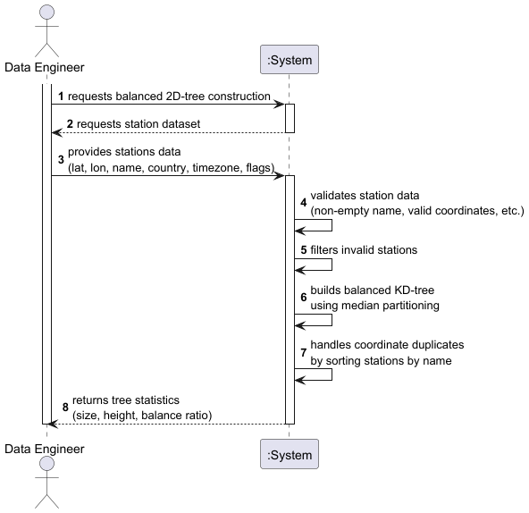

# USEI07 — Build Balanced 2D-Tree on Latitude/Longitude

## 1. Requirements Engineering

### 1.1 User story
As a data engineer, I want to build a balanced 2D-tree using latitude and longitude coordinates with a bulk build strategy that uses BST/AVL trees, so that range and proximity searches run efficiently and deterministically.

### 1.2 Customer specifications and clarifications
The system must:

- Implement a balanced KD-tree (`k = 2`) construction algorithm using median-based recursive partitioning.
- Use BST/AVL trees of latitude and longitude from USEI06 for efficient bulk loading.
- Handle multiple stations at identical coordinates by sorting them by name (ascending).
- Validate all station data during construction (non-empty name, valid coordinates, valid timezone).
- Filter out invalid stations while preserving valid ones.
- Provide detailed construction statistics (size, height, balance ratio).
- Ensure the tree is sufficiently balanced to achieve O(log n) search performance.

### 1.3 Acceptance criteria
- All valid stations are inserted into the KD-tree (non-empty name, valid coordinates).
- Invalid stations are rejected (invalid coordinates, empty names, missing timezone).
- Multiple stations with identical coordinates are preserved and sorted by name.
- Tree construction uses median-based partitioning for balance.
- Balance ratio (actual height / optimal height) ≤ 3.0 for large datasets.
- Construction time complexity: O(n log n).
- Tree supports efficient spatial operations (range search, nearest neighbor).

### 1.4 Dependencies
- USEI06: BST/AVL trees for latitude and longitude used in bulk/balanced construction.
- Domain model: `Station`, `Coordinates`, `TimeZone` classes.
- Data structures: `KDTree` extending BST, `KDNode` with spatial coordinates.
- Interfaces: `KDTreeNodeInterface` for spatial object compatibility.
- Repository: `StationsRepository` for station data access.
- Validation: Coordinate validation, station data validation.

### 1.5 Input and output data

#### Input
- List of European railway stations (~64,000 records).
- Station attributes: name, coordinates (latitude, longitude), country, timezone group.
- Station flags: `isCity`, `isMainStation`, `isAirport`.
- Validation rules for data integrity.

#### Output
- Balanced `KDTree<Station>` instance.
- Construction statistics:
    - Total stations processed
    - Valid stations inserted
    - Tree height
    - Balance ratio (actual / optimal height)
    - Construction time
    - Validation report of filtered invalid stations

### 1.6 System Sequence Diagram (SSD)

