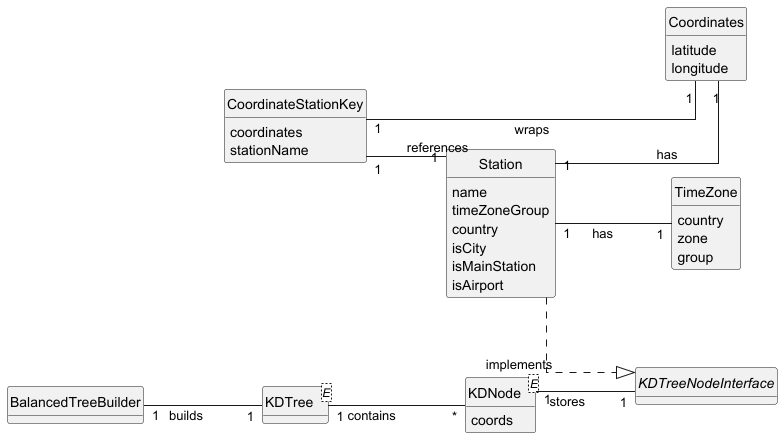

# USEI07 - Build Balanced 2D-Tree on Latitude/Longitude

## 2. Analysis

### 2.1 Relevant Domain Model Excerpt

**Tree Construction Package**

- **`BalancedTreeBuilder`** — Core construction service  
    - Methods: `buildBalancedKDTree()`, `buildOptimizedBalancedKDTree()`  
    - Uses bulk-loading strategy with median partitioning  
    - Validates and filters station data prior to construction

- **`Station`** — Railway station implementing `KDTreeNodeInterface`  
    - Attributes: `name`, `timeZone`, `country`, `isCity`, `isMainStation`, `isAirport`  
    - Has `Coordinates` (1 — 1)  
    - Provides `getCoords()` for KD-tree positioning  
    - Implements validation: `isValid()`

- **`Coordinates`** — Geographic location  
    - Attributes: `latitude`, `longitude`  
    - Validates ranges: `lat ∈ [-90, 90]`, `lon ∈ [-180, 180]`  
    - Implements `Comparable` for coordinate-based sorting

**KD-Tree Infrastructure**

- **`KDTree<E>`** — Generic 2D spatial index (extends BST)  
    - Uses `KDNode<E>` storing elements with `Point2D` coordinates  
    - Supports balanced construction via bulk loading  
    - Provides `height()` and `size()` for balance analysis

- **`KDTreeNodeInterface`**  
    - Requires `getCoords()` returning `Point2D.Double`

- **`CoordinateStationKey`** — Composite key for sorting  
    - Attributes: `coordinates`, `stationName`, station reference  
    - Primary sort by coordinates, secondary by station name — enables deterministic ordering and handling of duplicates

### 2.2 Balanced Construction Strategy

#### Median-Based Partitioning
- Recursively partition stations by alternating dimensions:
    - Depth 0: split by X-axis (longitude)  
    - Depth 1: split by Y-axis (latitude)  
    - Depth 2: back to X-axis, etc.
- Select median element at each partition to promote balance

#### Bulk Loading Algorithm
1. Filter and validate all stations  
2. Sort stations by the current splitting dimension  
3. Select median station as current node  
4. Recursively build left subtree with stations before median  
5. Recursively build right subtree with stations after median  
6. Handle coordinate duplicates via secondary (name) sorting

#### Duplicate Coordinate Handling
- Multiple stations at identical coordinates are preserved  
- Secondary sorting by station name ensures deterministic ordering  
- All stations remain accessible despite coordinate collisions

### 2.3 Data Structures
- `KDTree<Station>` — Main spatial index constructed by `BalancedTreeBuilder`  
- `KDNode<E>` — Tree node with element + `Point2D.Double` coordinates  
- `AVL<CoordinateStationKey>` — Balanced BST used in construction strategy  
- `CoordinateStationKey` — Composite key for coordinate-based organization  
- `List<Station>` — Input dataset from `StationsRepository`

### 2.4 Complexity Analysis
- Construction: O(n log n) for median-based recursive partitioning (average)  
- Balance guarantee: height ≤ 3 × log2 n for real-world geographic data (empirical)  
- Space: O(n) for n stations  
- Validation: O(n) for station data filtering  
- Sorting: O(n log n) per partitioning level

### 2.5 Other Remarks
- The balanced construction leverages BST/AVL infrastructure from USEI06 while implementing specialized 2D spatial partitioning.  
- The median-based approach ensures near-logarithmic height for efficient spatial queries.  
- Generic design maintains compatibility with any `KDTreeNodeInterface` implementation while providing geographic-specific optimizations for station data.
