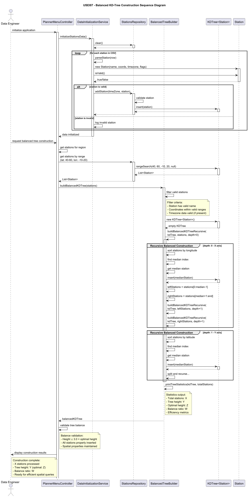
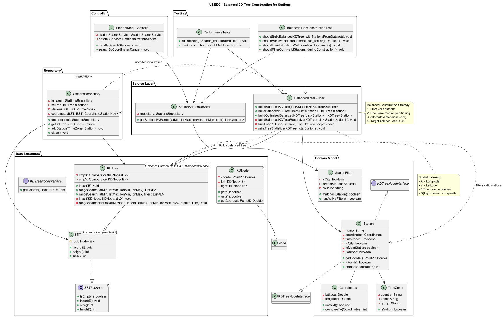

# USEI07 - Balanced 2D-Tree Construction for Stations

## 3. Design

### 3.1 Rationale

| Class | Responsibility | Patterns Applied |
|---|---|---|
| PlannerMenuController | Orchestrates data initialization and tree construction requests | Controller |
| DataInitializationService | Loads and validates station data from CSV sources | Service, Builder Pattern |
| StationsRepository | Manages KDTree instance and station collections | Repository, Singleton |
| BalancedTreeBuilder | Constructs balanced KD-trees using median partitioning | Strategy, Pure Fabrication |
| KDTree<E> | Generic 2D spatial tree structure | Generics, Template Method |
| KDNode<E> | Tree node storing spatial elements | Node Pattern |
| KDTreeNodeInterface | Contract for spatially indexable objects | Interface, Dependency Inversion |
| Station | Domain entity implementing spatial interface | Domain Model, Information Expert |
| Coordinates | Encapsulates geographic coordinates with validation | Value Object |

### 3.2 Sequence Diagram


### 3.3 Class Diagram


### 3.4 Design Patterns Applied

- Strategy Pattern  
    - Problem: Different balancing strategies needed for various datasets.  
    - Solution: BalancedTreeBuilder provides multiple construction methods.  
    - Implementation: `buildBalancedKDTree()`, `buildOptimizedBalancedKDTree()`, `buildBalancedKDTreeDirect()`.

- Template Method  
    - Problem: Recursive construction logic shared across methods.  
    - Solution: Base recursive algorithm with specialized variants.  
    - Implementation: `buildBalancedKDTreeRecursive()` template with bulk-loading optimization.

- Factory Method  
    - Problem: Complex KD-tree construction logic scattered.  
    - Solution: Centralized tree building service.  
    - Implementation: `BalancedTreeBuilder` as tree construction factory.

- Iterator Pattern  
    - Problem: Need to process stations in sorted order for median selection.  
    - Solution: Use Java Collections sorting with custom comparators.  
    - Implementation: `Comparator.comparingDouble()` for coordinate sorting.

### 3.5 Balanced Construction Algorithm Design

Balanced KD-Tree construction (median partitioning). Filter invalid stations, pick median by alternating axes, insert median as node, recurse.

Pseudocode:

```
buildBalancedKDTree(stations):
1. stations = filter(stations, station.isValid())
2. kdTree = new KDTree()
3. if stations not empty:
         buildBalancedKDTreeRecursive(kdTree, stations, depth=0)
4. printStatistics(kdTree)
5. return kdTree
```

```
buildBalancedKDTreeRecursive(kdTree, stations, depth):
1. if stations.empty(): return
2. axis = depth % 2    # 0 = longitude (X), 1 = latitude (Y)
3. sort stations by axis coordinate
4. medianIndex = stations.size() / 2
5. medianStation = stations[medianIndex]
6. kdTree.insert(medianStation)
7. leftStations  = stations[0 .. medianIndex-1]
8. rightStations = stations[medianIndex+1 .. end]
9. buildBalancedKDTreeRecursive(kdTree, leftStations,  depth+1)
10. buildBalancedKDTreeRecursive(kdTree, rightStations, depth+1)
```

Bulk loading optimization:

```
buildOptimizedBalancedKDTree(stations):
1. stations = filter(stations, station.isValid())
2. kdTree = new KDTree()
3. bulkLoadKDTree(kdTree, stations, depth=0)
4. printDetailedStatistics(kdTree)
5. return kdTree

bulkLoadKDTree(kdTree, stations, depth):
- same recursive structure, using in-place sorting and median selection
- optimized for memory efficiency with large datasets
```

Balance validation metrics:

- actualHeight = `kdTree.height()`
- optimalHeight = `ceil(log2(totalStations))`
- balanceRatio = `actualHeight / optimalHeight`

Acceptance criteria:
- Excellent: balanceRatio ≤ 1.5
- Good:      balanceRatio ≤ 2.0
- Acceptable: balanceRatio ≤ 3.0
- Poor:      balanceRatio > 3.0

### 3.6 Complexity Analysis

Time Complexity
- Construction: O(n log n) per level dominated by sorting
- Median selection (with sorting at each level): O(n log n) per level
- Total (approx): O(n log² n) for perfectly balanced recursion with sort per level

Space Complexity
- Tree storage: O(n)
- Recursive stack: O(log n) for balanced tree
- Temporary arrays: O(n) during construction (can be reduced with in-place/bulk methods)

Performance Characteristics
- Best case: height ≈ log2(n)
- Expected case: height ≈ 1.5 × log2(n) for real-world geographic data
- Worst case: height = n (degenerate, avoided by median selection)

### 3.7 Validation Strategy

Tree quality metrics:
- Balance ratio (actual vs optimal height)
- Spatial distribution (even partitioning)
- Query performance (range and nearest-neighbor search)
- Completeness (all valid stations inserted)

Test scenarios:
- Large datasets (10k+ stations)
- Stations with identical coordinates
- Edge cases: single station, empty list
- Geographic clustering scenarios

### 3.8 Tests
Refer to [Tests and Implementation](../04.tests-and-implementation/USEI07-tests-and-implementation.md)

