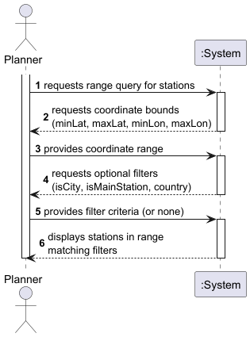

# USEI08 - 2D Range Query for Stations

## 1. Requirements Engineering

### 1.1. User Story Description

As a planner, I want to query the 2D-tree for all stations within a latitude and longitude range with optional filters (isCity, isMainStation, country), so I can efficiently find stations in a geographic area.

### 1.2. Customer Specifications and Clarifications 

The system must:

- Implement a KD-tree data structure for efficient 2D spatial queries
- Support range queries defined by min/max latitude and longitude
- Provide optional filtering by station attributes (isCity, isMainStation, country)
- Efficiently prune search space using KD-tree properties
- Return results sorted by name
- Validate coordinate ranges (lat: [-90, 90], lon: [-180, 180])

### 1.3. Acceptance Criteria

- KD-tree is populated with all stations during data import
- Range query searches only relevant subtrees (pruning optimization)
- Query with no filters returns all stations in geographic range
- Query with filters applies them to results within range
- Invalid coordinate ranges are rejected with IllegalArgumentException
- Empty or inverted ranges are rejected
- Performance is O(√n + k) where n = total stations, k = matching stations

### 1.4. Found out Dependencies

- **Domain Model**: Station, Coordinates
- **Data Structures**: KDTree extending BST, KDNode with Point2D coordinates
- **Interfaces**: KDTreeNodeInterface for spatial objects
- **Repository**: StationsRepository manages KDTree instance
- **Filtering**: StationFilter for optional criteria

### 1.5 Input and Output Data

**Input Data:**
- Minimum latitude (range: -90 to 90)
- Maximum latitude (range: -90 to 90)
- Minimum longitude (range: -180 to 180)
- Maximum longitude (range: -180 to 180)
- Optional filter: isCity (boolean)
- Optional filter: isMainStation (boolean)
- Optional filter: country (String)

**Output Data:**
- List of stations within geographic bounds matching filters
- Station details: name, country, coordinates, timezone, attributes
- Results sorted by name

### 1.6. System Sequence Diagram (SSD)

