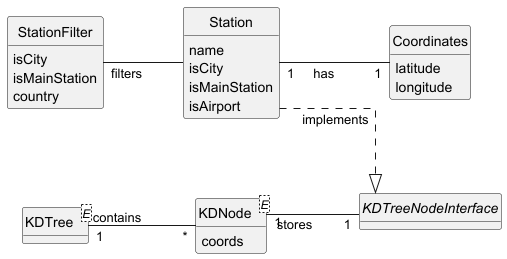

# USEI08 - 2D Range Query for Stations

## 2. Analysis

### 2.1. Relevant Domain Model Excerpt 

**Station Management Package:**
- **Station**: Railway station implementing KDTreeNodeInterface
  - Attributes: name, isCity, isMainStation, isAirport
  - Has Coordinates (1 -- 1)
  - Provides getCoords() for KD-tree positioning
  
- **Coordinates**: Geographic location
  - Attributes: latitude, longitude
  - Validates ranges: lat [-90, 90], lon [-180, 180]

**KD-Tree Infrastructure:**
- **KDTree&lt;E&gt;**: Generic 2D spatial index extending BST
  - Uses KDNode&lt;E&gt; storing elements with Point2D coordinates
  - Alternates between X (longitude) and Y (latitude) axis splits
  - Supports range queries with optional filtering
  
- **KDTreeNodeInterface**: Interface for spatial objects
  - Requires getCoords() returning Point2D.Double
  
- **StationFilter**: Optional query filters
  - Attributes: isCity, isMainStation, country

### 2.2. KD-Tree Structure

**Tree Construction:**
- Root splits on X-axis (longitude)
- Left child: longitude < parent longitude
- Right child: longitude >= parent longitude
- Children alternate to Y-axis (latitude)
- Process continues alternating axes at each level

**Range Search Algorithm:**
- Check if current node is in range bounds
- Apply optional filter predicate if provided
- Recursively search left subtree if range overlaps left region
- Recursively search right subtree if range overlaps right region
- Pruning: skip subtrees that cannot contain range matches

### 2.3. Data Structures

- **KDTree&lt;Station&gt;**: Main spatial index in StationsRepository
- **KDNode&lt;E&gt;**: Tree node with element + Point2D.Double coordinates
- **Point2D.Double**: Java standard class for 2D coordinates (x=lon, y=lat)
- **Comparator&lt;KDNode&lt;E&gt;&gt;**: X-axis and Y-axis comparators for split logic
