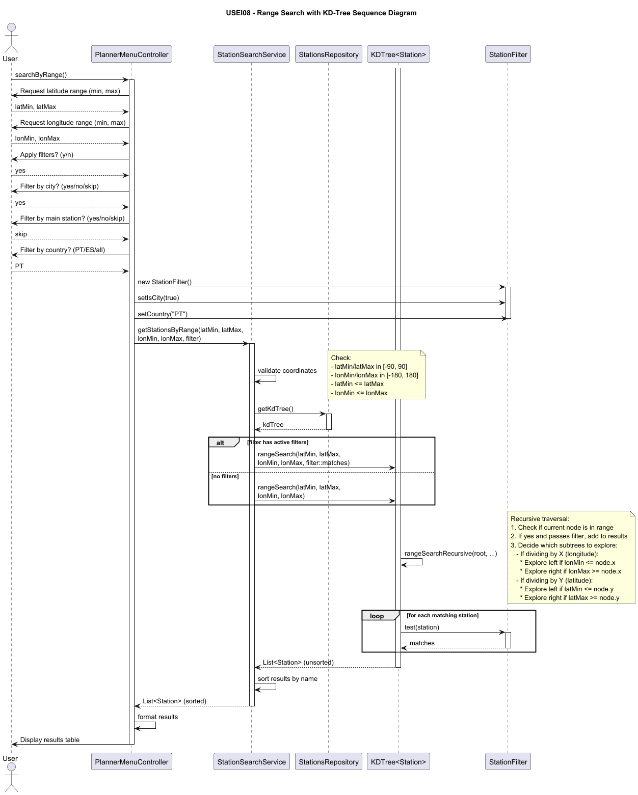
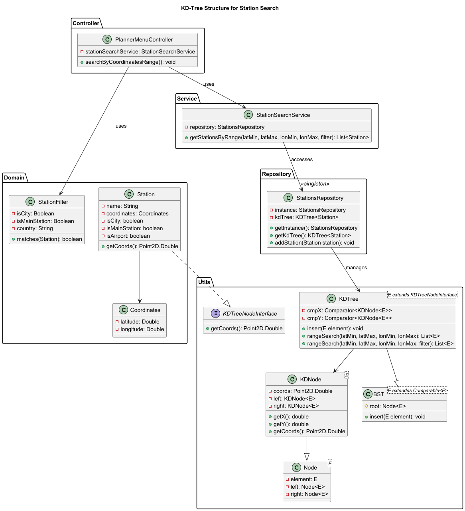

# USEI08 - 2D Range Query for Stations

## 3. Design

### 3.1. Rationale

| **Class**             | **Responsibility**                                                | **Patterns Applied**             |
|-----------------------|-------------------------------------------------------------------|----------------------------------|
| PlannerMenuController | Handles user input for range queries, coordinates filter creation | Controller                       |
| StationSearchService  | Implements range search business logic with validation            | Service, Pure Fabrication        |
| StationsRepository    | Manages KDTree and provides access to spatial index               | Repository, Singleton            |
| KDTree&lt;E&gt;       | Generic 2D spatial tree with efficient range queries              | Generics, Template Method        |
| KDNode&lt;E&gt;       | Tree node storing element with 2D coordinates                     | Node Pattern                     |
| KDTreeNodeInterface   | Contract for objects that can be indexed spatially                | Interface, Dependency Inversion  |
| Station               | Domain entity implementing spatial interface                      | Domain Model, Information Expert |
| StationFilter         | Encapsulates optional filter criteria                             | Value Object, Builder Pattern    |

### 3.2. Sequence Diagram



### 3.3. Class Diagram



### 3.4. Design Patterns Applied

#### Repository Pattern
- **Problem**: Direct access to KD-tree spreads spatial query logic
- **Solution**: StationsRepository centralizes KD-tree management
- **Implementation**: Singleton repository with KDTree&lt;Station&gt; field

#### Generics with Interface Constraint
- **Problem**: KD-tree hardcoded to Station type limits reusability
- **Solution**: KDTree&lt;E extends KDTreeNodeInterface&gt; supports any spatial type
- **Implementation**: Interface requires getCoords() for positioning

#### Strategy Pattern (via Predicate)
- **Problem**: Hard-coding filter logic in range search reduces flexibility
- **Solution**: Accept Predicate&lt;E&gt; parameter for custom filtering
- **Implementation**: rangeSearch(bounds, filter) applies predicate to candidates

#### Template Method
- **Problem**: Range search logic is complex with repeated structure
- **Solution**: KD-tree extends BST, overrides insert/search for 2D behavior
- **Implementation**: Alternating axis comparators, recursive search template

### 3.5. KD-Tree Algorithm Design

**Insertion Algorithm:**
```
1. Create KDNode with element and coordinates from getCoords()
2. If tree empty, set as root
3. Otherwise:
   - Start at root, depth = 0
   - Use X-comparator if depth is even (longitude axis)
   - Use Y-comparator if depth is odd (latitude axis)
   - Compare node coordinates using current axis comparator
   - Recurse left/right based on comparison
   - Increment depth for next level
4. Return inserted node
```

**Range Search Algorithm:**
```
rangeSearch(minX, maxX, minY, maxY, filter):
1. Validate bounds: min < max for both axes
2. Validate coordinate ranges
3. Call recursive helper with root, depth 0
4. Sort results by element name
5. Return sorted list

rangeSearchRecursive(node, depth, minX, maxX, minY, maxY, filter):
1. If node is null, return empty list
2. Get node coordinates (x, y) from element.getCoords()
3. If coordinates in bounds [minX, maxX] x [minY, maxY]:
   - If filter is null OR filter.test(element):
     - Add element to results
4. Determine current axis from depth (even = X, odd = Y)
5. If X-axis:
   - If minX <= node.x: recurse left subtree
   - If maxX > node.x: recurse right subtree
6. If Y-axis:
   - If minY <= node.y: recurse left subtree
   - If maxY > node.y: recurse right subtree
7. Return collected results
```


### 3.6. Tests

Refer to [Tests and Implementation](../04.tests-and-implementation/USEI08-tests-and-implementation.md)
