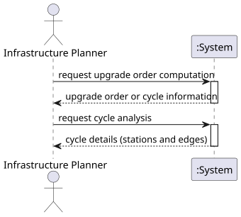

# USEI11 - Station Upgrade Order with Dependency Analysis

## 1. Requirements Engineering

### 1.1. User Story Description

As an infrastructure planner, I need to compute an ordering of Belgian stations based on the directed track dependencies so I can schedule station upgrades in an order that respects all directional dependencies; and if such an order does not exist because of cycles, I want to see which stations and links are involved in those cycles.

### 1.2. Customer Specifications and Clarifications 

The Belgian rail edges define directional dependencies for an upgrade or signaling project where each directed edge A → B means: "Before station B can be fully upgraded, its incoming neighbors (like A) must be upgraded first" to ensure compatibility, signaling, or control dependencies flow in the direction of traffic.

The system must:
- Compute a topological ordering of stations based on directed dependencies
- Detect cycles in the dependency graph
- If no cycles exist, provide the complete upgrade order
- If cycles exist, identify all stations and edges involved in cycles
- Provide temporal complexity analysis

### 1.3. Acceptance Criteria

- Graph without cycles: return order of all vertices (topological sort)
- Graph with cycles: return stations involved in cycles and the edges forming cycles
- Algorithm must detect all cycles if they exist
- Temporal complexity analysis must be provided

### 1.4. Found out Dependencies

- **Domain Model**: Station, TrackConnection
- **Repository**: RailwayNetworkRepository
- **Graph Algorithms**: Kahn's Topological Sort algorithm
- **Domain Results**: UpgradePlanResult, CycleInfo

### 1.5 Input and Output Data

Input Data:
- Directed railway network graph (stations and track connections)
- Track connection dependencies

Output Data:
- If acyclic: topological order of all stations
- If cyclic: list of stations in cycles, list of edges in cycles
- Graph statistics (vertices count, edges count)
- Complexity analysis documentation

### 1.6. System Sequence Diagram (SSD)

The SSD shows the main interactions between the Infrastructure Planner and the System:
1. **request upgrade order computation**: Compute topological sort or detect cycles
2. **request cycle analysis**: Show detailed cycle information if cycles exist

### 1.7 Other Relevant Remarks

The upgrade order computation uses Kahn's algorithm for topological sorting. This algorithm processes vertices with in-degree 0 and removes them from the graph, updating in-degrees of adjacent vertices. If all vertices are processed, a valid topological order exists. Otherwise, remaining vertices are part of cycles.
