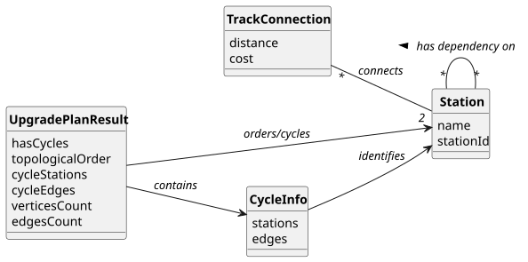

# USEI11 - Station Upgrade Order with Dependency Analysis

## 2. Analysis

### 2.1. Relevant Domain Model Excerpt 

The following entities from the domain model are relevant for this use case:

**Railway Network Package:**
- **Station**: Railway station representing an upgrade target
  - Connected to other stations via directed TrackConnections
  - Dependencies flow in the direction of edges
- **TrackConnection**: Directed railway track dependency
  - Represents upgrade dependency between two stations
  - Direction A → B means A must be upgraded before B

**Graph Structure:**
- **Graph&lt;Station, TrackConnection&gt;**: Directed network representation
  - Vertices: Stations to be upgraded
  - Edges: Directed dependencies (TrackConnections)
  - Must be treated as directed graph for topological sorting

**Repository:**
- **RailwayNetworkRepository**: Manages the directed railway network graph
  - Provides access to loaded network data
  - Singleton pattern for centralized access

**Result Classes:**
- **UpgradePlanResult**: Contains computation results
  - Topological order (if acyclic)
  - Cycle stations and edges (if cyclic)
  - Graph statistics
- **CycleInfo**: Information about detected cycles
  - Stations involved in cycles
  - Edges forming cycles

### 2.2. Other Remarks

The upgrade order computation involves:
1. **Internal Structures**: Build in-degree map and adjacency list from graph
2. **In-Degree Initialization**: Count incoming edges for each station
3. **Queue Processing**: Start with stations having in-degree 0
4. **Vertex Removal**: Process stations and update neighbor in-degrees
5. **Cycle Detection**: If not all vertices processed, cycles exist
6. **Cycle Identification**: Vertices with remaining in-degree > 0 are in cycles

The algorithm respects directional dependencies where an edge A → B means A must be upgraded before B can be upgraded.
