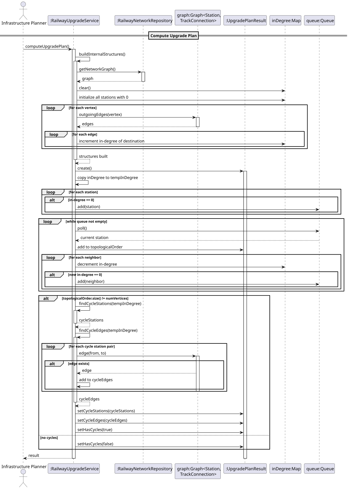
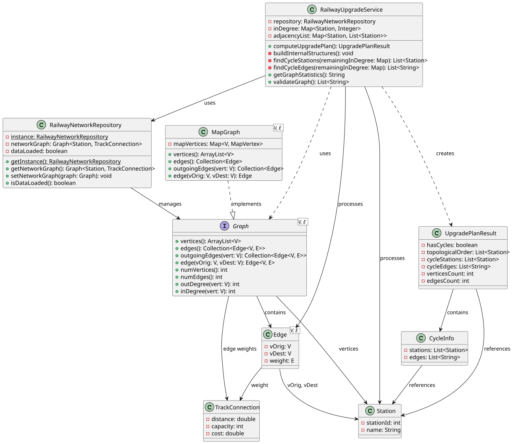

# USEI11 - Station Upgrade Order with Dependency Analysis

## 3. Design

### 3.1. Rationale

**The rationale grounds on the SSD interactions and the identified input/output data.**

| Interaction ID | Question: Which class is responsible for... | Answer  | Justification (with patterns)  |
|:-------------  |:--------------------- |:------------|:---------------------------- |
| Step 1  		 | ...coordinating upgrade order computation? | RailwayUpgradeService | Service Pattern: orchestrates topological sort |
| Step 2  		 | ...providing railway network data? | RailwayNetworkRepository | Repository Pattern, Singleton: centralized data access |
| Step 3  		 | ...implementing Kahn's algorithm? | RailwayUpgradeService | Information Expert: knows topological sort logic |
| Step 4  		 | ...storing internal structures? | RailwayUpgradeService | Information Expert: maintains in-degree and adjacency list |
| Step 5  		 | ...detecting cycles? | RailwayUpgradeService | Information Expert: analyzes remaining in-degrees |
| Step 6  		 | ...finding cycle stations? | RailwayUpgradeService | Information Expert: identifies vertices in cycles |
| Step 7  		 | ...finding cycle edges? | RailwayUpgradeService | Information Expert: identifies edges between cycle stations |
| Step 8  		 | ...managing complete workflow? | RailwayUpgradeService | Facade: provides unified interface for all operations |

### Systematization

According to the taken rationale, the conceptual classes promoted to software classes are:

* Station
* TrackConnection
* Graph&lt;Station, TrackConnection&gt;
* UpgradePlanResult
* CycleInfo

Other software classes (i.e. Pure Fabrication) identified:

* RailwayUpgradeService
* RailwayNetworkRepository

## 3.2. Sequence Diagram (SD)



## 3.3. Class Diagram (CD)



### 3.4. Design Patterns Applied

- **Service Pattern**: RailwayUpgradeService encapsulates upgrade planning business logic
- **Repository Pattern**: RailwayNetworkRepository provides centralized data access
- **Singleton**: RailwayNetworkRepository ensures single instance
- **Facade**: computeUpgradePlan() provides unified workflow interface
- **Information Expert**: RailwayUpgradeService knows topological sort algorithm

### 3.5. Algorithm Design

**Kahn's Topological Sort Algorithm:**
```
1. Build internal structures from graph:
   a. Initialize in-degree map for all stations
   b. Build adjacency list for all stations
   c. Count incoming edges for each station
   
2. Find initial vertices (in-degree = 0):
   a. Add all stations with in-degree 0 to queue
   
3. Process queue:
   a. Remove station from queue
   b. Add station to topological order
   c. For each neighbor of current station:
      - Decrement neighbor's in-degree
      - If neighbor's in-degree becomes 0, add to queue
   
4. Check completion:
   a. If topological order size = total vertices:
      - Return topological order (no cycles)
   b. Else:
      - Find cycle stations (remaining in-degree > 0)
      - Find cycle edges (edges between cycle stations)
      - Return cycle information
```

**Cycle Detection:**
```
1. After topological sort, check if all vertices processed
2. If not, remaining vertices have in-degree > 0
3. These vertices are involved in cycles
4. Find edges between cycle vertices
```

**Cycle Edge Finding:**
```
1. Get all stations with remaining in-degree > 0
2. For each pair of cycle stations (from, to):
   a. Check if edge exists from → to
   b. If exists, add to cycle edges list
```
