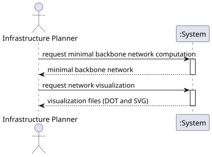

# USEI12 - Minimal Backbone Network

## 1. Requirements Engineering

### 1.1. User Story Description

As an infrastructure planner, I want to compute a minimum network over the rail network (treated as undirected) so I can identify a minimal backbone that connects all stations with minimum total track length.

### 1.2. Customer Specifications and Clarifications 

To estimate a cost baseline for maintenance or expansion, it is necessary to identify a minimal track subset that connects all reachable stations.

The system must:
- Compute a minimal backbone network from the railway graph treated as undirected
- Generate a graph representing the Minimal Backbone Network
- Export the result as a DOT file with vertices placed at their XY coordinates
- Generate an SVG visualization using Graphviz neato application
- Provide temporal complexity analysis

### 1.3. Acceptance Criteria

- The minimal backbone must connect all reachable stations
- The total track length must be minimal (Minimum Spanning Tree)
- DOT file must place each vertex at its XY coordinates
- Visual appearance should be similar to standard railway maps
- SVG file must be generated from the DOT file using neato

### 1.4. Found out Dependencies

- **Domain Model**: Station, TrackConnection
- **Repository**: RailwayNetworkRepository
- **Graph Algorithms**: Kruskal's MST algorithm
- **External Tool**: Graphviz neato for SVG generation

### 1.5 Input and Output Data

Input Data:
- Railway network graph (stations and track connections)
- Station coordinates (X, Y)
- Track connection distances

Output Data:
- Minimal Backbone Network graph
- DOT file representation with XY coordinates
- SVG visualization file
- Complexity analysis documentation

### 1.6. System Sequence Diagram (SSD)

The SSD shows the main interactions between the Infrastructure Planner and the System:
1. **calculateMinimalBackbone**: Compute MST using Kruskal's algorithm
2. **generateDotFile**: Export graph to DOT format with coordinates
3. **generateSvgFromDot**: Generate SVG visualization using neato
4. **generateMinimalBackboneVisualization**: Complete workflow

### 1.7 Other Relevant Remarks

The minimal backbone network is a Minimum Spanning Tree (MST) of the railway network graph. Kruskal's algorithm is used to compute the MST by sorting edges by cost and adding them if they don't create cycles.
