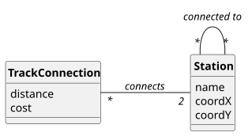

# USEI12 - Minimal Backbone Network

## 2. Analysis

### 2.1. Relevant Domain Model Excerpt 

The following entities from the domain model are relevant for this use case:

**Railway Network Package:**
- **Station**: Railway station with name and geographic coordinates
  - Has coordX and coordY for positioning
  - Connected to other stations via TrackConnections
- **TrackConnection**: Railway track segment between two stations
  - Contains distance and cost information
  - Weight for MST calculation

**Graph Structure:**
- **Graph&lt;Station, TrackConnection&gt;**: Network representation
  - Vertices: Stations
  - Edges: TrackConnections with distance/cost weights
  - Treated as undirected for MST computation

**Repository:**
- **RailwayNetworkRepository**: Manages the railway network graph
  - Provides access to loaded network data
  - Singleton pattern for centralized access

### 2.2. Other Remarks

The minimal backbone network computation involves:
1. **Graph Treatment**: The railway network is treated as an undirected graph for MST computation
2. **Edge Deduplication**: Edges are filtered to remove duplicates (keeping only one direction)
3. **Edge Sorting**: Edges are sorted by distance in ascending order
4. **Cycle Detection**: Uses Depth-First Search to check if adding an edge creates a cycle
5. **MST Construction**: Incrementally builds the MST by adding edges that don't create cycles

The visualization process involves:
1. **DOT Generation**: Creates a Graphviz DOT file with station coordinates
2. **Positioning**: Uses neato layout with fixed positions based on XY coordinates
3. **SVG Export**: Calls Graphviz neato to generate SVG from DOT file
