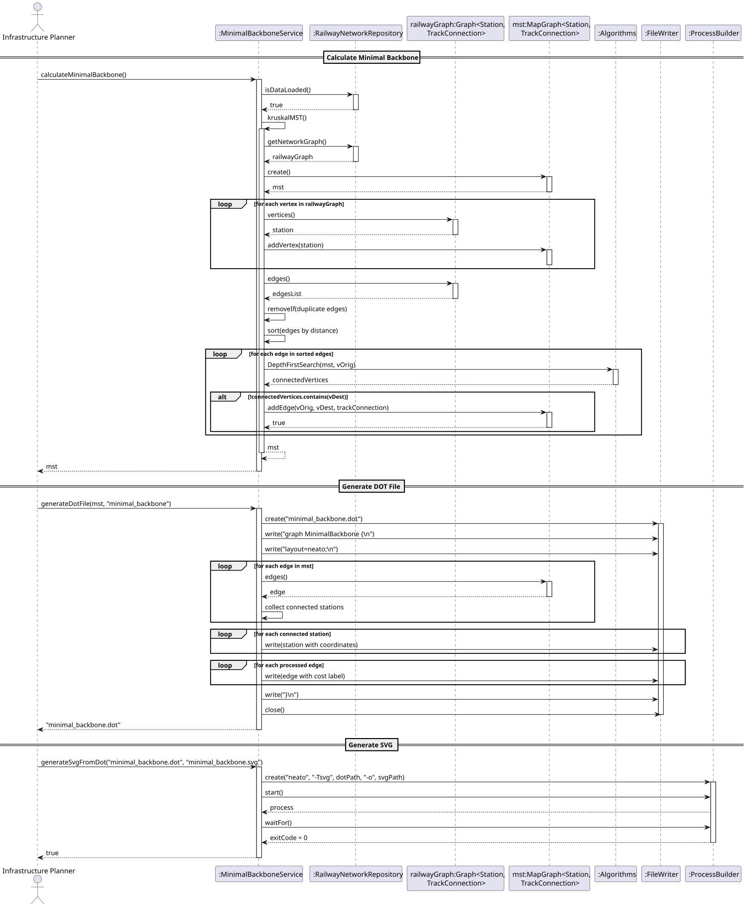
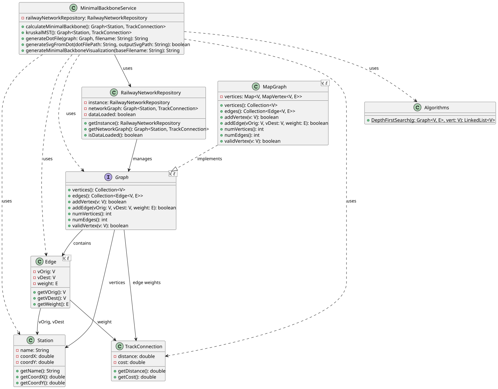

# USEI12 - Minimal Backbone Network

## 3. Design

### 3.1. Rationale

**The rationale grounds on the SSD interactions and the identified input/output data.**

| Interaction ID | Question: Which class is responsible for... | Answer  | Justification (with patterns)  |
|:-------------  |:--------------------- |:------------|:---------------------------- |
| Step 1  		 | ...coordinating MST calculation? | MinimalBackboneService | Service Pattern: orchestrates MST computation |
| Step 2  		 | ...providing railway network data? | RailwayNetworkRepository | Repository Pattern, Singleton: centralized data access |
| Step 3  		 | ...implementing Kruskal's algorithm? | MinimalBackboneService | Information Expert: knows MST algorithm logic |
| Step 4  		 | ...storing MST graph structure? | MapGraph&lt;Station, TrackConnection&gt; | Information Expert: maintains graph structure |
| Step 5  		 | ...performing cycle detection? | Algorithms.DepthFirstSearch | Pure Fabrication: reusable graph algorithm |
| Step 6  		 | ...generating DOT file representation? | MinimalBackboneService | Information Expert: knows output format requirements |
| Step 7  		 | ...executing neato visualization? | MinimalBackboneService | Controller: coordinates external tool execution |
| Step 8  		 | ...managing complete workflow? | MinimalBackboneService | Facade: provides unified interface for all operations |

### Systematization

According to the taken rationale, the conceptual classes promoted to software classes are:

* Station
* TrackConnection
* Graph&lt;Station, TrackConnection&gt;

Other software classes (i.e. Pure Fabrication) identified:

* MinimalBackboneService
* RailwayNetworkRepository
* Algorithms (with DepthFirstSearch)
* MapGraph&lt;V, E&gt;

## 3.2. Sequence Diagram (SD)



## 3.3. Class Diagram (CD)



### 3.4. Design Patterns Applied

- **Service Pattern**: MinimalBackboneService encapsulates MST business logic
- **Repository Pattern**: RailwayNetworkRepository provides centralized data access
- **Singleton**: RailwayNetworkRepository ensures single instance
- **Facade**: generateMinimalBackboneVisualization() provides unified workflow interface
- **Pure Fabrication**: Algorithms class provides reusable graph algorithms

### 3.5. Algorithm Design

**Kruskal's MST Algorithm:**
```
1. Get railway graph from repository
2. Create empty MST graph
3. Add all vertices from original graph to MST
4. Get all edges from original graph
5. Remove duplicate edges (keep only one direction)
6. Sort edges by distance ascending
7. For each edge in sorted order:
   a. Get origin and destination stations
   b. Perform DFS from origin in current MST
   c. If DFS result doesn't contain destination:
      - Add edge to MST (no cycle created)
8. Return MST graph
```

**DOT File Generation:**
```
1. Validate graph is not null or empty
2. Write DOT header with neato layout configuration
3. Process all edges to identify connected stations
4. For each connected station:
   - Write vertex with XY coordinates (scaled)
   - Use fixed positioning (pos attribute with !)
5. For each edge:
   - Write edge with cost label
6. Close DOT file
```

**SVG Generation:**
```
1. Build ProcessBuilder with neato command
2. Execute: neato -Tsvg <dotFile> -o <svgFile>
3. Wait for process completion
4. Return success/failure status
```
