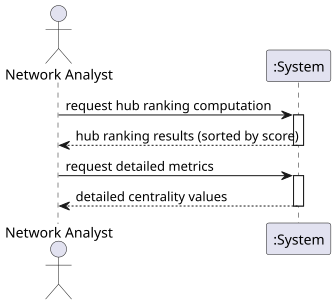

# USEI13 - Hub Centrality Analysis

## 1. Requirements Engineering

### 1.1. User Story Description

As a network analyst, I want to compute hub rankings for railway stations based on multiple centrality metrics so I can identify the most strategically important stations in the network for traffic management, maintenance prioritization, and network optimization.

### 1.2. Customer Specifications and Clarifications 

Hub stations play a critical role in railway networks as they serve as connectors between different parts of the network. Identifying these hubs requires analyzing multiple centrality metrics that capture different aspects of a station's importance.

The system must:
- Compute betweenness centrality for all stations (measuring bridge/connector importance)
- Compute harmonic closeness centrality for all stations (measuring accessibility)
- Compute degree centrality (strength) for all stations (measuring direct connectivity)
- Normalize all metrics to [0,1] range for fair comparison
- Combine metrics into a composite hub score
- Rank stations by their hub score
- Provide temporal complexity analysis

### 1.3. Acceptance Criteria

- All three centrality metrics must be computed correctly
- Betweenness centrality must count shortest path traversals
- Harmonic closeness must use sum of inverse distances
- Degree centrality must count total connections (in + out degree)
- All metrics must be normalized to [0,1]
- Hub score formula: 0.35 × betweenness + 0.35 × closeness + 0.30 × degree
- Results must be sorted by hub score in descending order
- Each result must include raw and normalized values

### 1.4. Found out Dependencies

- **Domain Model**: Station, TrackConnection
- **Repository**: RailwayNetworkRepository
- **Graph Algorithms**: Dijkstra's shortest path algorithm
- **Domain Results**: HubScoreResult

### 1.5 Input and Output Data

Input Data:
- Railway network graph (stations and track connections)
- Track connection distances
- Complete network topology

Output Data:
- List of HubScoreResult objects containing:
  - Station ID and name
  - Degree (strength) value
  - Betweenness centrality (raw)
  - Harmonic closeness centrality (raw)
  - Composite hub score (normalized)
- Results sorted by hub score descending

### 1.6. System Sequence Diagram (SSD)

The SSD shows the main interactions between the Network Analyst and the System:
1. **request hub ranking computation**: Compute all centrality metrics and hub scores
2. **request detailed metrics**: View individual centrality values for analysis

### 1.7 Other Relevant Remarks

The hub ranking combines three complementary centrality metrics:
- **Betweenness**: Identifies stations that act as bridges in the network
- **Harmonic Closeness**: Identifies stations that can easily reach all other stations
- **Degree**: Identifies stations with many direct connections

The weighted combination (35% betweenness, 35% closeness, 30% degree) balances these different perspectives to identify truly important hub stations.
