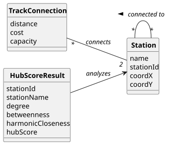

# USEI13 - Hub Centrality Analysis

## 2. Analysis

### 2.1. Relevant Domain Model Excerpt 

The following entities from the domain model are relevant for this use case:

**Railway Network Package:**
- **Station**: Railway station representing a network node
  - Connected to other stations via TrackConnections
  - Subject of centrality analysis
- **TrackConnection**: Railway track segment with distance metric
  - Distance used for shortest path calculations
  - Represents connectivity between stations

**Graph Structure:**
- **Graph&lt;Station, TrackConnection&gt;**: Network representation
  - Vertices: Stations to analyze
  - Edges: TrackConnections with distance weights
  - Can be directed or undirected depending on analysis

**Repository:**
- **RailwayNetworkRepository**: Manages the railway network graph
  - Provides access to complete network topology
  - Singleton pattern for centralized access

**Result Classes:**
- **HubScoreResult**: Contains analysis results for one station
  - Station identification (ID and name)
  - Degree/strength value
  - Betweenness centrality score
  - Harmonic closeness centrality score
  - Composite hub score
  - Implements Comparable for sorting

### 2.2. Other Remarks

The hub centrality analysis involves several computational phases:

**Phase 1: Degree Centrality**
- Sum of in-degree and out-degree for each station
- Represents direct connectivity strength
- O(V) computation where V is number of vertices

**Phase 2: Betweenness Centrality**
- For each pair of stations, compute shortest path
- Count how many times each station appears on shortest paths
- Stations on many shortest paths have high betweenness
- O(V²) or O(V³) depending on implementation

**Phase 3: Harmonic Closeness Centrality**
- For each station, compute shortest paths to all others
- Sum the inverse of distances (1/distance)
- Stations that can reach others quickly have high closeness
- O(V²) or O(V³) depending on implementation

**Phase 4: Normalization**
- Each metric normalized to [0,1] range
- Formula: (value - min) / (max - min)
- Ensures fair combination of different scales

**Phase 5: Hub Score Computation**
- Weighted combination of normalized metrics
- Weights reflect relative importance of each metric
- Results sorted to identify top hubs
