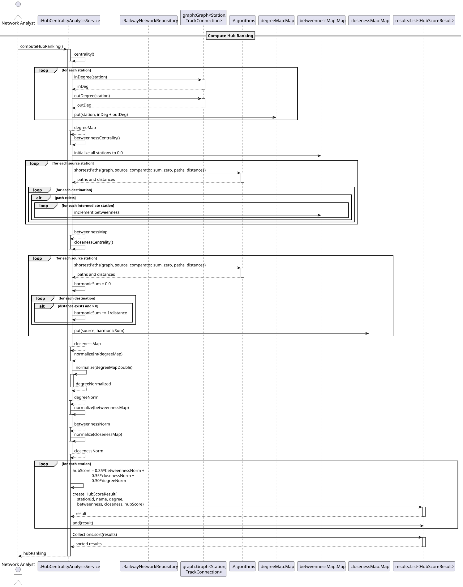
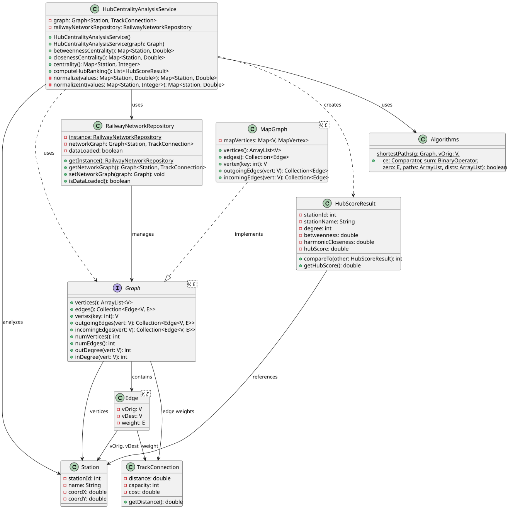

````markdown
# USEI13 - Hub Centrality Analysis

## 3. Design

### 3.1. Rationale

**The rationale grounds on the SSD interactions and the identified input/output data.**

| Interaction ID | Question: Which class is responsible for... | Answer  | Justification (with patterns)  |
|:-------------  |:--------------------- |:------------|:---------------------------- |
| Step 1  		 | ...coordinating hub ranking computation? | HubCentralityAnalysisService | Service Pattern: orchestrates centrality analysis |
| Step 2  		 | ...providing railway network data? | RailwayNetworkRepository | Repository Pattern, Singleton: centralized data access |
| Step 3  		 | ...computing betweenness centrality? | HubCentralityAnalysisService | Information Expert: knows betweenness algorithm |
| Step 4  		 | ...computing harmonic closeness? | HubCentralityAnalysisService | Information Expert: knows closeness algorithm |
| Step 5  		 | ...computing degree centrality? | HubCentralityAnalysisService | Information Expert: accesses graph structure |
| Step 6  		 | ...normalizing metric values? | HubCentralityAnalysisService | Information Expert: knows normalization logic |
| Step 7  		 | ...computing shortest paths? | Algorithms.shortestPaths | Pure Fabrication: reusable graph algorithm |
| Step 8  		 | ...creating result objects? | HubCentralityAnalysisService | Creator: has data needed for HubScoreResult |
| Step 9  		 | ...sorting results? | Collections.sort | Standard Library: sorting utility |
| Step 10  	     | ...managing complete workflow? | HubCentralityAnalysisService | Facade: provides unified interface for all operations |

### Systematization

According to the taken rationale, the conceptual classes promoted to software classes are:

* Station
* TrackConnection
* Graph&lt;Station, TrackConnection&gt;
* HubScoreResult

Other software classes (i.e. Pure Fabrication) identified:

* HubCentralityAnalysisService
* RailwayNetworkRepository
* Algorithms (with shortestPaths)

## 3.2. Sequence Diagram (SD)



## 3.3. Class Diagram (CD)



### 3.4. Design Patterns Applied

- **Service Pattern**: HubCentralityAnalysisService encapsulates centrality analysis business logic
- **Repository Pattern**: RailwayNetworkRepository provides centralized data access
- **Singleton**: RailwayNetworkRepository ensures single instance
- **Facade**: computeHubRanking() provides unified workflow interface
- **Information Expert**: HubCentralityAnalysisService knows all centrality algorithms
- **Pure Fabrication**: Algorithms class provides reusable graph algorithms

### 3.5. Algorithm Design

**Betweenness Centrality Algorithm:**
```
1. Initialize betweenness map with 0.0 for all vertices
2. For each source station in graph:
   a. Compute shortest paths from source to all other stations
   b. For each destination (except source):
      i. Get shortest path from source to destination
      ii. For each intermediate station on path (exclude source and dest):
          - Increment betweenness score by 1.0
3. Return betweenness map
```

**Harmonic Closeness Centrality Algorithm:**
```
1. Initialize closeness map
2. For each source station in graph:
   a. Initialize harmonicSum = 0.0
   b. Compute shortest paths from source to all stations
   c. For each destination with valid distance:
      i. Add (1 / distance) to harmonicSum
   d. Store harmonicSum in closeness map
3. Return closeness map
```

**Degree Centrality Algorithm:**
```
1. Initialize degree map
2. For each station in graph:
   a. degree = inDegree(station) + outDegree(station)
   b. Store degree in map
3. Return degree map
```

**Normalization Algorithm:**
```
1. Find min and max values in map
2. Calculate range = max - min
3. If range == 0:
   - Set all normalized values to 0.0
4. Else for each entry:
   - normalized = (value - min) / range
5. Return normalized map
```

**Hub Ranking Algorithm:**
```
1. Compute degree centrality (raw values)
2. Compute betweenness centrality (raw values)
3. Compute harmonic closeness centrality (raw values)
4. Normalize all three metrics to [0,1]
5. For each station:
   a. hubScore = 0.35 × betweenness_norm + 
                 0.35 × closeness_norm + 
                 0.30 × degree_norm
6. Create HubScoreResult for each station
7. Sort results by hub score (descending)
8. Return sorted list
```

**Shortest Path Integration:**
```
Uses Algorithms.shortestPaths with:
- Comparator: compare by TrackConnection distance
- Sum function: add distances
- Zero element: TrackConnection(0.0, 0, 0)
- Returns: paths and distances for all destinations
```
````
